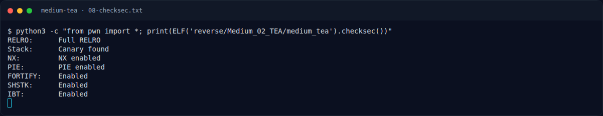

# Medium TEA — Recon

[← Overview](47-medium-tea.md) · [Index](index.md)

> **Langkah 1/12 — Recon.** Petunjuknya sangat langsung: TEA, 32 ronde, key 128-bit tertanam, padding nol ke kelipatan 8 byte.
>
> **Titik penting:** NFX{...}
>
> **Berikutnya:** [Triage awal](47-medium-tea-02-triage-awal.md)

## 1.1 Deskripsi challenge

> **Author: cypera**
>
> Validator ini memakai TEA 32 ronde dengan kunci 128-bit yang tertanam. Flag dipad dengan nol ke kelipatan 8 byte, lalu setiap blok 64-bit dienkripsi dan dibandingkan dengan ciphertext.
>
> Format: `NFX{...}`

Petunjuknya sangat langsung: TEA, 32 ronde, key 128-bit tertanam, padding nol ke kelipatan 8 byte. Yang perlu dilakukan adalah menemukan key dan ciphertext, lalu membalik TEA.

## 1.2 File yang diberikan

| File | Ukuran | SHA-256 | MD5 |
|---|---|---|---|
| `reverse/Medium_02_TEA/medium_tea` | 14.472 byte | `a2b45f299304e0cc64582e0bdc704100b9cb2f4fc4c0f164a8cfd322b01b255a` | `edd25b68f7bb42ab3910e80d3e5304ec` |

Tidak ada source atau file pendamping; hanya satu ELF yang membaca flag dari argumen.

## 1.3 Environment

- Linux x86-64, tools: `file`, `readelf`, `objdump`, `strings`, `gdb`, `python3`, `pyelftools`, `pwntools`.
- `checksec` standalone tidak tersedia; digunakan `ELF.checksec()` dari pwntools.
- Binary dijalankan langsung (`argv[1]`), tanpa service.

### Evidence langkah ini

*Terminal evidence — `08-checksec.txt` (arsip transkrip sesi solve).*

**Berkas mentah langkah ini:**

- [`08-checksec.txt`](assets/medium-tea/08-checksec.txt)
