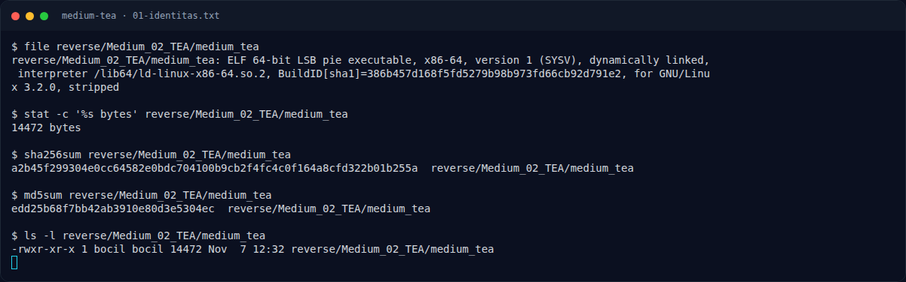
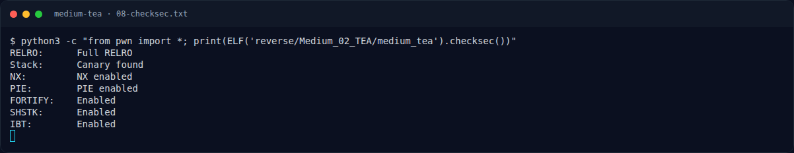

# Medium TEA — Perintah akuisisi bukti

[← Overview](47-medium-tea.md) · [Index](index.md)

> **Langkah 3/12 — Perintah akuisisi bukti.** Perintah akuisisi bukti
>
> **Titik penting:** python3 -c "from pwn import *; print(ELF('$BIN').checksec())" \ · python3 writeups/assets/medium-tea/solve_tea.py \
>
> **Berikutnya:** [Alur utama](47-medium-tea-04-alur-utama.md)

## 1.5 Perintah akuisisi bukti

```bash
mkdir -p writeups/assets/medium-tea
BIN=reverse/Medium_02_TEA/medium_tea
file "$BIN"                                  >  writeups/assets/medium-tea/01-identitas.txt
sha256sum "$BIN"                             >> writeups/assets/medium-tea/01-identitas.txt
md5sum "$BIN"                                >> writeups/assets/medium-tea/01-identitas.txt
readelf -hW -lW -SW -dW "$BIN"               >  writeups/assets/medium-tea/02-readelf.txt
strings -n 4 "$BIN"                          >  writeups/assets/medium-tea/03-strings.txt
objdump -d -Mintel "$BIN"                    >  writeups/assets/medium-tea/04-disasm.txt
objdump -s -j .rodata "$BIN"                 >  writeups/assets/medium-tea/05-rodata-data-hexdump.txt
python3 -c "from pwn import *; print(ELF('$BIN').checksec())" \
                                             >  writeups/assets/medium-tea/08-checksec.txt
python3 writeups/assets/medium-tea/solve_tea.py \
                                             | tee writeups/assets/medium-tea/06-solver-output.txt
```

### Evidence langkah ini



*Terminal evidence — `01-identitas.txt` (arsip transkrip sesi solve).*



*Terminal evidence — `08-checksec.txt` (arsip transkrip sesi solve).*

**Berkas mentah langkah ini:**

- [`01-identitas.txt`](assets/medium-tea/01-identitas.txt)
- [`08-checksec.txt`](assets/medium-tea/08-checksec.txt)
