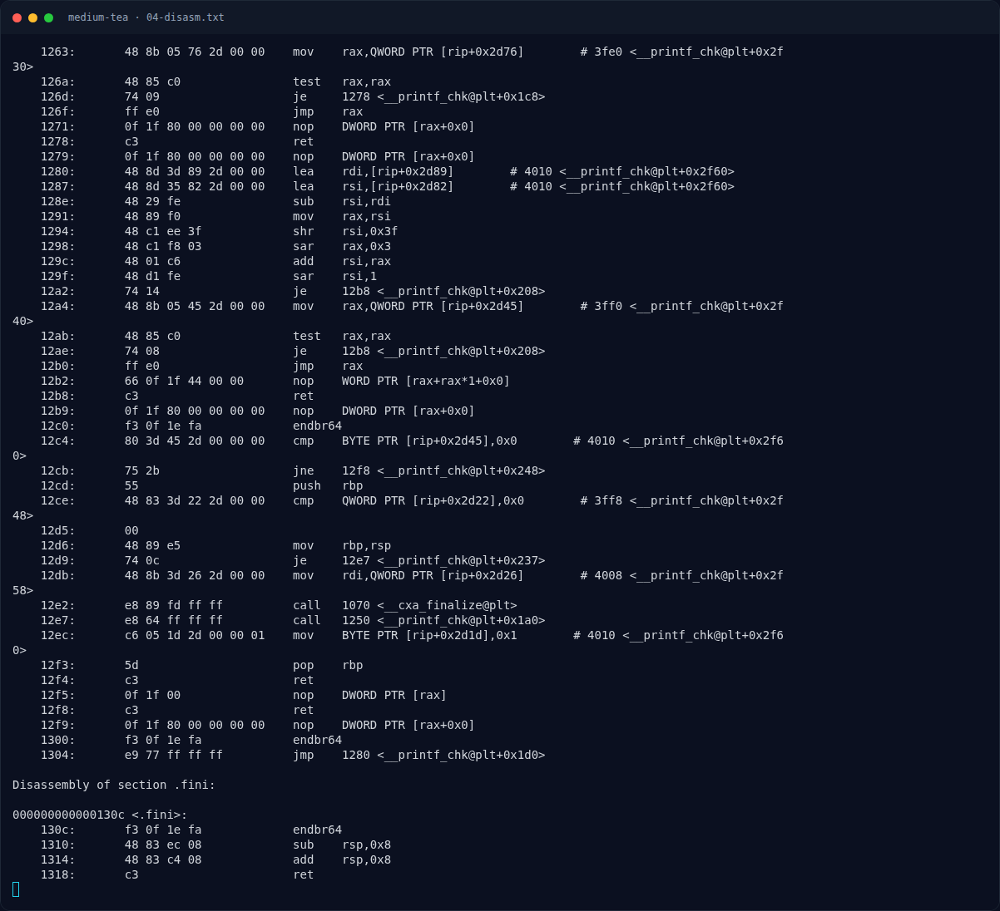

# Medium TEA — Alur utama

[← Overview](47-medium-tea.md) · [Index](index.md)

## 2.1 Alur utama

Main ada di `0x10c0`. Bagian pentingnya:

```asm
10df:  cmp    edi,0x1
10e2:  jle    11f5                  ; tidak ada argumen -> usage
10e8:  mov    rbp,QWORD PTR [rsi+0x8] ; argv[1]
10ef:  call   1090 <strlen@plt>
10f4:  cmp    rax,0x28              ; harus 40 byte
10f8:  je     112b
```

Lalu:

```asm
112b:  lea    r8,[rsp+0x28]         ; akhir area output/padding
1130:  mov    rdx,rsp
1133:  mov    ecx,0x36              ; zero 0x36 dword = 216 byte
113a:  mov    rdi,r8
1140:  lea    r10,[rip+0xef9]       # 2040  ciphertext
1147:  rep stos DWORD PTR es:[rdi],eax
1149:  mov    ecx,0xa               ; copy 10 dword = 40 byte input
114e:  mov    rdi,rdx
1151:  rep movs DWORD PTR es:[rdi],DWORD PTR ds:[rsi]
```

Input 40 byte disalin ke `[rsp]`, lalu diproses 5 blok × 8 byte. Setiap blok diambil sebagai qword little-endian:

```asm
1156:  mov    rdx,QWORD PTR [rdi]   ; 8 byte blok
1159:  xor    esi,esi               ; sum = 0
115b:  mov    ecx,edx               ; v0 = low 32 bit
115d:  shr    rdx,0x20              ; v1 = high 32 bit
```

### Evidence langkah ini



*Terminal evidence — `04-disasm.txt` (arsip transkrip sesi solve).*

**Berkas mentah langkah ini:**

- [`04-disasm.txt`](assets/medium-tea/04-disasm.txt)
