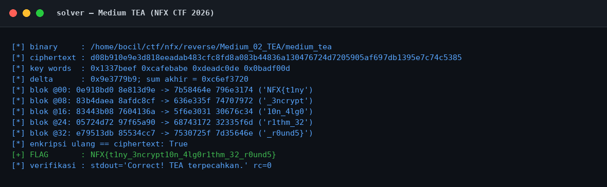
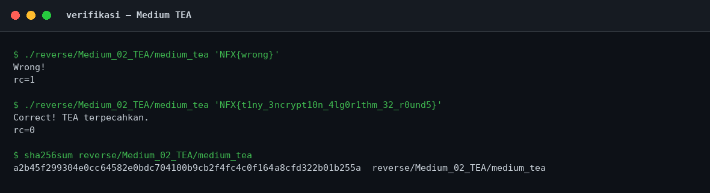
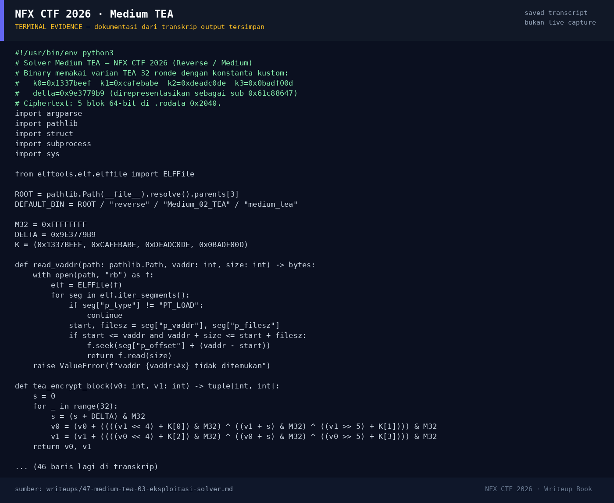

# Medium TEA — Evidence / Bukti

3 screenshot9 transkrip / script

[← Overview](47-medium-tea.md) · [Index](index.md)

## Arsip Evidence

> Semua file di bawah berasal dari folder `assets/medium-tea/`. Screenshot ditempel langsung; file teks/script ditautkan.

### Screenshot

<figure><figcaption>01-solver.png</figcaption></figure>
<figure><figcaption>02-verifikasi.png</figcaption></figure>
<figure><figcaption>98-terminal-evidence.png</figcaption></figure>

### Transkrip / file pendukung

- [`01-identitas.txt`](assets/medium-tea/01-identitas.txt)
- [`02-readelf.txt`](assets/medium-tea/02-readelf.txt)
- [`03-strings.txt`](assets/medium-tea/03-strings.txt)
- [`04-disasm.txt`](assets/medium-tea/04-disasm.txt)
- [`05-rodata-data-hexdump.txt`](assets/medium-tea/05-rodata-data-hexdump.txt)
- [`06-solver-output.txt`](assets/medium-tea/06-solver-output.txt)
- [`07-verifikasi.txt`](assets/medium-tea/07-verifikasi.txt)
- [`08-checksec.txt`](assets/medium-tea/08-checksec.txt)
- [`solve_tea.py`](assets/medium-tea/solve_tea.py)

## Tabel Evidence

| Bukti | File | Keterangan |
|---|---|---|
| Identitas & hash | `01-identitas.txt` | `file`, `stat`, hash |
| ELF metadata | `02-readelf.txt` | Header, segmen, section, dynamic |
| Strings | `03-strings.txt` | `strings -n 4` |
| Disassembly | `04-disasm.txt` | Seluruh `.text`, termasuk round function |
| Hex dump | `05-rodata-data-hexdump.txt` | `.rodata` berisi ciphertext |
| Solver | `solve_tea.py` | Script dekripsi TEA |
| Output solver | `06-solver-output.txt` | Output asli |
| Verifikasi | `07-verifikasi.txt` | Salah vs benar + hash |
| Checksec | `08-checksec.txt` | Hasil `ELF.checksec()` |
| Screenshot solver | `01-solver.png` | Render output solver |
| Screenshot verifikasi | `02-verifikasi.png` | Render output verifikasi |