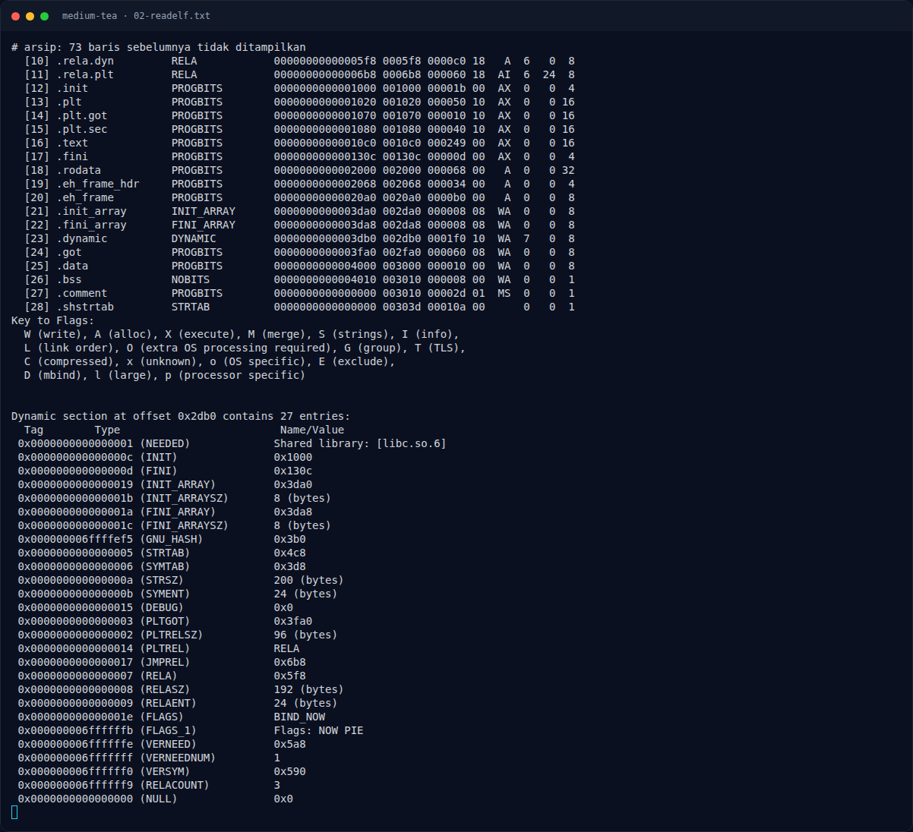
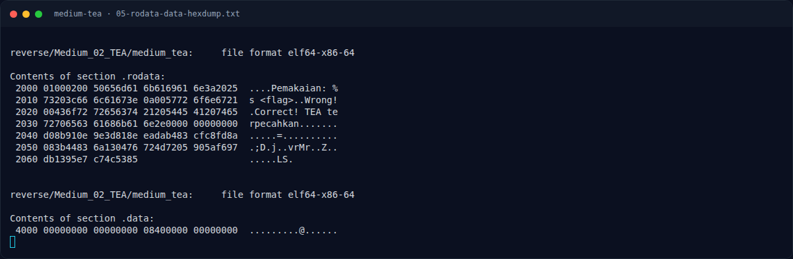

# Medium TEA — Analisis

[← Overview](47-medium-tea.md) · [Index](index.md)

> **Langkah 6/12 — Analisis.** Dari lea r10,[rip+0xef9] # 2040 dan panjang 40 byte:
>
> **Titik penting:** Dari lea r10,[rip+0xef9] # 2040 dan panjang 40 byte:
>
> **Berikutnya:** [Strategi](47-medium-tea-07-strategi.md)

## 2.3 Ciphertext

Dari `lea r10,[rip+0xef9] # 2040` dan panjang 40 byte:

```text
Contents of section .rodata:
 2040 d08b910e 9e3d818e eadab483 cfc8fd8a  .....=..........
 2050 083b4483 6a130476 724d7205 905af697  .;D.j..vrMr..Z..
 2060 db1395e7 c74c5385                    .....LS.
```

Ciphertext (40 byte):

```text
d0 8b 91 0e 9e 3d 81 8e ea da b4 83 cf c8 fd 8a
08 3b 44 83 6a 13 04 76 72 4d 72 05 90 5a f6 97
db 13 95 e7 c7 4c 53 85
```

## 2.4 Dekripsi TEA

Karena TEA adalah Feistel-like cipher yang invertibel, dekripsi dilakukan dengan membalik urutan operasi:

```text
sum = 0xc6ef3720
for 32 kali:
    v1 -= ((v0 << 4) + k2) XOR (v0 + sum) XOR ((v0 >> 5) + k3)
    v0 -= ((v1 << 4) + k0) XOR (v1 + sum) XOR ((v1 >> 5) + k1)
    sum -= delta
```

Semua operasi dilakukan modulo `2^32`. Blok dibaca/ditulis **little-endian** karena binary memakai `mov ecx, edx` (low 32 bit) dan `shr rdx, 0x20` (high 32 bit) dari qword yang dimuat little-endian.

### Evidence langkah ini



*Terminal evidence — `02-readelf.txt` (arsip transkrip sesi solve).*



*Terminal evidence — `05-rodata-data-hexdump.txt` (arsip transkrip sesi solve).*

**Berkas mentah langkah ini:**

- [`02-readelf.txt`](assets/medium-tea/02-readelf.txt)
- [`05-rodata-data-hexdump.txt`](assets/medium-tea/05-rodata-data-hexdump.txt)
