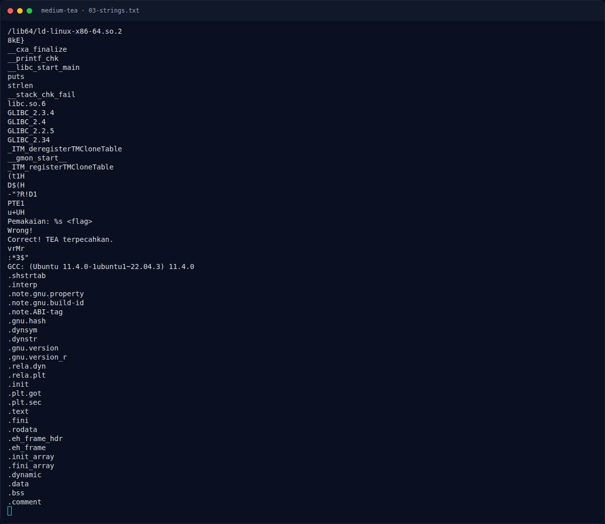

# Medium TEA — Strategi

[← Overview](47-medium-tea.md) · [Index](index.md)

## 3.1 Strategi

1. Ekstrak 40 byte ciphertext dari `.rodata` `0x2040`.
2. Gunakan empat key word yang ditemukan dari disassembly.
3. Dekripsi tiap blok 8 byte dengan TEA inverse (32 ronde).
4. Gabungkan hasilnya, lalu verifikasi dengan binary.
5. Sebagai pemeriksaan tambahan, enkripsi ulang plaintext dan pastikan hasilnya sama persis dengan ciphertext.

### Evidence langkah ini

*Terminal evidence — `03-strings.txt` (arsip transkrip sesi solve).*
