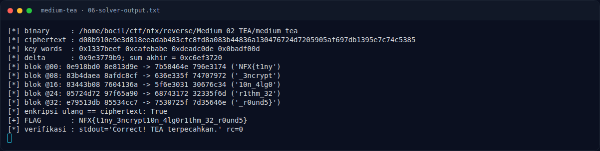

# Medium TEA — Flag & Verifikasi

[← Overview](47-medium-tea.md) · [Index](index.md)

> **Langkah 10/12 — Flag.** Cek file flag lokal:
>
> **Titik penting:** NFX{t1ny_3ncrypt10n_4lg0r1thm_32_r0und5}
>
> **Berikutnya:** [Bukti / Evidence](47-medium-tea-11-bukti-evidence.md)

> **Asal flag.** Flag diperoleh dari langkah exploit/solver yang terdokumentasi, lalu disubmit ke platform.  
> **Tingkat bukti metode.** Terdokumentasi. [Buka Evidence](47-medium-tea-11-bukti-evidence.md)

> **Flag:** `NFX{t1ny_3ncrypt10n_4lg0r1thm_32_r0und5}`
> **Status:** `VERIFIED`

```text
NFX{t1ny_3ncrypt10n_4lg0r1thm_32_r0und5}
```

Cek file flag lokal:

```text
$ cat flags/reverse/Medium_02_TEA.txt
NFX{t1ny_3ncrypt10n_4lg0r1thm_32_r0und5}
```

Verifikasi:

```text
$ ./reverse/Medium_02_TEA/medium_tea 'NFX{t1ny_3ncrypt10n_4lg0r1thm_32_r0und5}'
Correct! TEA terpecahkan.
rc=0

$ ./reverse/Medium_02_TEA/medium_tea 'NFX{wrong}'
Wrong!
rc=1
```

Isi `flags/reverse/Medium_02_TEA.txt` juga identik dengan flag di atas. **Status: `VERIFIED platform`.** Flag tercatat accepted di platform (lihat terminal evidence asli); verifikasi lokal tetap dilakukan terhadap binary dan file flag.

### Terminal evidence (real)



*Terminal evidence (real).*

> **Bukti:** terminal evidence (real).
