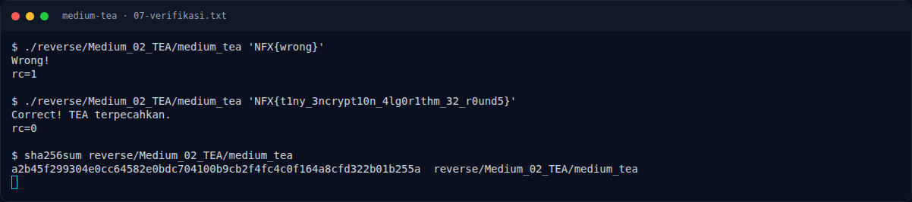

# Medium TEA — Referensi

[← Overview](47-medium-tea.md) · [Index](index.md)

- TEA (Tiny Encryption Algorithm) — David Wheeler & Roger Needham, 1994.
- `objdump(1)`, `readelf(1)` — binutils.
- `pyelftools` — parsing ELF.
- `pwntools` `ELF.checksec()`.

### Evidence langkah ini

*Terminal evidence — `07-verifikasi.txt` (arsip transkrip sesi solve).*
