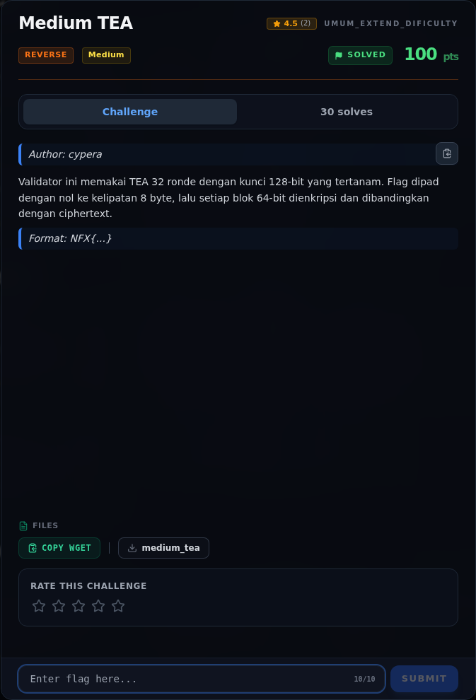
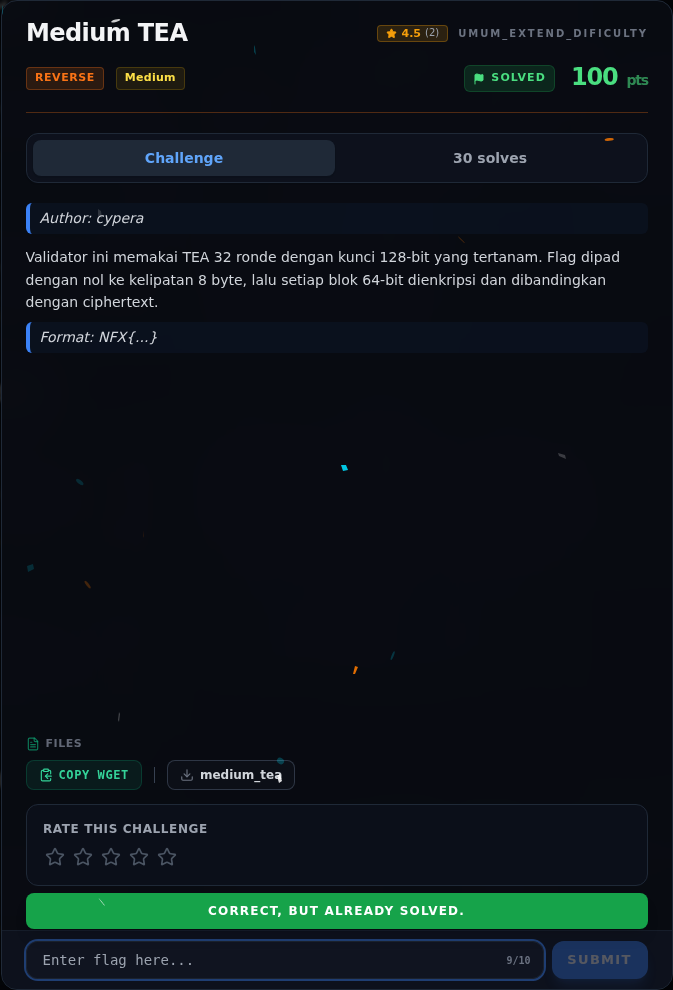

# Medium TEA

Track Umum / Extend · ReverseMedium100 poinVERIFIED

| Field | Nilai |
|---|---|
| Event | `umum_Extend` |
| Kategori | `Reverse` |
| Difficulty | `Medium` |
| Poin | `100` |
| Author | `cypera` |
| Solves | `25` |
| Tools | python3, pwntools, checksec, gdb, objdump, readelf, strings, sage |
| Flag | `NFX{t1ny_3ncrypt10n_4lg0r1thm_32_r0und5}` |
| Status | `VERIFIED` |

[← Kembali ke Index](index.md)

## Challenge Brief (platform)

*Challenge brief asli di platform NFX CTF 2026.*

## Cerita singkat

Jadi ceritanya gini. binary `medium_tea` memvalidasi flag 40 byte dari `argv[1]`. Terus, algoritmanya **TEA 32 ronde**, tetapi empat round key-nya diganti konstanta “lucu”: `0x1337beef`, `0xcafebabe`, `0xdeadc0de`, `0x0badf00d`. Lalu, flag diproses per blok 64-bit (little-endian), dienkripsi, lalu dibandingkan dengan 5 blok ciphertext di `.rodata` `0x2040`. Nah, dari situ kita bisa sampai ke flag dan bukti submit-nya.

## Alur & Titik Penting

| # | Langkah | Titik penting | Buka |
|---:|---|---|---|
| 1 | Recon | NFX{...} | [Buka](47-medium-tea-01-recon.md) |
| 2 | Triage awal | file reverse/Medium_02_TEA/medium_tea | [Buka](47-medium-tea-02-triage-awal.md) |
| 3 | Perintah akuisisi bukti | file "$BIN" > writeups/assets/medium-tea/01-identitas.txt | [Buka](47-medium-tea-03-perintah-akuisisi-bukti.md) |
| 4 | Alur utama | Input 40 byte disalin ke [rsp], lalu diproses 5 blok × 8 byte. | [Buka](47-medium-tea-04-alur-utama.md) |
| 5 | Round function TEA yang dimodifikasi | Binary melakukan hal yang sama, tetapi dengan konstanta berbeda: | [Buka](47-medium-tea-05-round-function-tea-yang-dimodifikasi.md) |
| 6 | Analisis | Dari lea r10,[rip+0xef9] # 2040 dan panjang 40 byte: | [Buka](47-medium-tea-06-analisis.md) |
| 7 | Strategi | — | [Buka](47-medium-tea-07-strategi.md) |
| 8 | Solver lengkap | File: writeups/assets/medium-tea/solvetea.py | [Buka](47-medium-tea-08-solver-lengkap.md) |
| 9 | Output asli | python3 writeups/assets/medium-tea/solve_tea.py | [Buka](47-medium-tea-09-output-asli.md) |
| 10 | Flag | NFX{t1ny_3ncrypt10n_4lg0r1thm_32_r0und5} | [Buka](47-medium-tea-10-flag.md) |
| 11 | Bukti / Evidence | arsip screenshot dan transkrip | [Buka](47-medium-tea-11-bukti-evidence.md) |
| 12 | Referensi | — | [Buka](47-medium-tea-12-referensi.md) |

## TL;DR

- Binary `medium_tea` memvalidasi flag 40 byte dari `argv[1]`.
- Algoritmanya **TEA 32 ronde**, tetapi empat round key-nya diganti konstanta “lucu”: `0x1337beef`, `0xcafebabe`, `0xdeadc0de`, `0x0badf00d`.
- Flag diproses per blok 64-bit (little-endian), dienkripsi, lalu dibandingkan dengan 5 blok ciphertext di `.rodata` `0x2040`.
- Karena TEA invertibel, dekripsi dilakukan dengan urutan ronde terbalik, `sum` dimulai dari `0xc6ef3720` dan dikurangi `delta` setiap ronde.
- Flag: `NFX{t1ny_3ncrypt10n_4lg0r1thm_32_r0und5}`.

Pratinjau evidence. Buka halaman <a href="47-medium-tea-03-perintah-akuisisi-bukti.html">Evidence / Bukti</a> untuk semua screenshot dan transkrip.

## Navigasi Halaman

<a class="nx-page-card" href="47-medium-tea-01-recon.html"><b>Recon</b>Enumerasi target dan bukti awal</a>
<a class="nx-page-card" href="47-medium-tea-02-triage-awal.html"><b>Triage awal</b>Baca bagian ini</a>
<a class="nx-page-card" href="47-medium-tea-03-perintah-akuisisi-bukti.html"><b>Perintah akuisisi bukti</b>Screenshot, transkrip, dan artefak</a>
<a class="nx-page-card" href="47-medium-tea-04-alur-utama.html"><b>Alur utama</b>Baca bagian ini</a>
<a class="nx-page-card" href="47-medium-tea-05-round-function-tea-yang-dimodifikasi.html"><b>Round function TEA yang dimodifikasi</b>Baca bagian ini</a>
<a class="nx-page-card" href="47-medium-tea-06-analisis.html"><b>Analisis</b>Membaca alur dan akar masalah</a>
<a class="nx-page-card" href="47-medium-tea-07-strategi.html"><b>Strategi</b>Baca bagian ini</a>
<a class="nx-page-card" href="47-medium-tea-08-solver-lengkap.html"><b>Solver lengkap</b>Langkah exploit dan solver</a>
<a class="nx-page-card" href="47-medium-tea-09-output-asli.html"><b>Output asli</b>Baca bagian ini</a>
<a class="nx-page-card" href="47-medium-tea-10-flag.html"><b>Flag</b>Flag dan verifikasi platform</a>
<a class="nx-page-card" href="47-medium-tea-11-bukti-evidence.html"><b>Bukti / Evidence</b>Screenshot, transkrip, dan artefak</a>
<a class="nx-page-card" href="47-medium-tea-12-referensi.html"><b>Referensi</b>Sumber dan bacaan lanjutan</a>

