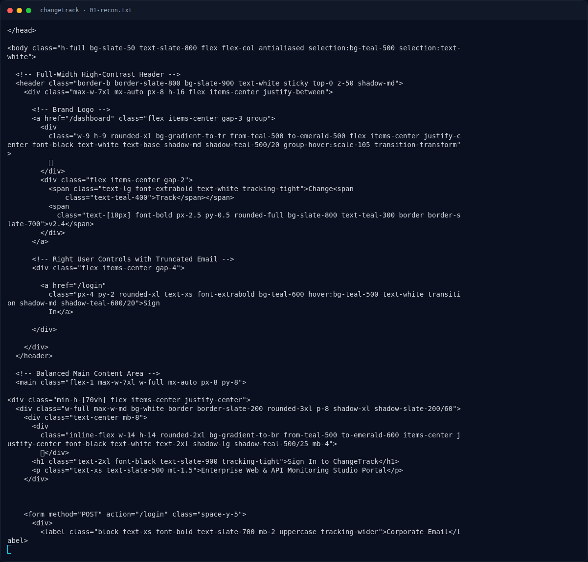

# ChangeTrack — Recon

[← Overview](48-changetrack.md) · [Index](index.md)

### 1.1 Deskripsi challenge

> Author: Ariaf
>
> **ChangeTrack** adalah platform pemantau perubahan halaman web, REST API, dan RSS perusahaan yang terinspirasi murni dari proyek open-source terkenal `changedetection.io`. Pengguna mengonfigurasi watcher dan manifes webhook notifikasi kustom dalam format YAML.
>
> Note: Challenge ini sedikit terinspirasi dari Columbina — karakter yang identik dengan matanya yang selalu tertutup.

Hint:
- `changedetection.io` → notification body template.
- YAML manifest → `notification.template`.
- CVE di flag → `CVE-2024-32651` (Jinja2 SSTI).
- “OOB” → hasil eksekusi harus dikirim keluar, bukan direfleksikan di response.

### 1.2 File / service yang diberikan

Tidak ada source lokal di workspace. Yang tersedia hanya metadata platform dan instance live:

| Item | Nilai |
|---|---|
| Service | `NFX/ChangeTrack` |
| Tipe | HTTP |
| Port live | `40359` (saat validasi) |
| URL | `http://s1.nfx.my.id:40359` |
| Stack | Flask + gunicorn (`Server: gunicorn`) |
| Login | `/login` |
| Dashboard | `/dashboard` |
| Watcher | `/watchers/watch-01`, `/watchers/watch-01/edit`, `/watchers/watch-01/test` |

Instance di-launch dengan:

```bash
cd /home/bocil/ctf/nfx
python3 nxapi.py nx-up "NFX/ChangeTrack" "NFXCTF-NFCC-NXCTF-2026"
```

### 1.3 Environment

- `curl`, `python3` + `requests`.
- Webhook sink eksternal: **webhook.site** (token dibuat via API, gratis).
- Tidak ada submit flag ke platform.

### 1.4 Triage awal

```bash
BASE=http://s1.nfx.my.id:40359
curl -sS -i "$BASE/"
curl -sS -i "$BASE/login"
```

Temuan:
- `/` → `302 /login`.
- `/login` → `200`, form `email` + `password`, tidak ada register.
- `/register` → `404`.
- `/dashboard` tanpa session → `302 /login`.
- Header `Server: gunicorn`, `Vary: Cookie` → Flask session.

### Evidence langkah ini



*Terminal evidence — `01-recon.txt` (arsip transkrip sesi solve).*
