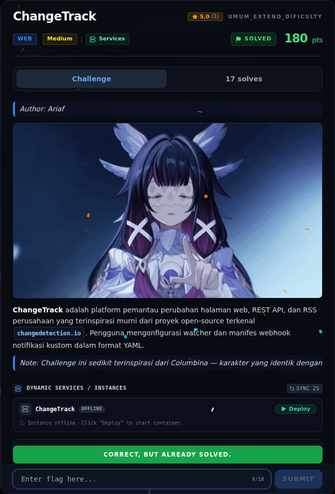

# ChangeTrack — Flag & Verifikasi

[← Overview](48-changetrack.md) · [Index](index.md)

> **Langkah 7/9 — Flag.** Flag yang sama muncul di body webhook dari instance live.
>
> **Titik penting:** NFX{ch4ng3_d3t3ct10n_j1nj4_sst1_oob_cve_2024_32651_2026}
>
> **Berikutnya:** [Bukti / Evidence](48-changetrack-08-bukti-evidence.md)

> **Flag:** `NFX{ch4ng3_d3t3ct10n_j1nj4_sst1_oob_cve_2024_32651_2026}`
> **Status:** `VERIFIED`

```text
NFX{ch4ng3_d3t3ct10n_j1nj4_sst1_oob_cve_2024_32651_2026}
```

Verifikasi:

```bash
cat flags/misc/ChangeTrack.txt
# NFX{ch4ng3_d3t3ct10n_j1nj4_sst1_oob_cve_2024_32651_2026}
```

Flag yang sama muncul di body webhook dari instance live. Tidak ada submit ke platform.

### Bukti submit di platform



*Submit flag di platform: `CORRECT, BUT ALREADY SOLVED.`*

> **Bukti submit:** screenshot form challenge di atas menampilkan `CORRECT, BUT ALREADY SOLVED.`
