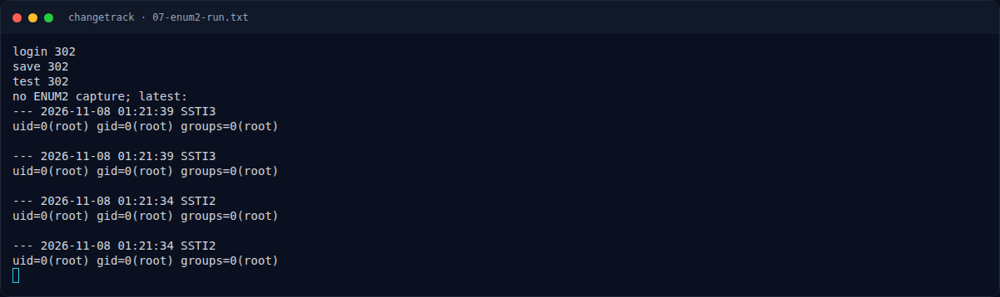

# ChangeTrack — Referensi

[← Overview](48-changetrack.md) · [Index](index.md)

> **Langkah 9/9 — Referensi.** Referensi
>
> **Titik penting:** —
>
> **Selesai.** Kembali ke [Overview](48-changetrack.md).

- CVE-2024-32651 — changedetection.io notification template SSTI.
- Jinja2 `SandboxedEnvironment`, `cycler`, `__globals__`.
- OWASP: Server-Side Template Injection.
- PortSwigger: SSTI → RCE.
- CWE-1336 (Improper Neutralization of Special Elements Used in a Template Engine), CWE-287 (Improper Authentication).

### Evidence langkah ini

*Terminal evidence — `07-enum2-run.txt` (arsip transkrip sesi solve).*

**Berkas mentah langkah ini:**

- [`07-enum2-run.txt`](assets/changetrack/07-enum2-run.txt)
