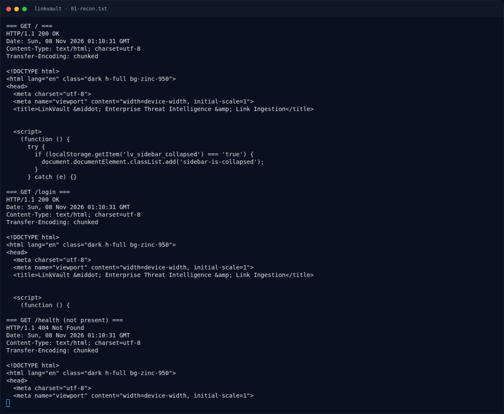
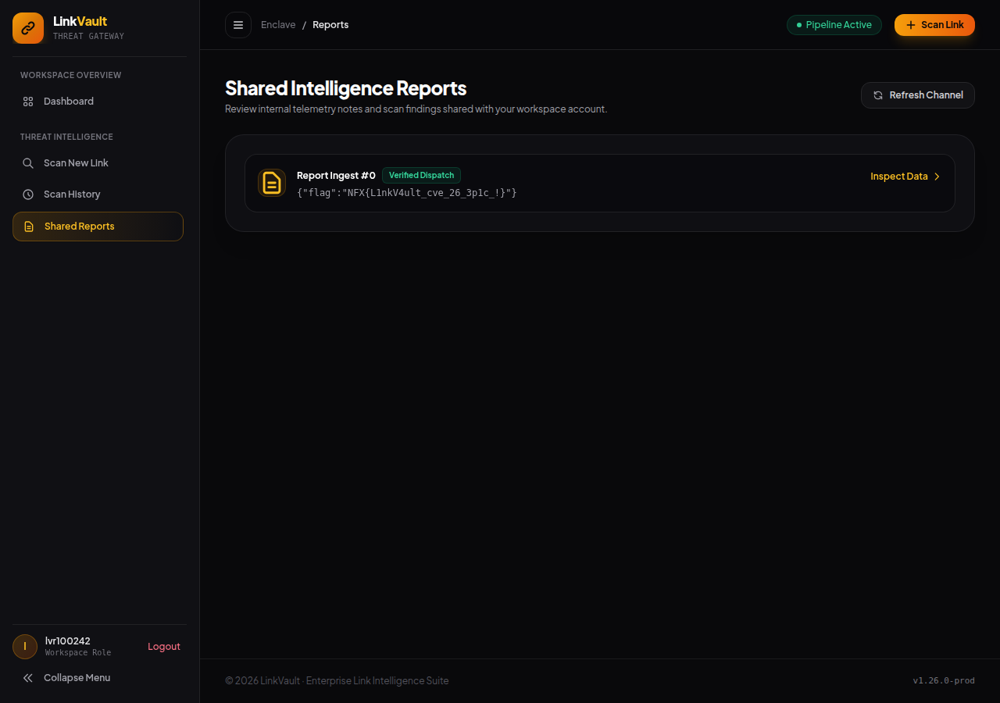

# LinkVault — Deskripsi challenge

[← Overview](49-linkvault.md) · [Index](index.md)

## 1.1 Deskripsi challenge

> Author: Ariaf
>
> **LinkVault** adalah platform tinjauan tautan dan moderasi perusahaan yang dibangun di atas Go 1.26.0. Pengguna dapat mengirimkan URL yang kemudian dimuat ke dalam antrean filter konten internal, dan tim peninjau akan memeriksa setiap item melalui konsol moderasi administratif.
>
> Pemeriksaan keamanan internal mengindikasikan bahwa terdapat kejanggalan parsing pada URL parser Go serta perilaku escaping ekspresi reguler pada engine template HTML yang dapat memungkinkan penyerang melewati pembatasan jaringan lokal, menyisipkan aturan filter tanpa otorisasi, dan mengeksekusi Cross-Site Scripting (XSS) untuk mengambil alih sesi administrator.

Hint tersirat:
- SSRF / bypass pembatasan jaringan lokal.
- “menyisipkan aturan filter tanpa otorisasi” → internal import API.
- “escaping ekspresi reguler pada engine template HTML” → `html/template` + regex literal.
- “mengambil alih sesi administrator” → admin bot Chromium.

### Evidence langkah ini

*Terminal evidence — `01-recon.txt` (arsip transkrip sesi solve).*

*Evidence — `01-reports-flag.png`.*
