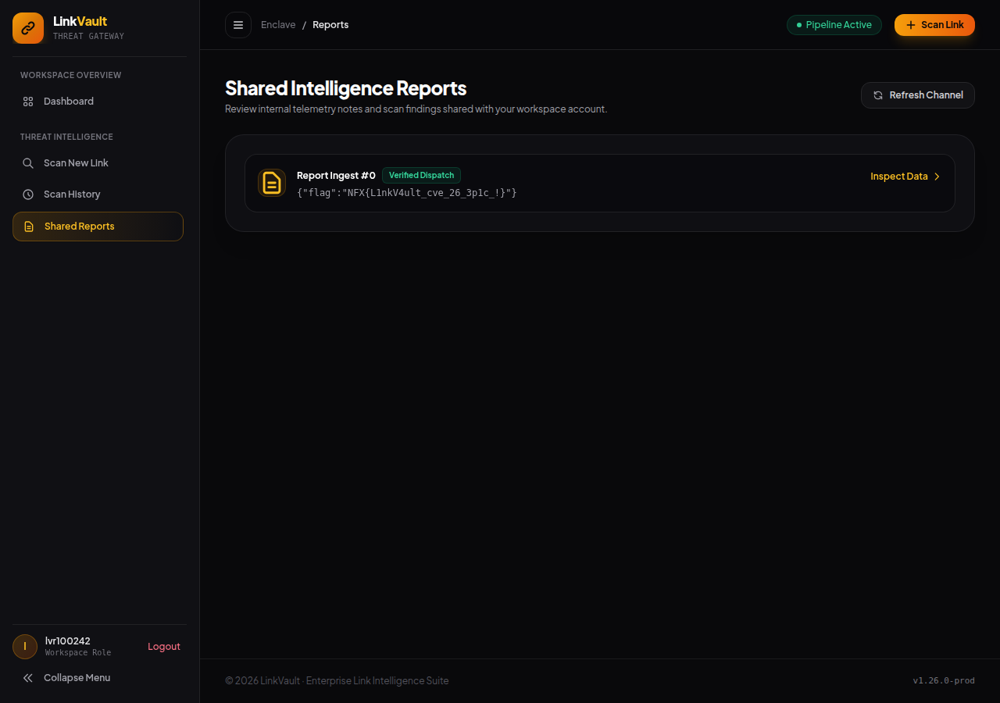

# LinkVault — File / service yang diberikan

[← Overview](49-linkvault.md) · [Index](index.md)

> **Langkah 2/12 — File / service yang diberikan.** Hash source yang dianalisis:
>
> **Titik penting:** http://s1.nfx.my.id:49191 · 127.0.0.1:8081
>
> **Berikutnya:** [Recon](49-linkvault-03-recon.md)

## 1.2 File / service yang diberikan

| File/Service | Ukuran/Endpoint | Keterangan |
|---|---|---|
| `web/LinkVault/src/main.go` | 31 baris | Entrypoint, `FLAG` dari env, listener `:80`, start internal API + bot |
| `web/LinkVault/src/handlers.go` | 354 baris | Route publik, SSRF `guardedFetch`, login/register, submit, admin, `/flag` |
| `web/LinkVault/src/internal.go` | 34 baris | Internal crawler API `127.0.0.1:8081` dan `[::1]:8081` |
| `web/LinkVault/src/store.go` | 128 baris | User/session/queue/inbox in-memory, `safeFilter` |
| `web/LinkVault/src/bot.go` | 47 baris | Chromium admin bot, cookie `adminSID`, buka `/moderation` tiap 25 detik |
| `web/LinkVault/src/templates/moderation.html` | — | Template konsol moderasi, menyisipkan `{{.Filter}}` ke `<script>` |
| `web/LinkVault/docker-compose.yml` | port `8004:80` | Deployment |
| Instance live | `http://s1.nfx.my.id:49191` | Di-launch dengan `nxapi.py nx-up NFX/LinkVault` (TTL ~30 menit) |

Hash source yang dianalisis:

```bash
sha256sum web/LinkVault/src/*.go web/LinkVault/src/templates/moderation.html
```

```text
dec732d8eaf7d15a53423f23a01d5977c707eb7055ba526559f197efe01dfc31  web/LinkVault/src/bot.go
d874dde7f9a849db874f47a2141ab0ed51905cb03d12a833474d471e6888d097  web/LinkVault/src/handlers.go
6f181304753600645d095b10e39ab60197661f91e93911ae3070c603b5cce515  web/LinkVault/src/internal.go
00b4158ff1f17ca8dfd7c827463c5fa2850e8d39c56255c2502827f72f793820  web/LinkVault/src/main.go
e3d413fe6e7a1828c8ed0b1e7294de8ec80bcaa153f199606fda4b3c207d42fc  web/LinkVault/src/store.go
a10853de2d1f65bb112f0368c3cfba0335047eae3859df107fb45471c82bea74  web/LinkVault/src/templates/moderation.html
```

### Evidence langkah ini


*Terminal evidence — `source-notes.txt` (arsip transkrip sesi solve).*



*Evidence — `01-reports-flag.png`.*

**Berkas mentah langkah ini:**

- [`source-notes.txt`](assets/linkvault/source-notes.txt)
