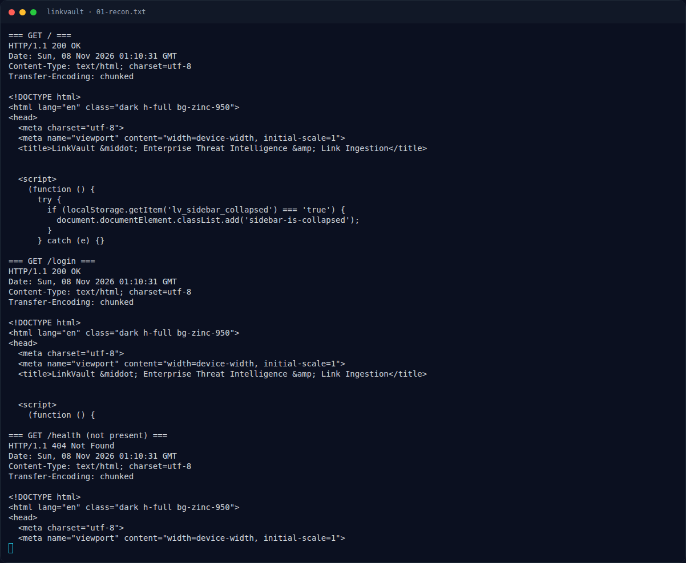

# LinkVault — Recon

[← Overview](49-linkvault.md) · [Index](index.md)

> **Langkah 3/12 — Recon.** Recon
>
> **Titik penting:** curl -sS -i http://s1.nfx.my.id:49191/ · curl -sS -i http://s1.nfx.my.id:49191/login · curl -sS -i http://s1.nfx.my.id:49191/health
>
> **Berikutnya:** [SSRF guard dan bypass IPv6 loopback](49-linkvault-04-ssrf-guard-dan-bypass-ipv6-loopback.md)

## 1.3 Environment

- OS/tools: Linux, `curl`, `python3` + `requests`, Go 1.26.0 (di container).
- Docker tidak tersedia di workspace ini (`docker: command not found`), sehingga validasi dilakukan pada instance live hasil orchestrator NXCTL, bukan `docker compose up` lokal.
- Instance dijalankan dengan:

```bash
cd <repo>
python3 nxapi.py nx-up "NFX/LinkVault" "NFXCTF-NFCC-NXCTF-2026"
```

- Tidak ada flag yang di-submit ke platform. Flag hanya dibandingkan dengan `flags/web/LinkVault.txt`.

## 1.4 Triage awal

```bash
curl -sS -i http://s1.nfx.my.id:49191/
curl -sS -i http://s1.nfx.my.id:49191/login
curl -sS -i http://s1.nfx.my.id:49191/health
```

Temuan:
- `GET /` → `200`, halaman landing LinkVault.
- `GET /login` → `200`, form login.
- `GET /health` → `404` (tidak ada health check).
- Header tidak menampilkan versi Go, tetapi source menunjukkan `go 1.26.0`.

Source tree:

```text
web/LinkVault/
├── docker-compose.yml
└── src/
    ├── Dockerfile
    ├── go.mod
    ├── main.go
    ├── handlers.go
    ├── internal.go
    ├── store.go
    ├── bot.go
    └── templates/
        ├── moderation.html
        ├── admin.html
        └── ...
```

### Evidence langkah ini



*Terminal evidence — `01-recon.txt` (arsip transkrip sesi solve).*

**Berkas mentah langkah ini:**

- [`01-recon.txt`](assets/linkvault/01-recon.txt)
