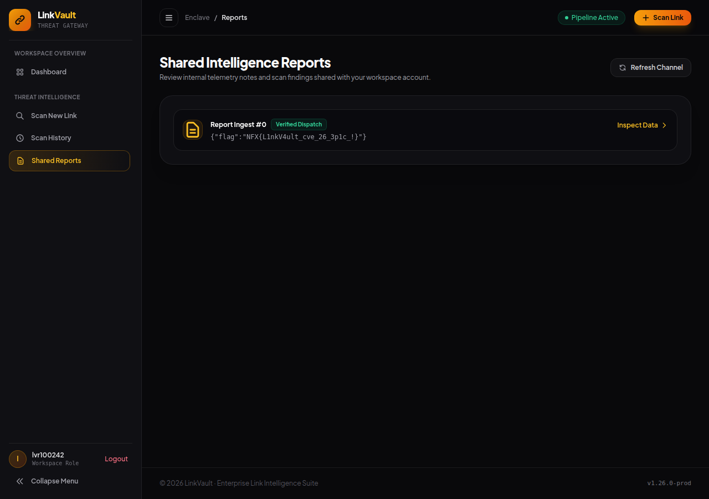

# LinkVault — Evidence / Bukti

[← Overview](49-linkvault.md) · [Index](index.md)

## Arsip Evidence

> Semua file di bawah berasal dari folder `assets/linkvault/`. Screenshot ditempel langsung; file teks/script ditautkan.

### Screenshot

### Transkrip / file pendukung

- [`01-recon.txt`](assets/linkvault/01-recon.txt)
- [`02-exploit-run.txt`](assets/linkvault/02-exploit-run.txt)
- [`03-ssrf-evidence.py`](assets/linkvault/03-ssrf-evidence.py)
- [`03-ssrf-evidence.txt`](assets/linkvault/03-ssrf-evidence.txt)
- [`03-ssrf-submit-response.html`](assets/linkvault/03-ssrf-submit-response.html)
- [`05-reports-with-flag.html`](assets/linkvault/05-reports-with-flag.html)
- [`exploit_linkvault.py`](assets/linkvault/exploit_linkvault.py)
- [`source-notes.txt`](assets/linkvault/source-notes.txt)

## Tabel Evidence

| Bukti | File | Keterangan |
|---|---|---|
| Recon awal | `assets/linkvault/01-recon.txt` | `GET /`, `/login`, `/health` |
| Transcript exploit | `assets/linkvault/02-exploit-run.txt` | Register, SSRF, XSS, flag setelah 32s |
| Bukti SSRF | `assets/linkvault/03-ssrf-evidence.txt` | Kontrol `127.0.0.1` ditolak, `[::1]` diterima |
| Respons SSRF | `assets/linkvault/03-ssrf-submit-response.html` | `{"ok":true,"queued":true,"source":"crawler"}` |
| Inbox flag | `assets/linkvault/05-reports-with-flag.html` | `/reports` berisi flag |
| Screenshot | `assets/linkvault/01-reports-flag.png` | `/reports` menampilkan `{"flag":"NFX{...}"}` |
| Source snippet | `assets/linkvault/source-notes.txt` | `guardedFetch`, internal API, template, bot |
| Exploit | `assets/linkvault/exploit_linkvault.py` | Script lengkap |
| Hash source | lihat §1.2 | SHA-256 file source |
