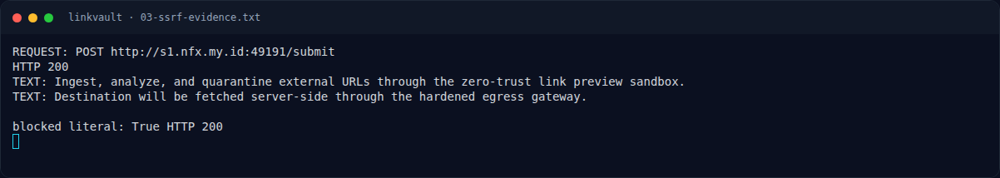

# LinkVault — Strategi

[← Overview](49-linkvault.md) · [Index](index.md)

## 3.1 Strategi

- Gunakan IPv6 loopback `[::1]` untuk SSRF.
- Gunakan endpoint `/internal/import` untuk menyisipkan `filter` tanpa validasi.
- Susun payload XSS yang:
  - keluar dari regex literal: `./; ... ;var q=/.`
  - tidak memakai karakter `>` agar tidak di-escape,
  - memakai `fetch` same-origin untuk `/flag`,
  - mengirim hasil ke `/api/share` milik user penyerang.

### Evidence langkah ini

*Terminal evidence — `03-ssrf-evidence.txt` (arsip transkrip sesi solve).*
