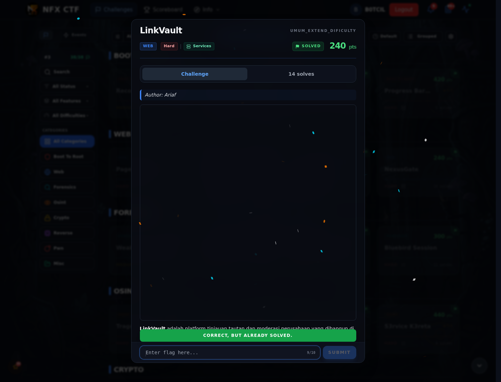
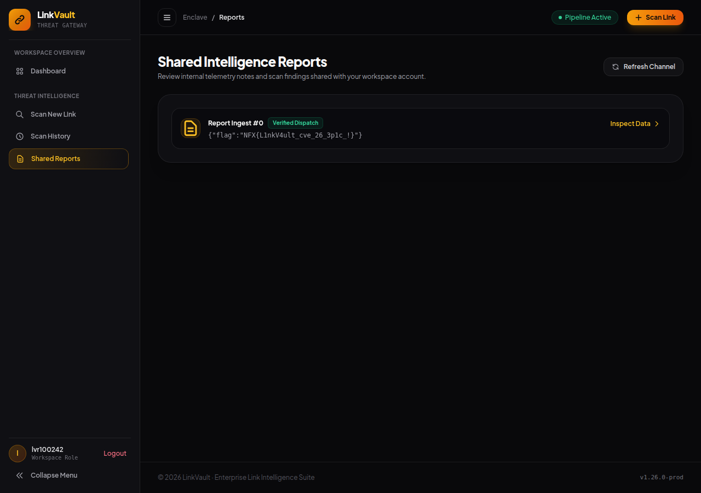

# LinkVault — Flag & Verifikasi

[← Overview](49-linkvault.md) · [Index](index.md)

> **Langkah 10/12 — Flag.** Flag yang sama muncul di halaman /reports milik user penyerang pada instance live.
>
> **Titik penting:** NFX{L1nkV4ult_cve_26_3p1c_!}
>
> **Berikutnya:** [Bukti / Evidence](49-linkvault-11-bukti-evidence.md)

> **Flag:** `NFX{L1nkV4ult_cve_26_3p1c_!}`
> **Status:** `VERIFIED`

```text
NFX{L1nkV4ult_cve_26_3p1c_!}
```

Verifikasi:

```bash
cat flags/web/LinkVault.txt
# NFX{L1nkV4ult_cve_26_3p1c_!}
```

Flag yang sama muncul di halaman `/reports` milik user penyerang pada instance live. Tidak ada submit ke platform.

### Bukti submit di platform



*Submit flag di platform: `CORRECT, BUT ALREADY SOLVED.`*

### Evidence langkah ini



*Evidence — `01-reports-flag.png`.*

> **Verifikasi platform:** flag sudah diterima. Recheck 2026-11-09 mengembalikan `Correct, but already solved.`
