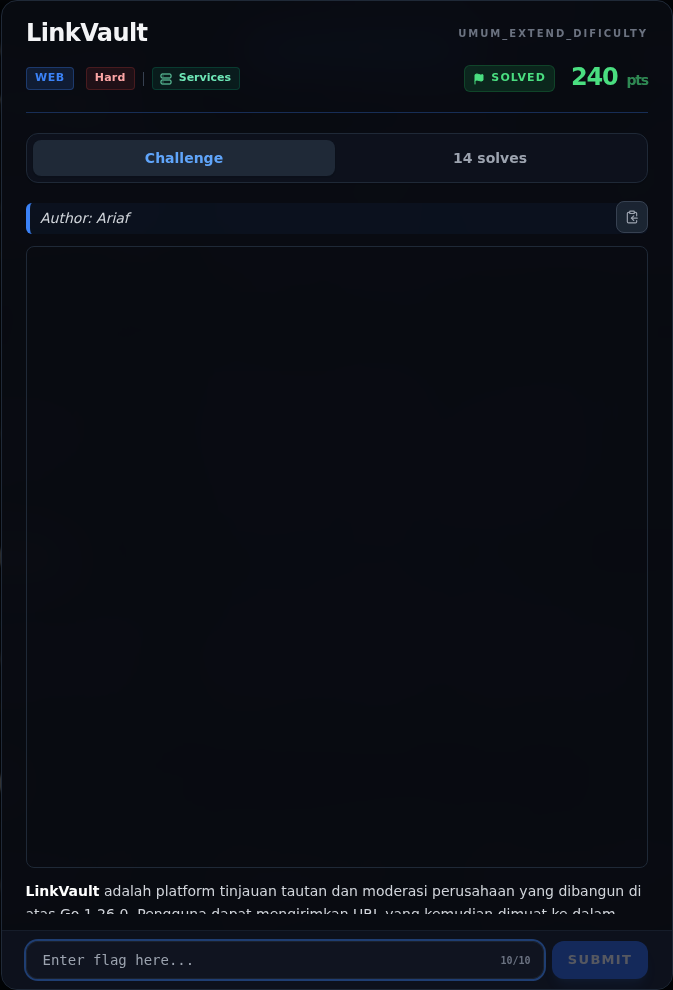

# LinkVault — Referensi

[← Overview](49-linkvault.md) · [Index](index.md)

> **Langkah 12/12 — Referensi.** Referensi
>
> **Titik penting:** —
>
> **Selesai.** Kembali ke [Overview](49-linkvault.md).

- Go `net/url`, `net.SplitHostPort`, `net.IP.IsLoopback`.
- Go `html/template` contextual escaping.
- `golang.org/x/net/idna`.
- Chromedp / headless Chromium.
- CVE-2026-56858 (penamaan challenge untuk bug escaping regex pada `html/template`).
- OWASP: Server-Side Request Forgery Prevention Cheat Sheet; XSS Prevention Cheat Sheet.

### Evidence langkah ini

*Challenge brief asli di platform NFX CTF 2026.*
