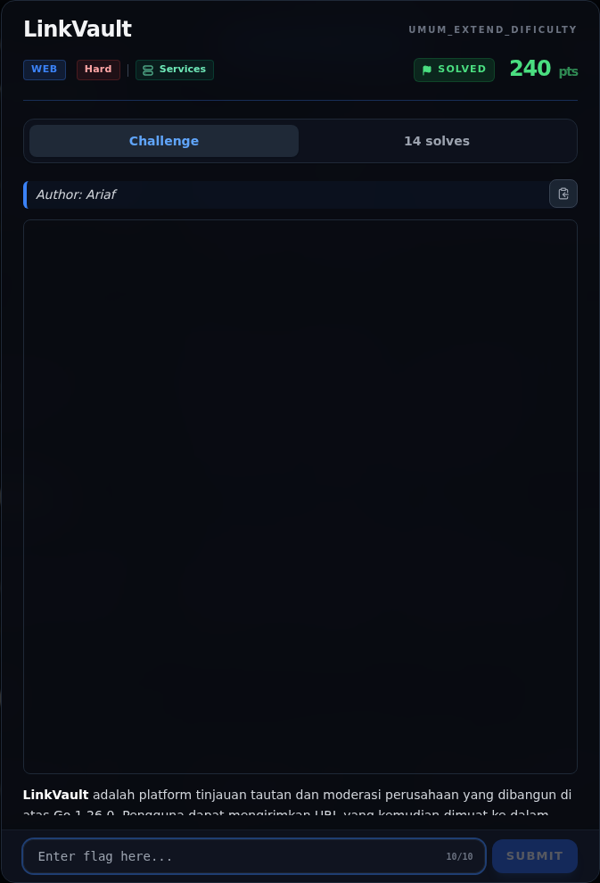

# LinkVault

Track Umum / Extend · WebHard360 poinVERIFIED

| Field | Nilai |
|---|---|
| Event | `umum_Extend` |
| Kategori | `Web` |
| Difficulty | `Hard` |
| Poin (snapshot) | `360` |
| Author | `Ariaf` |
| Solves | `8` |
| Tools | curl, python3, strings, docker |
| Flag | `NFX{L1nkV4ult_cve_26_3p1c_!}` |
| Status | `VERIFIED` |
| Metode | **FULL** — metode utama berhasil direproduksi. |
| Snapshot | 2026-11-13 |

[← Kembali ke Index](index.md)

## Challenge Brief (platform)

*Challenge brief asli di platform NFX CTF 2026.*

## Cerita singkat

Jadi ceritanya gini. **LinkVault** adalah aplikasi Go 1.26.0 untuk submit URL, fetch preview di server, lalu admin bot meninjau queue moderasi dengan Chromium. Terus, denylist SSRF hanya memblokir `admin.internal`, `localhost`, dan `127.0.0.1`. Alamat IPv6 loopback `http://[::1]:8081` **tidak** diblokir, sehingga penyerang dapat memanggil internal crawler API `127.0.0.1:8081`. Lalu, endpoint internal `/internal/import` menerima parameter `filter` **tanpa** validasi `safeFilter` dan memasukkannya ke queue moderasi. Nah, dari situ kita bisa sampai ke flag dan bukti submit-nya.

## Alur & Titik Penting

| # | Langkah | Titik penting | Buka |
|---:|---|---|---|
| 1 | Deskripsi challenge | — | [Buka](49-linkvault-01-deskripsi-challenge.md) |
| 2 | File / service yang diberikan | http://s1.nfx.my.id:49191 | [Buka](49-linkvault-02-file-service-yang-diberikan.md) |
| 3 | Recon | curl -sS -i http://s1.nfx.my.id:49191/ | [Buka](49-linkvault-03-recon.md) |
| 4 | SSRF guard dan bypass IPv6 loopback | http://[::1 | [Buka](49-linkvault-04-ssrf-guard-dan-bypass-ipv6-loopback.md) |
| 5 | Internal import tidak memvalidasi `filter` | 127.0.0.1 | [Buka](49-linkvault-05-internal-import-tidak-memvalidasi-filter.md) |
| 6 | Analisis | http://127.0.0.1:80/moderation" | [Buka](49-linkvault-06-analisis.md) |
| 7 | Strategi | — | [Buka](49-linkvault-07-strategi.md) |
| 8 | Langkah exploit (live) | curl -sS -c cj -X POST -d 'username=lvr123456&password=pw12345' "$BASE/register" | [Buka](49-linkvault-08-langkah-exploit-live.md) |
| 9 | Eksploitasi / Solver | NFX{L1nkV4ult_cve_26_3p1c_!} | [Buka](49-linkvault-09-eksploitasi-solver.md) |
| 10 | Flag | NFX{L1nkV4ult_cve_26_3p1c_!} | [Buka](49-linkvault-10-flag.md) |
| 11 | Bukti / Evidence | arsip screenshot dan transkrip | [Buka](49-linkvault-11-bukti-evidence.md) |
| 12 | Referensi | — | [Buka](49-linkvault-12-referensi.md) |

## TL;DR

- **LinkVault** adalah aplikasi Go 1.26.0 untuk submit URL, fetch preview di server, lalu admin bot meninjau queue moderasi dengan Chromium.
- Denylist SSRF hanya memblokir `admin.internal`, `localhost`, dan `127.0.0.1`. Alamat IPv6 loopback `http://[::1]:8081` **tidak** diblokir, sehingga penyerang dapat memanggil internal crawler API `127.0.0.1:8081`.
- Endpoint internal `/internal/import` menerima parameter `filter` **tanpa** validasi `safeFilter` dan memasukkannya ke queue moderasi.
- Template admin `moderation.html` menempelkan `filter` ke dalam regex literal JavaScript: ``. Bug escaping konteks regex di `html/template` (disebut challenge sebagai **CVE-2026-56858**) memungkinkan breakout dan XSS.
- XSS berjalan di origin `127.0.0.1:80` dengan cookie admin. Payload memanggil `/flag` (admin-only), lalu mengirim hasilnya ke `/api/share?to=<user>&d=<flag>`; penyerang membaca inbox-nya di `/reports`.
- Flag diperoleh dari instance live: `NFX{L1nkV4ult_cve_26_3p1c_!}`.

Pratinjau evidence. Buka halaman <a href="49-linkvault-11-bukti-evidence.html">Evidence / Bukti</a> untuk semua screenshot dan transkrip.

## Navigasi Halaman

<a class="nx-page-card" href="49-linkvault-01-deskripsi-challenge.html"><b>Deskripsi challenge</b>Baca bagian ini</a>
<a class="nx-page-card" href="49-linkvault-02-file-service-yang-diberikan.html"><b>File / service yang diberikan</b>Baca bagian ini</a>
<a class="nx-page-card" href="49-linkvault-03-recon.html"><b>Recon</b>Enumerasi target dan bukti awal</a>
<a class="nx-page-card" href="49-linkvault-04-ssrf-guard-dan-bypass-ipv6-loopback.html"><b>SSRF guard dan bypass IPv6 loopback</b>Baca bagian ini</a>
<a class="nx-page-card" href="49-linkvault-05-internal-import-tidak-memvalidasi-filter.html"><b>Internal import tidak memvalidasi `filter`</b>Baca bagian ini</a>
<a class="nx-page-card" href="49-linkvault-06-analisis.html"><b>Analisis</b>Membaca alur dan akar masalah</a>
<a class="nx-page-card" href="49-linkvault-07-strategi.html"><b>Strategi</b>Baca bagian ini</a>
<a class="nx-page-card" href="49-linkvault-08-langkah-exploit-live.html"><b>Langkah exploit (live)</b>Baca bagian ini</a>
<a class="nx-page-card" href="49-linkvault-09-eksploitasi-solver.html"><b>Eksploitasi / Solver</b>Langkah exploit dan solver</a>
<a class="nx-page-card" href="49-linkvault-10-flag.html"><b>Flag</b>Flag dan verifikasi platform</a>
<a class="nx-page-card" href="49-linkvault-11-bukti-evidence.html"><b>Bukti / Evidence</b>Screenshot, transkrip, dan artefak</a>
<a class="nx-page-card" href="49-linkvault-12-referensi.html"><b>Referensi</b>Sumber dan bacaan lanjutan</a>

