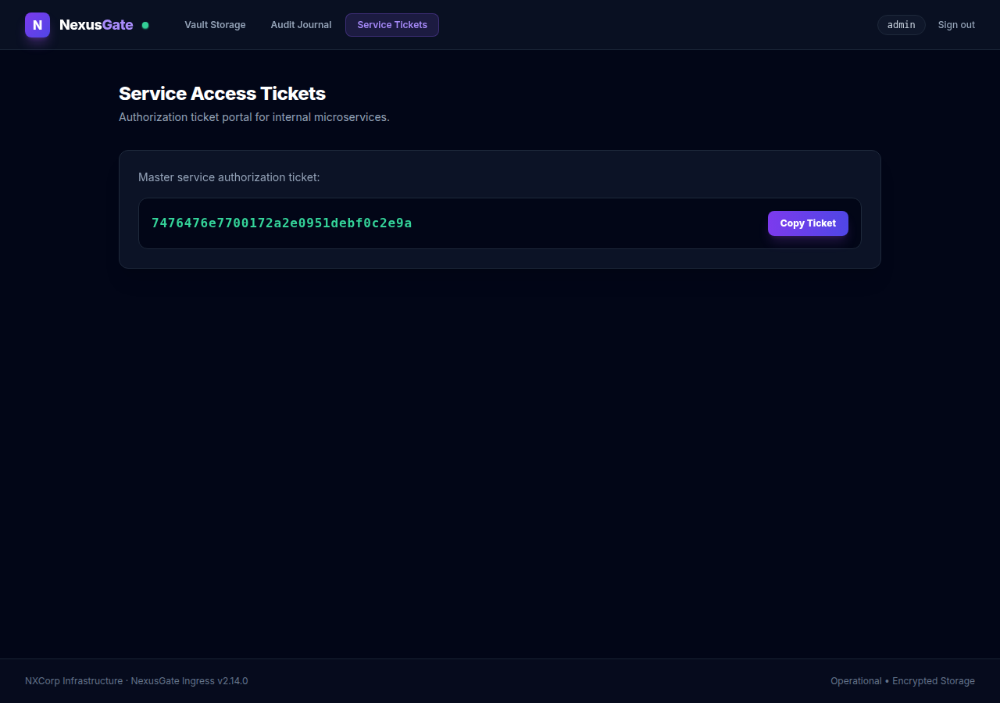

# NexusGate — Deskripsi challenge

[← Overview](50-nexusgate.md) · [Index](index.md)

## 1.1 Deskripsi challenge

> Author: Ariaf
>
> **NexusGate** adalah gerbang identitas utama perusahaan dan vault identitas yang mengelola single sign-on internal serta tata kelola akses karyawan. Arsitekturnya terdiri dari edge reverse proxy yang di-harden di depan microservice vault internal, dipatok pada rilis Node.js tertentu.
>
> Pemeriksaan keamanan internal mengindikasikan bahwa perbedaan perilaku antara parser edge, cacher statement, tree model izin, dan interceptor shared cache dapat memungkinkan penyerang melewati ACL edge, membocorkan token hak akses, melewati sandboxing file system, dan mengambil ticket administratif.

Empat komponen yang disebut:
1. **parser edge** → normalisasi path.
2. **cacher statement** → tagged template `tagStore`.
3. **tree model izin** → Node permission model (`--allow-fs-read`).
4. **interceptor shared cache** → `undici` cache pada halaman ticket.

### Evidence langkah ini

*Evidence — `01-cached-ticket.png`.*
