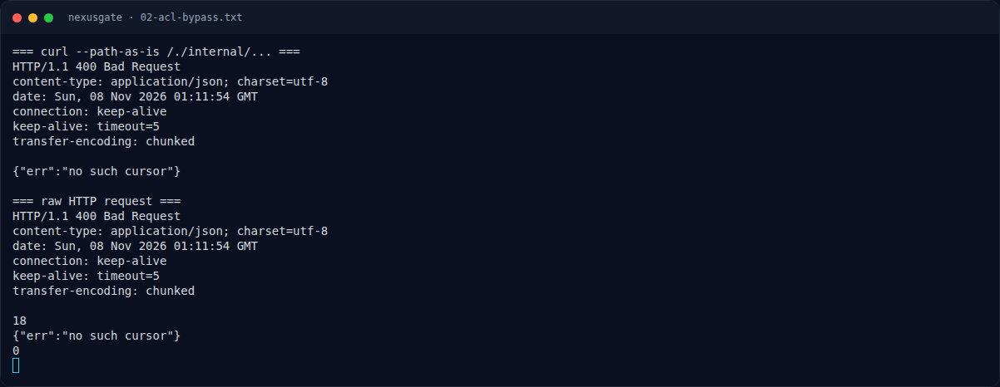

# NexusGate — Analisis

[← Overview](50-nexusgate.md) · [Index](index.md)

## 2.4 Shared cache → MASTER_TICKET

`proxy.js`:

```js
const ticketClient = new Client(BACKEND_ORIGIN);
const ticketDispatcher = ticketClient.compose(interceptors.cache());
...
if (req.method === 'GET' && req.url.startsWith('/tickets/')) {
  ticketDispatcher.request({
    origin: BACKEND_ORIGIN,
    path: req.url,
    method: req.method,
    headers: rebuildHeaders(req),
  }).then((r) => {
    res.writeHead(r.statusCode, r.headers);
    r.body.pipe(res);
  })...
}
```

- Bot admin meminta `/tickets/latest?aud=<nonce>` dengan cookie admin.
- `undici` cache interceptor menyimpan respons HTML admin untuk URL tersebut.
- Cache tidak membedakan pemilik cookie; penyerang yang meminta URL **yang sama** (nonce diketahui dari `/app/data/bot`) mendapatkan HTML admin dari cache.
- HTML admin berisi ticket:

`views.js`:

```js
const inner = user === 'admin'
  ? `<p ...>Master service authorization ticket:</p>
     ...
     <span class="ticket ...">${esc(masterTicket)}</span>
     ...
     <meta name="nx-ticket" content="${esc(masterTicket)}">`
  : `... No active master ticket ...`;
```

- `POST /flag` membandingkan `ticket === MASTER_TICKET`.

## 2.5 Rantai penuh

```text
ACL bypass (/./internal)
  -> cursor owner=admin
  -> journal=<user> membocorkan PHASE_TOKEN
  -> /internal/console/files membaca /app/data/bot (nonce)
  -> GET /tickets/latest?aud=<nonce> dari cache = HTML admin
  -> ambil MASTER_TICKET
  -> POST /flag {"ticket": ...} = flag
```

### Evidence langkah ini



*Terminal evidence — `02-acl-bypass.txt` (arsip transkrip sesi solve).*


*Terminal evidence — `source-notes.txt` (arsip transkrip sesi solve).*

**Berkas mentah langkah ini:**

- [`02-acl-bypass.txt`](assets/nexusgate/02-acl-bypass.txt)
- [`source-notes.txt`](assets/nexusgate/source-notes.txt)
