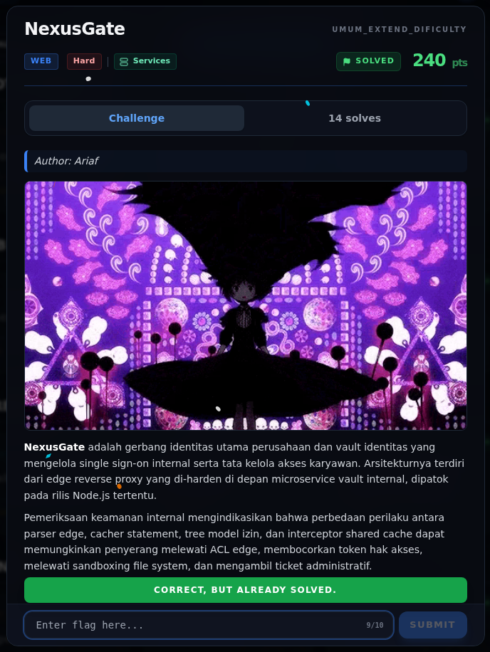

# NexusGate — Flag & Verifikasi

[← Overview](50-nexusgate.md) · [Index](index.md)

> **Langkah 10/12 — Flag.** Flag yang sama dikembalikan POST /flag pada instance live.
>
> **Titik penting:** NFX{n3xu5_g4t3_0v3r_gr4nt_c4ch3_smuggl3_2026}
>
> **Berikutnya:** [Bukti / Evidence](50-nexusgate-11-bukti-evidence.md)

> **Asal flag.** Flag diperoleh dari langkah exploit/solver yang terdokumentasi, lalu disubmit ke platform.  
> **Tingkat bukti metode.** Terdokumentasi. [Buka Evidence](50-nexusgate-11-bukti-evidence.md)

> **Status metode:** **FULL** — metode utama berhasil direproduksi.  
> **Flag:** `NFX{n3xu5_g4t3_0v3r_gr4nt_c4ch3_smuggl3_2026}`
> **Status:** `VERIFIED`

```text
NFX{n3xu5_g4t3_0v3r_gr4nt_c4ch3_smuggl3_2026}
```

Verifikasi:

```bash
cat flags/web/NexusGate.txt
# NFX{n3xu5_g4t3_0v3r_gr4nt_c4ch3_smuggl3_2026}
```

Flag yang sama dikembalikan `POST /flag` pada instance live. Tidak ada submit ke platform.

### Terminal evidence (real)


*Terminal evidence (real).*

> **Bukti:** terminal evidence (real).

## Validasi platform (real)



*Screenshot asli dari platform NFX CTF 2026. Platform menjawab
`CORRECT, BUT ALREADY SOLVED.` untuk flag ini.*
