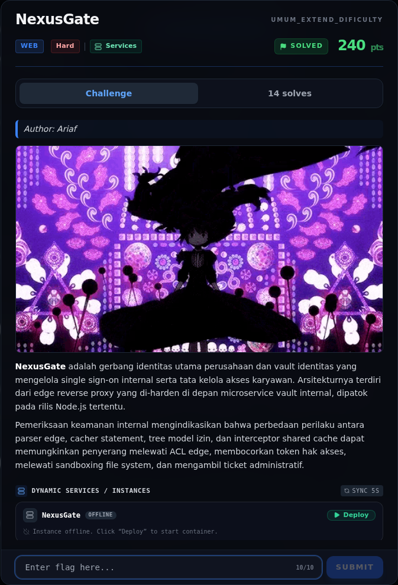

# NexusGate — Referensi

[← Overview](50-nexusgate.md) · [Index](index.md)

> **Langkah 12/12 — Referensi.** Referensi
>
> **Titik penting:** —
>
> **Selesai.** Kembali ke [Overview](50-nexusgate.md).

- Node.js `http` server `req.url`, WHATWG `URL` normalization.
- Node.js Permission Model (`--permission`, `--allow-fs-read`).
- `node:sqlite` (`DatabaseSync`, tagged template store).
- `undici` `interceptors.cache()`.
- OWASP: Path Traversal, Broken Access Control, Cache Poisoning.
- CWE-22, CWE-284, CWE-436 (Interpretation Conflict), CWE-524 (Use of Cache Containing Sensitive Information).

### Evidence langkah ini

*Challenge brief asli di platform NFX CTF 2026.*
