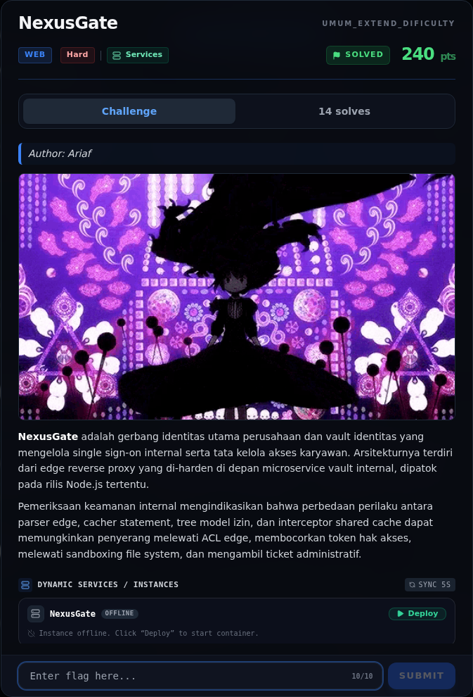
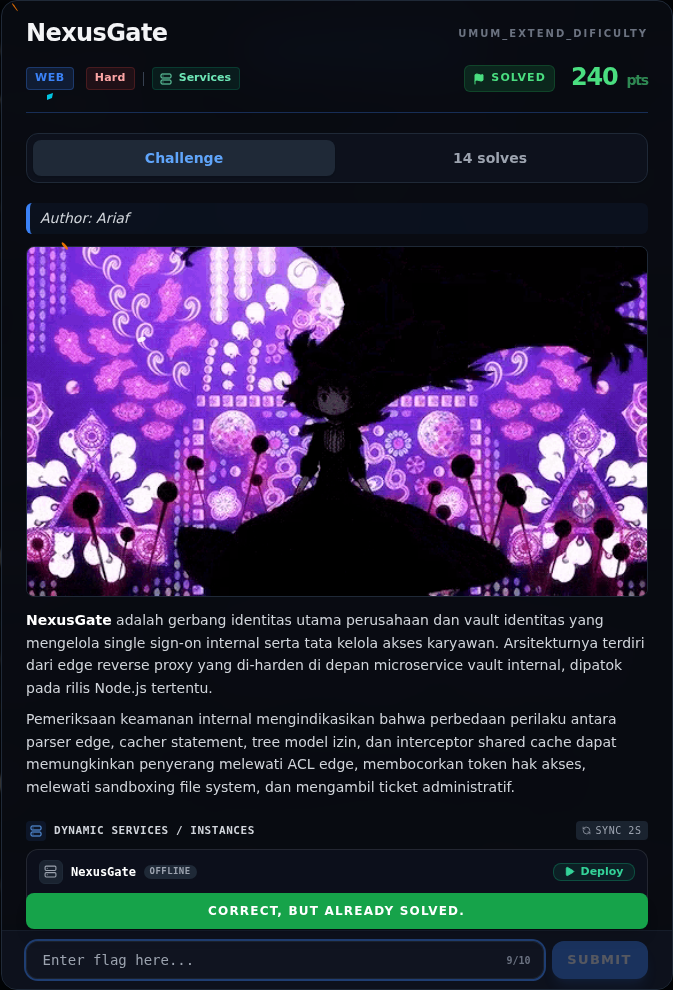

# NexusGate

Track Umum / Extend · WebHard320 poinVERIFIED

| Field | Nilai |
|---|---|
| Event | `umum_Extend` |
| Kategori | `Web` |
| Difficulty | `Hard` |
| Poin | `320` |
| Author | `Ariaf` |
| Solves | `10` |
| Tools | curl, docker |
| Flag | `NFX{n3xu5_g4t3_0v3r_gr4nt_c4ch3_smuggl3_2026}` |
| Status | `VERIFIED` |

[← Kembali ke Index](index.md)

## Challenge Brief (platform)

*Challenge brief asli di platform NFX CTF 2026.*

## TL;DR

- **NexusGate** terdiri dari edge reverse proxy Node.js (`:80`) di depan microservice vault (`127.0.0.1:8080`).
- ACL edge hanya memblokir `req.url.startsWith('/internal/')`. Path `/./internal/...` lolos dari string check, lalu dinormalisasi oleh `new URL()` di backend menjadi `/internal/...` → **ACL bypass**.
- Endpoint `/internal/console/cursor` membuat iterator SQL dari parameter `owner` yang dikendalikan user. `owner=admin` menghasilkan cursor atas vault admin; endpoint GET dengan parameter `journal=<user>` menulis isi row (`secret=PHASE_TOKEN`) ke audit journal penyerang.
- Endpoint `/internal/console/files` membaca file dengan Node `--permission`. Allow-list `bot1.json`, `bot2.json`, `bot3.json` memiliki common prefix `/app/data/bot`; permission tree Node 24.14.0 menganggap node prefix itu readable, sehingga `/app/data/bot` (nonce bot) bisa dibaca.
- Nonce bot adalah `aud` yang dipakai bot admin saat mengambil `/tickets/latest?aud=<nonce>` melalui edge cache (`undici interceptors.cache()`). Cache key tidak memisahkan admin vs anonim, sehingga penyerang mendapatkan HTML admin yang berisi `MASTER_TICKET`.
- `POST /flag` dengan ticket tersebut mengembalikan flag: `NFX{n3xu5_g4t3_0v3r_gr4nt_c4ch3_smuggl3_2026}`.

Pratinjau evidence. Buka halaman <a href="50-nexusgate-11-bukti-evidence.html">Evidence / Bukti</a> untuk semua screenshot dan transkrip.

## Navigasi Halaman

<a class="nx-page-card" href="50-nexusgate-01-deskripsi-challenge.html"><b>Deskripsi challenge</b>Baca bagian ini</a>
<a class="nx-page-card" href="50-nexusgate-02-recon.html"><b>Recon</b>Enumerasi target dan bukti awal</a>
<a class="nx-page-card" href="50-nexusgate-03-acl-bypass-raw-req-url-vs-new-url.html"><b>ACL bypass: raw `req.url` vs `new URL()`</b>Baca bagian ini</a>
<a class="nx-page-card" href="50-nexusgate-04-cursor-over-grant-phase-token.html"><b>Cursor over-grant → PHASE_TOKEN</b>Baca bagian ini</a>
<a class="nx-page-card" href="50-nexusgate-05-file-read-sandbox-node-permission-tree.html"><b>File-read sandbox: Node permission tree</b>Baca bagian ini</a>
<a class="nx-page-card" href="50-nexusgate-06-analisis.html"><b>Analisis</b>Membaca alur dan akar masalah</a>
<a class="nx-page-card" href="50-nexusgate-07-strategi.html"><b>Strategi</b>Baca bagian ini</a>
<a class="nx-page-card" href="50-nexusgate-08-langkah-exploit-live.html"><b>Langkah exploit (live)</b>Baca bagian ini</a>
<a class="nx-page-card" href="50-nexusgate-09-output-asli.html"><b>Output asli</b>Baca bagian ini</a>
<a class="nx-page-card" href="50-nexusgate-10-flag.html"><b>Flag</b>Flag dan verifikasi platform</a>
<a class="nx-page-card" href="50-nexusgate-11-bukti-evidence.html"><b>Bukti / Evidence</b>Screenshot, transkrip, dan artefak</a>
<a class="nx-page-card" href="50-nexusgate-12-referensi.html"><b>Referensi</b>Sumber dan bacaan lanjutan</a>

