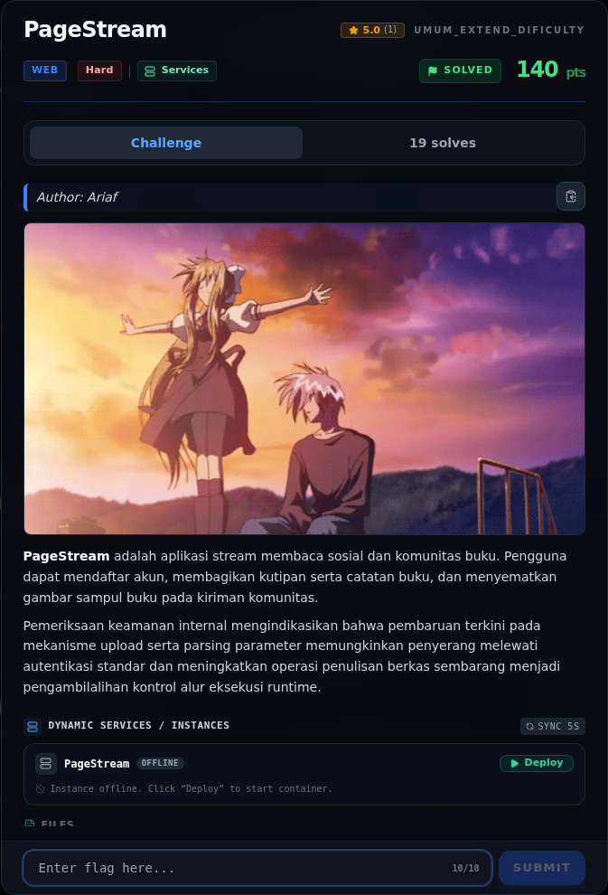

# PageStream — Deskripsi challenge

[← Overview](51-pagestream.md) · [Index](index.md)

> **Langkah 1/11 — Deskripsi challenge.** Deskripsi challenge
>
> **Titik penting:** —
>
> **Berikutnya:** [Recon](51-pagestream-02-recon.md)

## 1.1 Deskripsi challenge

> Author: Ariaf
>
> **PageStream** adalah aplikasi stream membaca sosial dan komunitas buku. Pengguna dapat mendaftar akun, membagikan kutipan serta catatan buku, dan menyematkan gambar sampul buku pada kiriman komunitas.
>
> Pemeriksaan keamanan internal mengindikasikan bahwa pembaruan terkini pada mekanisme upload serta parsing parameter memungkinkan penyerang melewati autentikasi standar dan meningkatkan operasi penulisan berkas sembarang menjadi pengambilalihan kontrol alur eksekusi runtime.

Hint:
- “melewati autentikasi standar” → mass assignment role.
- “operasi penulisan berkas sembarang” → upload filename traversal.
- “pengambilalihan kontrol alur eksekusi runtime” → overwrite EJS view → RCE.

### Evidence langkah ini

*Challenge brief asli di platform NFX CTF 2026.*
