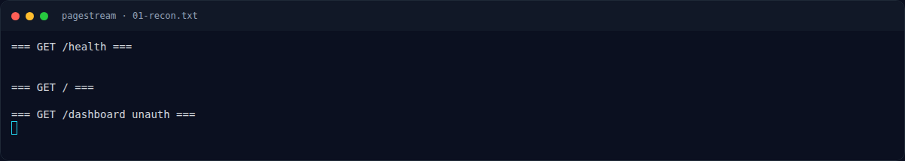

# PageStream — Recon

[← Overview](51-pagestream.md) · [Index](index.md)

## 1.2 File / service yang diberikan

| File/Service | Ukuran/Endpoint | Keterangan |
|---|---|---|
| `web/PageStream/src/app.js` | 54 baris | Express, session, static, route |
| `web/PageStream/src/routes/auth.js` | 121 baris | Login/register/profile/dashboard |
| `web/PageStream/src/routes/posts.js` | 70 baris | Upload multer, `/view` traversal, post |
| `web/PageStream/src/db.js` | 13 baris | MySQL pool |
| `web/PageStream/src/init.sql` | — | Seed user/post; admin role |
| `web/PageStream/src/Dockerfile` | — | Node 25.6.0, compile `/readflag` setuid + `helper.node` |
| `web/PageStream/src/readflag.c` | — | Setuid root, cek token `/etc/pagestream.key`, baca `/root/flag.txt` |
| `web/PageStream/src/helper.c` | — | `pagestream_native_sync(cmd)` → `system(cmd)` |
| `web/PageStream/src/supervisord.conf` | — | `user=root`, `command=node app.js` |
| `web/PageStream/docker-compose.yml` | port `8003:80` | Web + MySQL 8.0 |
| Instance live | `http://s1.nfx.my.id:43659` | Di-launch dengan `nxapi.py nx-up` |

Hash source:

```bash
sha256sum web/PageStream/src/routes/auth.js web/PageStream/src/routes/posts.js
```

```text
f954e3af50c09b6e94940e034ebf9042a6bce1b3e6a79bb5ce78e7bcf00b4eba  web/PageStream/src/routes/auth.js
2d7629573ea0d5a2b30d7ce1f937a71ae9a7096523c1bcca8e2453e9a0e03ed4  web/PageStream/src/routes/posts.js
```

## 1.3 Environment

- Node 25.6.0 di container; MySQL 8.0.
- Docker tidak tersedia di workspace; validasi pada instance live.
- Instance butuh ±25 detik untuk MySQL siap; `/health` mengembalikan `OK`.

```bash
curl -sS -i http://s1.nfx.my.id:43659/health
# HTTP/1.1 200 OK
# OK
```

## 1.4 Triage awal

```bash
curl -sS -i http://s1.nfx.my.id:43659/
curl -sS -i http://s1.nfx.my.id:43659/dashboard
```

- `/` → landing PageStream.
- `/dashboard` tanpa session → `302 /login`.
- Tidak ada registrasi tertutup; `POST /register` membuat user role `user`.

### Evidence langkah ini



*Terminal evidence — `01-recon.txt` (arsip transkrip sesi solve).*


*Terminal evidence — `source-notes.txt` (arsip transkrip sesi solve).*

**Berkas mentah langkah ini:**

- [`01-recon.txt`](assets/pagestream/01-recon.txt)
- [`source-notes.txt`](assets/pagestream/source-notes.txt)
