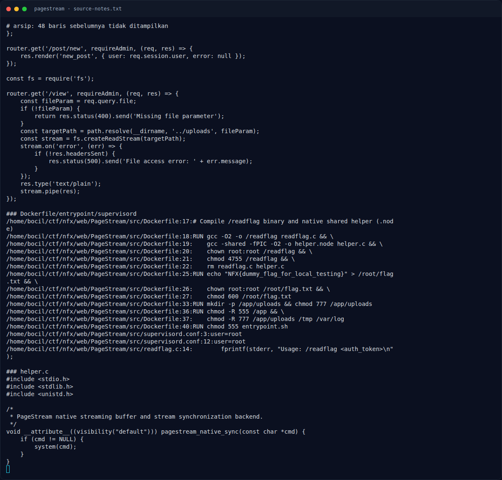

# PageStream — Mass assignment role

[← Overview](51-pagestream.md) · [Index](index.md)

> **Langkah 3/11 — Mass assignment role.** Setelah role=admin, semua route requireAdmin (/post/new, /view) dapat diakses.
>
> **Titik penting:** Setelah role=admin, semua route requireAdmin (/post/new, /view) dapat diakses.
>
> **Berikutnya:** [Path traversal di `/view`](51-pagestream-04-path-traversal-di-view.md)

## 2.1 Mass assignment role

`routes/auth.js`:

```js
const handleProfileUpdate = (req, res) => {
    if (!req.session.user) {
        return res.status(401).json({ error: 'Unauthorized' });
    }

    req.session.user = Object.assign({}, req.session.user, req.body);
    req.session.save(() => {
        if (req.headers['content-type'] && req.headers['content-type'].includes('application/json')) {
            return res.json({ ok: true, user: req.session.user });
        }
        res.render('settings', { user: req.session.user, success: 'Profile settings updated successfully.' });
    });
};

router.post('/profile', handleProfileUpdate);
router.post('/settings', handleProfileUpdate);
```

- `req.body` dari `express.urlencoded({ extended: true })` dan `express.json()`.
- Tidak ada allowlist field (`avatar`, `bio` saja yang seharusnya).
- Payload `role=admin` menimpa `req.session.user.role`.
- Session disimpan di MemoryStore; `req.session.save()` menulis perubahan.

`requireAdmin`:

```js
const requireAdmin = (req, res, next) => {
    if (!req.session.user) {
        return res.redirect('/login');
    }
    const role = req.session.user.role;
    if (role !== 'admin' && role !== 'verified') {
        return res.status(403).send('Forbidden: Account Email Verification required. ...');
    }
    next();
};
```

Setelah `role=admin`, semua route `requireAdmin` (`/post/new`, `/view`) dapat diakses.

### Evidence langkah ini



*Terminal evidence — `source-notes.txt` (arsip transkrip sesi solve).*

**Berkas mentah langkah ini:**

- [`source-notes.txt`](assets/pagestream/source-notes.txt)
