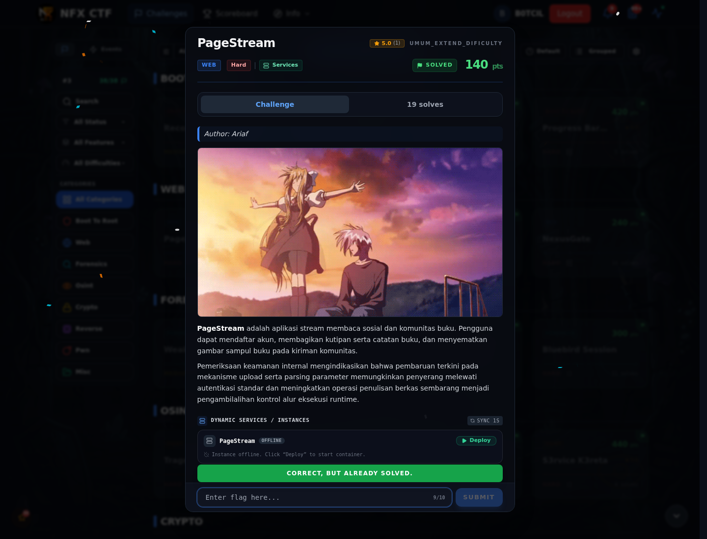

# PageStream — Flag & Verifikasi

[← Overview](51-pagestream.md) · [Index](index.md)

> **Flag:** `NFX{f3w_n_d4y_ch41ns_f0r_w3b_pwn_1s_n0t_th4t_h4rd_7734a1}`
> **Status:** `VERIFIED`

```text
NFX{f3w_n_d4y_ch41ns_f0r_w3b_pwn_1s_n0t_th4t_h4rd_7734a1}
```

Verifikasi:

```bash
cat flags/web/PageStream.txt
# NFX{f3w_n_d4y_ch41ns_f0r_w3b_pwn_1s_n0t_th4t_h4rd_7734a1}
```

Flag yang sama diperoleh dari `/view` dan dari `/readflag` setelah RCE. Tidak ada submit ke platform.

### Bukti submit di platform



*Submit flag di platform: `CORRECT, BUT ALREADY SOLVED.`*

> **Verifikasi platform:** flag sudah diterima. Recheck 2026-11-09 mengembalikan `Correct, but already solved.`
