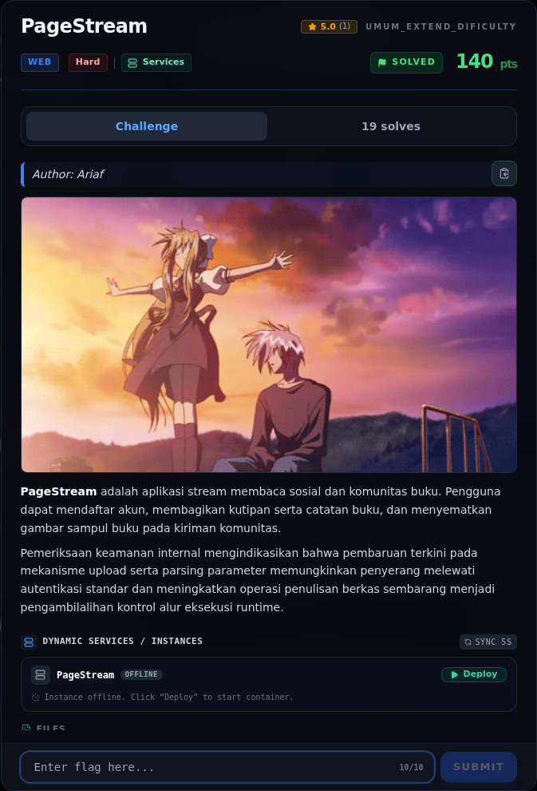
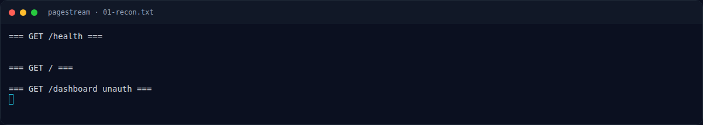
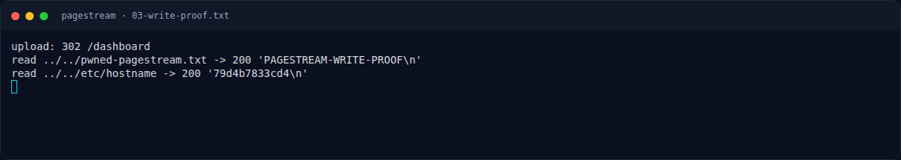
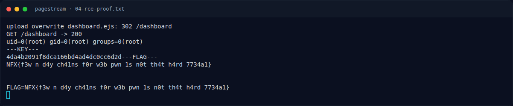

# PageStream — Evidence / Bukti

7 screenshot6 transkrip / script

[← Overview](51-pagestream.md) · [Index](index.md)

> **Langkah 10/11 — Bukti / Evidence.** Bukti / Evidence
>
> **Titik penting:** arsip screenshot dan transkrip
>
> **Berikutnya:** [Referensi](51-pagestream-11-referensi.md)

## Arsip Evidence

> Semua file berasal dari `assets/pagestream/`. Screenshot platform dan terminal adalah bukti asli dari sesi solve; transkrip mentah tetap ditautkan di bagian bawah.

### Platform

<figure><figcaption>00-challenge-platform.png</figcaption></figure>

*Challenge brief asli di platform NFX CTF 2026.*

<figure><figcaption>Terminal evidence (real)</figcaption></figure>

*Terminal evidence (real).*

### Terminal (arsip sesi)

<figure><figcaption>term-01-recon.png</figcaption></figure>

*Terminal evidence — `01-recon.txt` (arsip transkrip sesi solve).*

<figure><figcaption>term-02-exploit-run.png</figcaption></figure>

*Terminal evidence — `02-exploit-run.txt` (arsip transkrip sesi solve).*

<figure><figcaption>term-03-write-proof.png</figcaption></figure>

*Terminal evidence — `03-write-proof.txt` (arsip transkrip sesi solve).*

<figure><figcaption>term-04-rce-proof.png</figcaption></figure>

*Terminal evidence — `04-rce-proof.txt` (arsip transkrip sesi solve).*

<figure><figcaption>term-source-notes.png</figcaption></figure>

*Terminal evidence — `source-notes.txt` (arsip transkrip sesi solve).*

### Transkrip mentah & script

- [`01-recon.txt`](assets/pagestream/01-recon.txt)
- [`02-exploit-run.txt`](assets/pagestream/02-exploit-run.txt)
- [`03-write-proof.txt`](assets/pagestream/03-write-proof.txt)
- [`04-rce-proof.txt`](assets/pagestream/04-rce-proof.txt)
- [`exploit_pagestream.py`](assets/pagestream/exploit_pagestream.py)
- [`source-notes.txt`](assets/pagestream/source-notes.txt)

## Tabel Evidence

| Bukti | File | Keterangan |
|---|---|---|
| Recon | `assets/pagestream/01-recon.txt` | `/health`, `/`, `/dashboard` |
| Transcript exploit | `assets/pagestream/02-exploit-run.txt` | Mass assignment, LFI, flag |
| Arbitrary write | `assets/pagestream/03-write-proof.txt` | Upload traversal + readback |
| RCE | `assets/pagestream/04-rce-proof.txt` | `uid=0`, `/readflag`, flag |
| Source snippet | `assets/pagestream/source-notes.txt` | Auth, posts, Dockerfile, helper |
| Exploit | `assets/pagestream/exploit_pagestream.py` | Script lengkap |
| Hash source | lihat §1.2 | SHA-256 `auth.js`, `posts.js` |