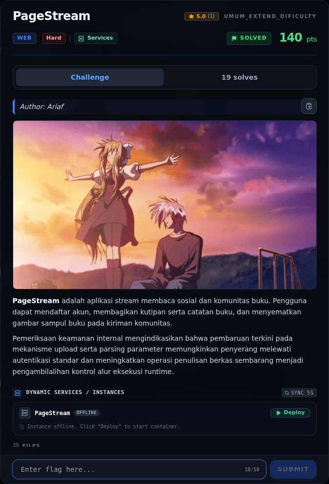

# PageStream — Referensi

[← Overview](51-pagestream.md) · [Index](index.md)

> **Langkah 11/11 — Referensi.** Referensi
>
> **Titik penting:** —
>
> **Selesai.** Kembali ke [Overview](51-pagestream.md).

- Express `express.urlencoded({ extended: true })`, `express.json()`.
- Multer `diskStorage`, `preservePath`, `originalname`.
- EJS template execution / Express view cache.
- OWASP: Mass Assignment, Path Traversal, Unrestricted File Upload.
- CWE-915 (Mass Assignment), CWE-22 (Path Traversal), CWE-434 (Unrestricted Upload), CWE-250 (Execution with Unnecessary Privileges).

### Evidence langkah ini

*Challenge brief asli di platform NFX CTF 2026.*
