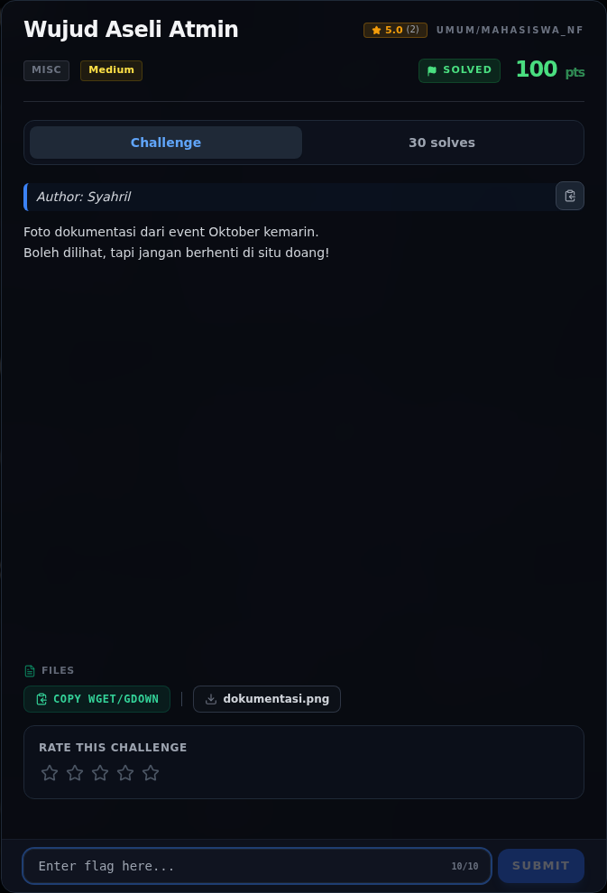
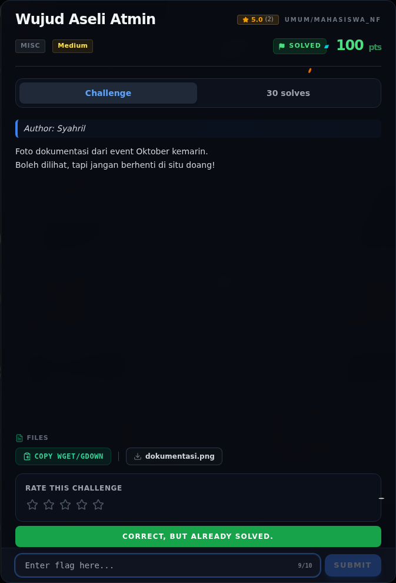

# Wujud Aseli Atmin — Cerita Singkat

[← Overview](52-wujud-aseli-atmin.md) · [Index](index.md)

Jadi ceritanya gini. Kita dikasih satu foto dokumentasi event **National
Cybersecurity Connect 2026**. Sekilas biasa aja — foto orang-orang, banner,
selesai. Tapi deskripsinya bilang “jangan berhenti di situ doang”, jadi kita
cek lebih dalam.

Pertama, foto ini dibuka pakai `exiftool`. Eh, muncul warning: ada **data
tambahan setelah akhir file PNG** (trailer). Dari situ kita curiga. Ternyata
trailer-nya adalah **ZIP** berisi dua file: `catatan.txt` yang isinya cuma
godaan (“Tidak ada apa-apa di sini”), dan `scan_07.dat`.

Nah, `scan_07.dat` ini jahil. Dia sebenarnya **PNG 400×300**, tapi 8 byte
pertama (signature PNG) sengaja dinolkan. Begitu signature-nya kita balikin,
file-nya langsung bisa dibuka. Dari situ kita pakai `zsteg`, dan ketemu
base64 di **LSB kanal merah**. Decode base64-nya, keluar deh flag-nya.

Alur besarnya:

1. Lihat foto → cek metadata.
2. Ketemu trailer ZIP di belakang `IEND`.
3. Ekstrak ZIP → dapat `scan_07.dat`.
4. Perbaiki signature PNG yang dihapus.
5. Ambil LSB kanal R → base64 → decode.
6. Flag: `NFX{NFCC_Goes_to_NCSC_2026}`.
7. Submit → **`Correct! +460 points.`**

### Evidence langkah ini

*Challenge brief asli di platform NFX CTF 2026.*

*Submit flag di platform: `CORRECT, BUT ALREADY SOLVED.`*
