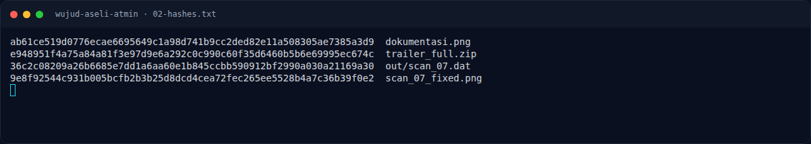
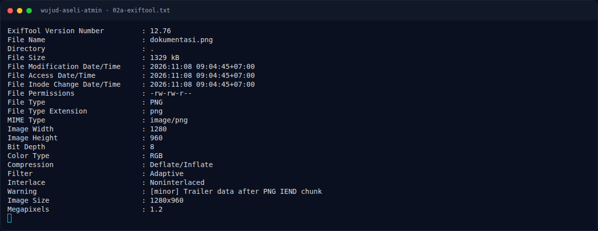
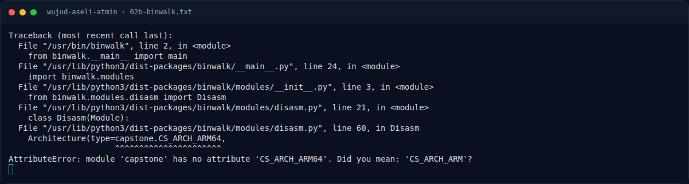

# Wujud Aseli Atmin — Analisis

[← Overview](52-wujud-aseli-atmin.md) · [Index](index.md)

### 2.1 Ekstrak trailer ZIP

Cari `IEND` lalu `PK\x03\x04` pertama setelahnya:

```python
d = open('dokumentasi.png','rb').read()
ie = d.find(b'IEND')
start = d.find(b'PK\x03\x04', ie)
open('trailer_full.zip','wb').write(d[start:])
```

Hasil: ZIP 4.100 byte, berisi:

```text
catatan.txt    43 byte
scan_07.dat  4.753 byte
```

`catatan.txt`:

```text
Arsip internal. Tidak ada apa-apa di sini.
```

Jelas decoy; target sebenarnya `scan_07.dat`.

### 2.2 `scan_07.dat` adalah PNG yang signature-nya dihapus

```bash
file scan_07.dat
xxd scan_07.dat | head
```

Output:

```text
scan_07.dat: data
00000000: 0000 0000 0000 0000 0000 000d 4948 4452  ............IHDR
00000010: 0000 0190 0000 012c 0802 0000 0062 d572  .......,.....b.r
```

Delapan byte pertama seharusnya signature PNG:

```text
89 50 4E 47 0D 0A 1A 0A
```

Namun semuanya nol. Perbaiki:

```python
d = bytearray(open('scan_07.dat','rb').read())
d[:8] = bytes.fromhex('89504e470d0a1a0a')
open('scan_07_fixed.png','wb').write(d)
```

Hasil:

```text
scan_07_fixed.png: PNG image data, 400 x 300, 8-bit/color RGB
```

### 2.3 LSB extraction

```bash
zsteg -a scan_07_fixed.png
```

Temuan penting:

```text
b1,r,lsb,xy         .. text: "TkZYe05GQ0NfR29lc190b19OQ1NDXzIwMjZ9"
```

Base64 itu decode menjadi:

```text
NFX{NFCC_Goes_to_NCSC_2026}
```

### 2.4 Kenapa `dokumentasi.png` sendiri tidak menunjukkan flag?

- Foto utama hanya menjadi “pembungkus” agar terlihat seperti dokumentasi
  event.
- Flag tidak ada di metadata, tidak di trailer utama, dan tidak di teks
  `catatan.txt`.
- Rantainya: **trailer ZIP → PNG rusak → perbaiki signature → LSB kanal R →
  base64 → flag**.

### Evidence langkah ini



*Terminal evidence — `02-hashes.txt` (arsip transkrip sesi solve).*



*Terminal evidence — `02a-exiftool.txt` (arsip transkrip sesi solve).*



*Terminal evidence — `02b-binwalk.txt` (arsip transkrip sesi solve).*
