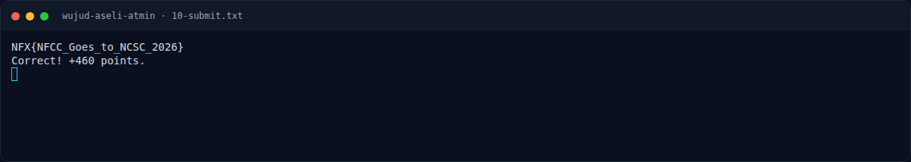
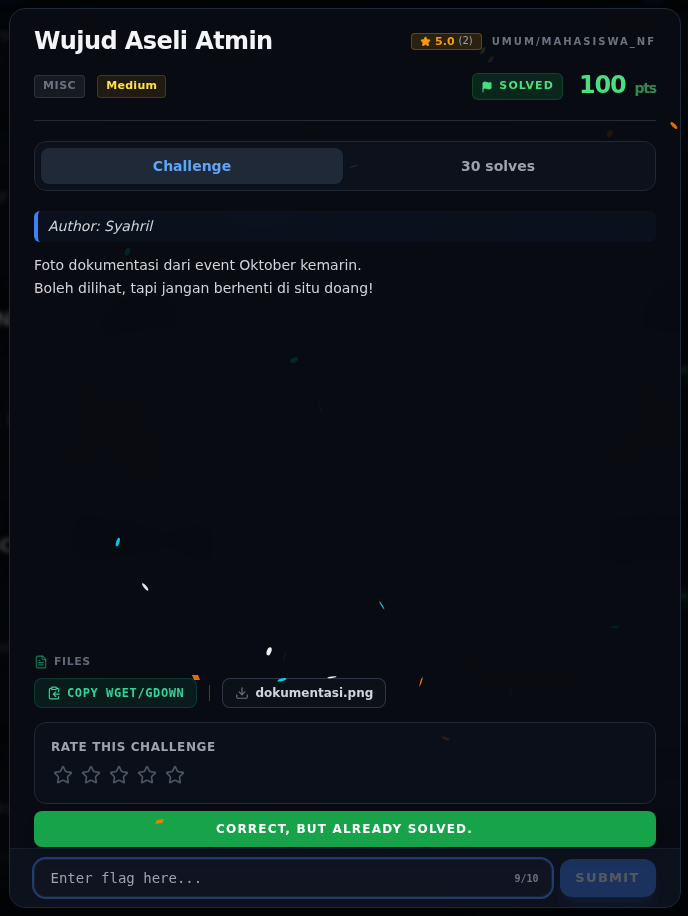

# Wujud Aseli Atmin — Flag & Verifikasi

[← Overview](52-wujud-aseli-atmin.md) · [Index](index.md)

> **Langkah 4/6 — Flag.** Verifikasi platform:
>
> **Titik penting:** NFX{NFCC_Goes_to_NCSC_2026}
>
> **Berikutnya:** [Bukti / Evidence](52-wujud-aseli-atmin-05-bukti-evidence.md)

> **Asal flag.** Flag diperoleh dari langkah exploit/solver yang terdokumentasi, lalu disubmit ke platform.  
> **Tingkat bukti metode.** Terdokumentasi. [Buka Evidence](52-wujud-aseli-atmin-05-bukti-evidence.md)

> **Status metode:** **FULL** — metode utama berhasil direproduksi.  
> **Flag:** `NFX{NFCC_Goes_to_NCSC_2026}`
> **Status:** `VERIFIED`

```text
NFX{NFCC_Goes_to_NCSC_2026}
```

Verifikasi platform:

```text
HTTP 200
{"success": true, "message": "Correct! +460 points."}
```

### Terminal evidence (real)



*Terminal evidence (real).*

> **Bukti:** terminal evidence (real).

## Validasi platform (real)



*Screenshot asli dari platform NFX CTF 2026. Platform menjawab
`CORRECT, BUT ALREADY SOLVED.` untuk flag ini.*
